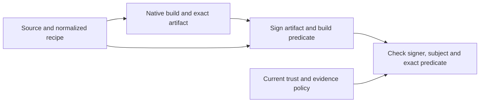

# RT-16 — Reproducible artifacts and exact signed build predicates

- **Date** — 2026-11-25
- **Tracking** — [PLAN §7.4](../../../PLAN.md#74-security-trust-and-reproducibility) · [#335](https://github.com/aivibeflow/LLMLang/issues/335)
- **Status** — Reproduced native build and signing comparison

## Question and method

What can a reproducible artifact and a valid signature establish about the selected build? The fixture compiles a small ELF library with three observations, including an expanded filename, compile timestamp and integer output. Two same-recipe builds use distinct physical checkout paths. The recorded recipe binds source bytes, toolchain fingerprints, flags, locale, path policy and `SOURCE_DATE_EPOCH`. The normalized profile maps the input path to a declared virtual root. [RT-16 threat model](RT-16-THREAT-MODEL-01.md) · [Cache result evidence and trust](../../toolchain-and-collaboration/RT-11/RESEARCH-SCENARIO-93-CACHE-SOUNDNESS-RESULT-ENVELOPES-AND-TRUST.md)

The runner signs compact JSON claims with OpenSSL Ed25519 keys created in its temporary workspace. The first policy verifies a currently trusted signer and the artifact digest. The exact policy also compares the source, recipe and evidence policy. The harness creates both signing identities and the outsider. It supplies test evidence for claim verification without relying on external identities.



## Results

Eight native builds separate recipe agreement from artifact equality. The two normalized checkout paths produce identical artifact bytes and the same observed virtual filename and timestamp. Without mapping, two checkout paths produce distinct output artifacts and filename observations. Changing the epoch changes the embedded timestamp and artifact. Changing the return value changes the native result. A comment edit and an unused compiler flag each preserve the artifact while changing the declared exact recipe.

| Signed claim | Trusted signer and artifact subject | Exact build predicate |
|---|---|---|
| Reference build | Accepted | Accepted |
| Independent checkout with the same recipe | Accepted | Accepted |
| Same artifact from different source bytes | Accepted | Refused |
| Same artifact under different flags | Accepted | Refused |
| Wrong evidence policy | Accepted | Refused |
| Subject alone | Accepted | Refused |
| Different artifact, untrusted signer, incorrect signing key or modified signed predicate | Refused | Refused |

The subject-only policy accepts six of ten controls. The exact policy accepts the two statements for the matching build request. Byte identity can support artifact reuse while source and recipe provenance still need their own scoped claim. [Evidence ledger](BUILD-ATTESTATION-01/evidence.json)

## Limits

The recipe names the inputs varied in this experiment. A general reproducible build claim also needs the complete transitive source, compiler, assembler, linker, library and environment closure. Trust in the described build remains conditional on authentic and appropriately scoped producers. The fixture leaves production keys, transparency records, revocation, environmental isolation and authorization for compatible recipe changes open.

## Reproduction

Run from the repository root with CPython 3.12.14, GCC 14.2.0 (Debian 14.2.0-19), GNU binutils 2.44 and OpenSSL 3.5.7 on Linux x86-64. Signing keys and physical checkout paths vary during replay. The deterministic receipt records the verified decisions and stable artifact hashes, along with the observed equality or difference of the path-sensitive builds. [Probe](BUILD-ATTESTATION-01/probe.c) · [Runner](BUILD-ATTESTATION-01/run.py)

```sh
set -eu
dir=research/security/RT-16/BUILD-ATTESTATION-01
observed=$(mktemp)
trap 'rm -f "$observed"' EXIT
python3 -B "$dir/run.py" --cc gcc --openssl openssl > "$observed"
cmp "$dir/evidence.json" "$observed"
```
