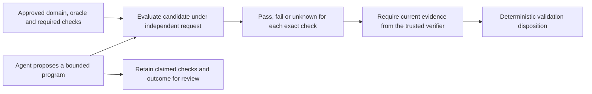

# RT-16 Deterministic validation of agent proposals

**Issue** [#335](https://github.com/aivibeflow/LLMLang/issues/335)

A model can propose a program and describe its expected validation. The Toolchain acceptance gate needs evidence from a preapproved check of the actual program. This experiment combines an independent finite verifier with the existing RT-16 required-evidence gate. It asks whether model claims, incomplete execution or an otherwise valid receipt from a narrower scope can affect the gate. [RT-16 authorization model](RT-16-THREAT-MODEL-01.md)

## Candidate validation boundary

The trusted request specifies a candidate, the domain of all 256 byte inputs, the check inventory and a local verifier revision. The required checks compare the result of byte increment modulo 256 and the ordered trace consisting of the input followed by its result. The proposal's text fields may claim pass or failure and propose a different scope. Those fields are kept in the replay record. The verifier takes its instructions from the independent request.

The verifier evaluates only its bounded program model and records a failed check when a counterexample exists, an unknown check when the execution limit is reached without full coverage, and a passed check when every input satisfies the obligation. It constructs the existing evidence context from the candidate digest, verifier revision, target and digest of the required checks and domain. The local gate separately checks that every required record comes from the trusted verifier, is current and passed. This study assumes trusted local evidence delivery. A digest by itself cannot authenticate who supplied a record.



A claim may provide a useful test suggestion. This fixture exercises what happens after the scope has been selected independently. A suggestion cannot remove a required check or lower the executable coverage needed for a pass.

## Controls and results

The runner checks three candidates at two execution limits and replays contrary model claims for each. The [ledger](INDEPENDENT-VALIDATION-01/evidence.json) records the exact inputs, observed result and trace pairs, evidence digests and five receipt-admission controls.

| Candidate and authorized execution | Arithmetic | Ordered trace | Gate |
| --- | --- | --- | --- |
| Correct wrapping increment, all 256 inputs | Pass | Pass | Admits |
| Correct increment, first 255 inputs | Unknown | Unknown | Refuses |
| Saturating increment, all 256 inputs | Fail at 255 | Fail at 255 | Refuses |
| Saturating increment, first 255 inputs | Unknown | Unknown | Refuses |
| Correct arithmetic with reversed trace, all 256 inputs | Pass | Fails on all 256 inputs | Refuses |
| Reversed trace, first 255 inputs | Unknown | Fails on all 255 inputs | Refuses |

The two opposite claims for each candidate and execution limit produce identical verifier receipts and decisions. A genuinely passing saturating-program receipt for the narrower domain 0–254 is refused when presented for 0–255. The model-originated verifier record, missing check, duplicate check and changed candidate are also refused. All 24 original policy tests pass separately. The table is a categorical summary of finite observations and contains no timing claims.

A status-only verifier or a gate relying on reported coverage could accept the saturating implementation without observing its final input. A value-only check would accept the reversed trace. The experiment demonstrates the benefit of exact verifier-owned obligations and typed outcomes for one closed program model. Production still needs independently authorized obligations, authenticated delivery, source-to-model correspondence, isolated execution and audit handling. This validation disposition does not authorize accepting, committing or publishing a change. Those actions are separate RT-16 policy decisions.

## Reproduction

Use CPython 3.12.14 from repository root. The runner verifies the existing policy file against `755977e024086acacedae74f4b48635251f031c0`. Runs with hash seeds 1 and 2 gave byte-identical ledgers. Relative links and Mermaid source structure were checked. GitHub visual rendering was not manually verified.

```sh
study=research/security/RT-16/INDEPENDENT-VALIDATION-01
PYTHONHASHSEED=1 python -B "$study/run.py" >/tmp/llmlang-independent-validation.json
cmp "$study/evidence.json" /tmp/llmlang-independent-validation.json
python -B -m unittest discover -s research/security/PROTOTYPES/RT-16-AUTHORIZATION-01 -p 'test_*.py' -q
```
