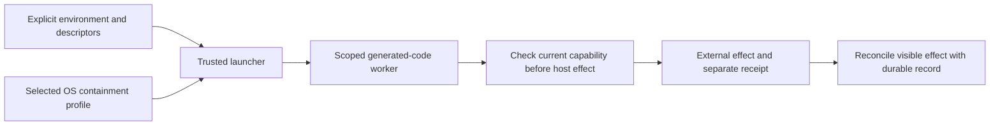

# RT-16 worker isolation, secrets and mediated host effects

Build inputs, inherited resources, host permissions and external completion records need independent checks. Two native studies support a candidate boundary for isolated workers and generated code.

## Candidate boundaries

| Boundary | Checked contract |
| --- | --- |
| Worker launch | Construct a minimum environment and explicit descriptor list. Evaluate them before generated code starts. |
| Path and syscall access | Enforce the selected OS profile before executing generated instructions. Existing descriptors and environment retain their own admission rules. |
| Secret handling | Exclude credentials from ambient worker state and receipts. Transfer only explicitly approved inputs and emit only permitted observation metadata. |
| Host capability effect | Bind the worker request to its exact active grant and ancestry. Enforce freshness at the effective boundary using an appropriate serialization rule where required. |
| External completion | Validate the actual effect separately from database completion. If recovery sees an effect without a receipt, preserve that unresolved state until independently reconciled. |



## Reconciled observations

The checker pins and reads both original ledgers. In 48 launches with 336 checked fields, the minimal launch retains declared public inputs. The measured seccomp setup refuses new file opens. A separately passed synthetic field or descriptor remains visible to the child, so the file-open policy cannot replace environment and descriptor selection. The evidence contains presence observations only. [Worker isolation study](RT-16-WORKER-ISOLATION-2026-11-25.md)

The 45 effect schedules show four stale effects under a cached grant and three after a fresh check without serialization. The scoped cooperative locking profiles leave two and one stale effects respectively. The database writer gate shows zero stale effects and postpones one unrelated authority change. Process termination between effect and receipt produces a visible file without a receipt under all five tested policies. [Mediated external effect and revocation](../../language-design/RT-04/RT-04-EXTERNAL-EFFECT-REVOCATION-2026-11-25.md)

The tested scope is local Linux worker launches and a cooperating local effect service. Trusted launcher integration, network and resource policy, production log transport, remote workers, and crash recovery of external effects remain open. The fixtures use synthetic input values and produce no evidence about real credentials or arbitrary generated programs.

## Reproduce

Use CPython 3.12.14. Hash seeds 37 and 71 produce evidence SHA-256 `8f0dd3576d158d0aa09b9369187864ba92252567ea71a0d99614c189dff258d0`. Each original study provides its separate replay commands. [Evidence reconciliation](ISOLATION-BOUNDARY-01/evidence.json)

```sh
LC_ALL=C PYTHONHASHSEED=37 PYTHONDONTWRITEBYTECODE=1 \
  python research/security/RT-16/ISOLATION-BOUNDARY-01/check.py > /tmp/rt16-isolation-boundary.json
```
