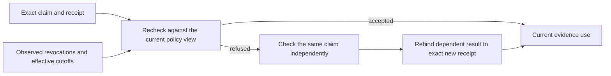

# RT-16 — Revocation views and exact proof-evidence recovery

- **Date** — 2026-11-25
- **Tracking** — [PLAN §7.4](../../../PLAN.md#74-security-trust-and-reproducibility) · [#335](https://github.com/aivibeflow/LLMLang/issues/335)
- **Status** — Checked Lean model and finite recovery comparison

## Question and contract

How should a consumer handle previously checked evidence after learning that a signer, checker build or implementation was compromised? Each revocation names the affected identity and two times. The observation time says when the policy journal records it. The effective cutoff says which issuance times it invalidates. A prospective event has equal observation and cutoff times. A retrospective event can invalidate earlier receipts as soon as it is recorded. The receipt also names the exact checked program and its evidence identity. [RT-16 threat model](RT-16-THREAT-MODEL-01.md) · [Signed build predicates](RT-16-BUILD-ATTESTATION-2026-11-25.md)

The issuance-only policy reuses the verdict made when the receipt arrived. The current-use policy requires an authoritative current view and checks every applicable revocation. Historical replay can still reconstruct what an earlier view knew. The bounded recovery rule accepts new checked evidence only under the current policy and requires each dependent result to name the new receipt explicitly.



## Results

Lean checks that an applicable recorded event remains applicable in later views, an unseen event leaves that historical view unchanged, and receipts before the cutoff are unaffected by that event. It also checks that a distinct replacement receipt cannot satisfy an old exact dependency. The machine receipt preserves Lean's axiom report.

| Policy scenario | Cases | Current acceptances | Incorrect cached acceptances |
|---|---:|---:|---:|
| No revocation | 540 | 216 | 0 |
| Prospective signer revocation | 540 | 198 | 0 |
| Retroactive checker-build revocation | 540 | 153 | 36 |
| Implementation revocation covering prior issuance | 540 | 117 | 72 |

The current gate matches the separate oracle in all 2,160 cases. A receipt issued before discovery remains visible in its historical view and is refused for current use after the retroactive checker event. Signing again with a different key while reusing the affected checker build also fails. An independent check of the same program supplies an eligible receipt. The old dependent record remains ineligible with that replacement until it is rebound. A new independent checker still cannot authorize a receipt that relies on the revoked implementation in the separate implementation case. [Evidence ledger](PROOF-REVOCATION-01/evidence.json)

## Limits

The model takes the authenticated receipt fields, latest view and revocation journal as inputs. Production use needs an authority for event ingestion and view freshness, trusted issuance times, a policy for disputed compromise intervals, complete dependency discovery and a revalidation protocol for published results. A rebuilt implementation also needs its own exact implementation binding before invocation. The proof results apply to the modeled single dependency and event semantics.

## Reproduction

Run from the repository root with Lean 4.36.0 and CPython 3.12.14. The runner checks the Lean statements and replays the cases. [Lean file](PROOF-REVOCATION-01/Revocation.lean) · [Runner](PROOF-REVOCATION-01/run.py)

```sh
set -eu
dir=research/security/RT-16/PROOF-REVOCATION-01
observed=$(mktemp)
trap 'rm -f "$observed"' EXIT
python3 -B "$dir/run.py" --lean lean > "$observed"
cmp "$dir/evidence.json" "$observed"
```
