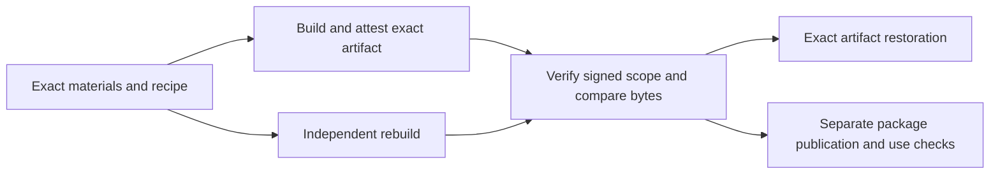

# RT-16 signed provenance, reproducible builds and artifact reuse

Reproducibility demonstrates byte agreement for a defined build closure. A signed attestation identifies who made a scoped statement about that closure. Package delivery, cache restoration and runtime behavior have separate checked subjects.

## Candidate records and gates

| Step | Exact subject and check |
| --- | --- |
| Build request | Source and transitive materials, toolchain, target, command and environment, path normalization and epoch policy |
| Builder attestation | Builder role, artifact digest and exact recipe under the accepted evidence policy |
| Independent rebuild | Repeat a matching closure independently and compare the resulting bytes. Record omissions and shared environment assumptions. |
| Cache restoration | Require a complete current candidate view, authorized attestations, exact fetched bytes and the applicable rebuild or verification receipt. Preserve conflicts when alternatives are unavailable. |
| Package delivery | Bind publisher and policy to the exact logical package and archive representation. Evaluate the separate declared-use record at its declared scope. |



## Reconciled observations

The evidence checker pins three archived ledgers by SHA-256 and reads the original observations.

| Study | Verified outcome |
| --- | --- |
| Eight native build profiles and ten signed controls | Two path-normalized checkouts reproduce both bytes and recipe. Comments and an unused flag preserve bytes while changing the signed recipe. Subject-only signature admission accepts six claims. Exact signed recipe admission accepts two. |
| Independent restoration | Three clean builds reproduce exact bytes. Eighteen controls include an exact hit after current revocation narrows the authorized view, a conflict even with an absent alternative payload, and refusal when signed results disagree with an independent rebuild. All 120 tested orderings preserve the conflict. |
| Signed publication and declared use | Repacking preserves the logical package root and applicable declared-use record. The old archive-bound statement fails while a fresh exact publication statement passes. |

[Native signed build evidence](RT-16-BUILD-ATTESTATION-2026-11-25.md) · [Signed cache restoration](../../toolchain-and-collaboration/RT-11/RT-11-SIGNED-REBUILD-ADMISSION-2026-11-25.md) · [Package publication and declared use](../../packages-and-ecosystem/RT-12/RT-12-DECLARED-PACKAGE-RIGHTS-2026-11-25.md)

The studies cover deliberately bounded source and tool closures on one pinned host per fixture. They leave general material discovery, cross-machine reproducibility, execution effect equivalence, authenticated authority enrollment and production signing policy open.

## Reproduce

Use CPython 3.12.14. Hash seeds 37 and 71 produce the same evidence SHA-256 `35906f4e6eb73efbe2013f1c0c60b668d8fcdfe3e33183b745fe36a0709a8164`. Each source study provides its own original replay. [Reconciliation ledger](PROVENANCE-BOUNDARY-01/evidence.json)

```sh
LC_ALL=C PYTHONHASHSEED=37 PYTHONDONTWRITEBYTECODE=1 \
  python research/security/RT-16/PROVENANCE-BOUNDARY-01/check.py > /tmp/rt16-provenance.json
```
