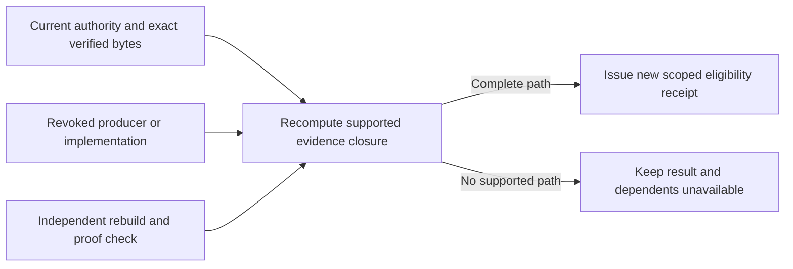

# RT-16 defensive artifact restoration and revocation recovery

A cache hit requires verified bytes and an applicable evidence chain under current authority. The bounded recovery model lets a result become unavailable when a compiler, checker or implementation is removed from its authority view. An independently rebuilt implementation and an independently checked proof can restore eligibility through a new bound receipt.

## Candidate gate

| Step | Checked decision |
| --- | --- |
| Admit cache subject | Verify actual payload bytes and exact action and context. Hold unresolved conflicting authorized claims separately from availability. |
| Apply current revocation | Retain old records for audit and remove their authority from current admission. |
| Derive recovery closure | Recompute which results and dependents have complete unrevoked support paths. A path needs both applicable output and proof evidence. |
| Restore eligibility | Require verified bytes and a complete independent build and proof path under the new generation. Rebind the result and its dependents to the recovered scope. |
| Refuse unsupported cycles | An evidence cycle with no authorized starting fact cannot justify itself in the bounded model. |



## Checked observations

The fixture has two compiler/checker paths, two independently addressed implementations, one result and one dependent. It crosses up to two revoked authorities or implementations, presence of an independent rebuild and recheck, and availability of verified bytes. A direct path oracle agrees in all 704 cases. Sixty-nine are eligible and 635 remain unavailable.

Removing the original compiler or implementation disables the original support path. Rebuilding alone does not restore the consumer whose proof is now stale. An independent proof check and exact delivered bytes restore the result and dependent through the alternate path. Missing verified bytes or dependency cycles without initial support keep the result unavailable. The scope digest differs after recovery even when eligibility returns.

The replay models availability and verified evidence as inputs. It uses synthetic identities and performs no real incident, quarantine or production trust operation. Native cache restoration evidence checks fetched bytes separately. The existing proof study checks current revocation and scoped replacement. Irreversible external effect recovery, real key authority and distributed dependency inventory remain open. [Signed native cache restoration](../../toolchain-and-collaboration/RT-11/RT-11-SIGNED-REBUILD-ADMISSION-2026-11-25.md) · [Lean proof revocation study](RT-16-PROOF-REVOCATION-2026-11-25.md)

## Reproduce

Use CPython 3.12.14. Hash seeds 37 and 71 reproduce evidence SHA-256 `96003ca49e99136c36d8271931c46a3aa67b6dcbdab8a0830dc807f965a61f87`. [Evidence ledger](RECOVERY-CLOSURE-01/evidence.json)

```sh
LC_ALL=C PYTHONHASHSEED=37 PYTHONDONTWRITEBYTECODE=1 \
  python research/security/RT-16/RECOVERY-CLOSURE-01/check.py > /tmp/rt16-recovery-closure.json
```
