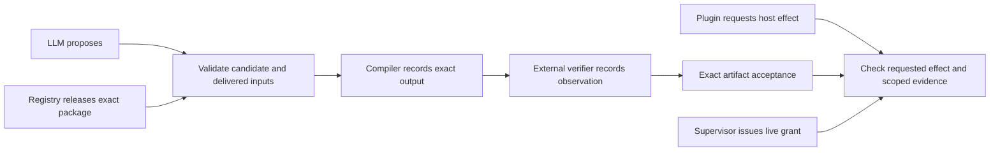

# RT-16 scoped trust across author, toolchain, runtime and registry

A handoff accepts only authenticated claims from the role authorized for that statement, with an exact shared context. In the bounded model, an LLM can propose a candidate and a plugin can request an effect. Acceptance and execution require separate evidence and runtime authority.

## Candidate role boundaries

| Role | Typed statement | Boundary at intake |
| --- | --- | --- |
| LLM author | Proposed change | Authenticate the proposer and validate the proposal against the expected project and candidate. |
| Artifact registry | Package integrity and delivery claim | Verify exact payload identity and any required publisher policy independently. |
| Compiler | Compiled artifact record | Bind exact candidate, emitted artifact and the required compilation profile. |
| Plugin | Named operation request | Validate the requested effect and exact context. A request carries no runtime permission of its own. |
| External verifier | Observed result | Accept observations only from the configured independent verifier for the exact artifact and profile. |
| Runtime supervisor | Execution grant | Check the live effect, artifact, scope and policy epoch before crossing into the host. |

The finite model separates three handoffs. Candidate validation requires proposal and package integrity. Artifact acceptance adds compiled output and independent observations. A host effect checks compiled output and observation evidence plus the plugin request and runtime grant. The fixture assumes claim authentication has run and models its result explicitly. A real repository still needs applicable human approval, build and package attestations, and isolated effect enforcement. [Existing threat model](RT-16-THREAT-MODEL-01.md) · [Independent validation](RT-16-INDEPENDENT-VALIDATION-2026-11-25.md)



## Results

The replay changes the producer, authentication state and one context dimension of each required claim. It compares 840 handoffs against a separate exact predicate. Ten matrix entries with all required facts unchanged pass and 830 refuse. Additional controls refuse missing or duplicate claims and a changed handoff epoch. A plugin claim cannot serve as runtime grant, and a registry claim cannot serve as independent behavior evidence.

The context fixes project, candidate, artifact, evaluation profile, effect and policy epoch. The fixture proves no cryptographic authentication, runtime isolation or end-to-end production protocol. Those components must establish the assumptions represented by the typed facts.

## Reproduce

Use CPython 3.12.14. Hash seeds 37 and 71 produce evidence SHA-256 `c1acd29f6eb3fbfe973dfec18c4f97a9be7bb4a24e1829fedbac0f155f4aff6d`. [Evidence ledger](TRUST-HANDOFF-01/evidence.json)

```sh
LC_ALL=C PYTHONHASHSEED=37 PYTHONDONTWRITEBYTECODE=1 \
  python research/security/RT-16/TRUST-HANDOFF-01/check.py > /tmp/rt16-handoff.json
```
