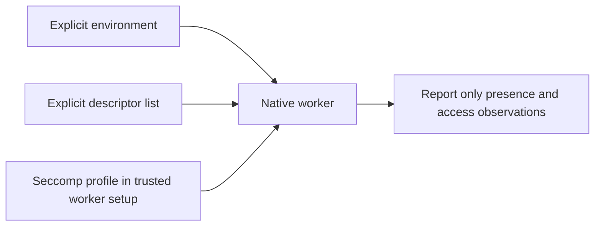

# RT-16 — Synthetic build-worker launch isolation

- **Date** — 2026-11-25
- **Tracking** — [PLAN §7.4](../../../PLAN.md#74-security-trust-and-reproducibility) · [#335](https://github.com/aivibeflow/LLMLang/issues/335)
- **Status** — Reproduced Linux child-process controls for declared inputs

## Question and setup

What does each launch control establish about the data visible to a build worker? The fixture constructs an explicit environment with public and synthetic private values and two test files. A native child reports only whether the test values and files are accessible. It uses a known public descriptor and, in selected cases, a separately passed synthetic private descriptor. The runner never uses ambient credentials as input. [Threat model](RT-16-THREAT-MODEL-01.md) · [POSIX startup descriptor observations](../../runtime-and-systems/RT-10/RT-10-POSIX-SPAWN-DESCRIPTORS-2026-11-25.md)

Three controls vary independently. The environment is either reduced to public inputs or includes the synthetic private variable. The explicit descriptor list either contains only the public descriptor or also contains the synthetic private descriptor. The x86-64 child either runs normally or enters a seccomp profile that permits its selected descriptor I/O and termination calls while denying new file opens. A separate Landlock feature query returns `ENOSYS` on the runner, so the measured pathname-denial mechanism is seccomp. The probe applies it in a trusted executable before the measured calls.



## Results

All 48 native launches and 336 observed fields match the oracle. Two GCC profiles each repeat all eight combinations three times.

| Control | Observed result |
|---|---|
| Omit the synthetic private environment field | The child retains the public value and cannot see the omitted field. |
| Pass only the public descriptor | The public descriptor remains readable and the synthetic private slot is closed. |
| Restrict new opens | The child cannot reopen either fixture file by path and cannot open the public file for writing. |
| Restrict new opens while passing the private descriptor | The child still reads the passed descriptor. |
| Restrict new opens while passing the private environment field | The field remains visible. |
| Apply all three controls | The child retains the declared public environment and descriptor, with the other tested data unavailable. |

The three controls address independent inputs. The file-open rule does not remove already accessible state. Metadata-only output reports the tested observations without retaining any input value. [Evidence ledger](WORKER-ISOLATION-01/evidence.json)

## Limits

This is a restrictive descriptor-only profile for one trusted native probe. Production build isolation needs a reviewed launcher boundary before generated instructions run, explicit descriptor and environment policy, filesystem and network mediation, resource limits, controlled logs and trusted output handling. The measured profile does not cover remote workers or arbitrary compiler processes.

## Reproduction

Run from the repository root on x86-64 Linux with CPython 3.12.14, GCC 14.2.0 and seccomp filters available. The runner creates the two synthetic files in a temporary directory and returns the capability query and observation receipt. [Native probe](WORKER-ISOLATION-01/probe.c) · [Runner](WORKER-ISOLATION-01/run.py)

```sh
set -eu
dir=research/security/RT-16/WORKER-ISOLATION-01
observed=$(mktemp)
trap 'rm -f "$observed"' EXIT
python3 -B "$dir/run.py" --cc gcc > "$observed"
cmp "$dir/evidence.json" "$observed"
```
