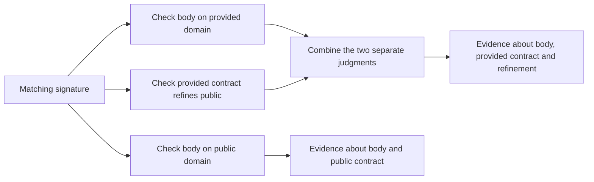

# RT-05/20 — Compare finite public-interface admission judgments

**Status:** Scoped Python and Lean comparison complete.

**Baseline:** Candidate proposal and dependency evidence at `eeb13d6` on main. The ledger pins the exact fixture, Lean checker and runner bytes for this pilot.

**Evidence type:** Exhaustive finite relation check, separately implemented Lean calculation and kernel-checked fixture verdicts.

**Tracking:** [PLAN §1.3.1](../../../PLAN.md#131-public-interfaces-and-verified-provider-binding-rt-0520-proposed), [public interface proposal](PUBLIC-INTERFACES-AND-CONTRACT-REFINEMENT.md), and [RT-20 contract identity](../../toolchain-and-collaboration/RT-20/RT-20-CONTRACT-IDENTITY-AND-COMPATIBILITY.md).

## Question and comparison

A provider can match a signature while breaking a public behavioral contract. A provider can also satisfy the public contract while making a separate implementation claim that it cannot substantiate. The proposed binding model needs to distinguish the exact judgment being checked.

We compare three methods for one declared implementation and one public contract.

1. **Signature admission** checks only the fixture's matching signature flag.
2. **Direct body check** checks actual body observations on every public-admitted input.
3. **Separate body and refinement checks** require the provided contract to admit every public input and allow only public observations there. The body must also satisfy the provided contract on its entire domain.



Each behavioral route yields evidence for the subjects shown. The direct route can establish a public-contract judgment even when a separate provider claim fails.

## Finite model and controls

The fixture has concrete inputs from `{0, 1, 2}`. A contract maps each admitted input to a nonempty set of permitted observations. Observations include status, result, ordered effect names and terminal ownership. A body table supplies one observation per tested input. A missing or unsupported observation remains unknown. A contract row with an empty observation set is rejected as vacuous. The matching signature flag describes fixture-level type shape and leaves the tested ownership and effects to behavioral checks.

The [Python oracle](public-refinement-pilot/run.py) compares records and set inclusion. A [separate Lean implementation](public-refinement-pilot/Refinement.lean) evaluates admissibility and inclusion over lists and explicit observation tags. The runner converts the [declared fixtures](public-refinement-pilot/fixtures.json) to Lean values and checks that their observation tags are injective in the finite input. A theorem compares the Lean decisions with the declared expected fixture verdicts and is checked by the kernel with `by decide`. The generated theorem and both checkers consume the same declared fixtures. The translation from actual LLMLang source to those fixtures remains an open correspondence problem.

## Observations

| Method | Admitted | Rejected | Unknown |
| --- | ---: | ---: | ---: |
| Signature | 14 | 1 | 0 |
| Direct body against public contract | 8 | 6 | 1 |
| Body against provided contract, plus refinement | 3 | 11 | 1 |

Both implementations agree with all 45 expected decisions across 15 fixtures. The Lean theorem depends on no axioms. Mutating one expected verdict makes the Lean proof fail. The [result ledger](public-refinement-pilot/results.json) retains each verdict, tool versions, input digests and the generated theorem source digest.

- The finite direct check rejects the reordered-effect, omitted-effect, unexpected-error and borrowed-result bodies. Their signatures agree in the fixture. Both behavioral methods preserve UNKNOWN when a public-admitted input lacks an observation.
- Five cases pass the direct public-body check and fail separate admission. They include a narrower provider domain, an overbroad guaranteed outcome set, failure of a promised provider result, failure outside the public but inside the provided domain, and an impossible provider contract. The difference identifies which exact implementation claims were checked.
- Two bodies return different permitted values for the same public revision and pass both behavioral routes. Their conformance leaves an observable difference. A call optimization or execution-cache reuse needs its own equivalence and binding evidence.

The finite result supports keeping the public-body judgment and the combined refinement judgment explicit in the evidence. Signature comparison is a useful preliminary constraint. It admits the fixture cases that violate effects or ownership and the fixture whose observation remains unknown.

## Reproduction and remaining work

Use CPython 3.12.14 and Lean 4.36.0 at commit `611c117bfaf7b7ae1cfcf246ce6fba31e8f509e9` on x86-64 Linux.

```sh
pilot=research/semantic-representation/RT-05/public-refinement-pilot
python3 -B "$pilot/run.py" --lean "$(command -v lean)" \
  --output /tmp/llmlang-finite-provider-refinement.json
cmp "$pilot/results.json" /tmp/llmlang-finite-provider-refinement.json
```

The recorded Python build line is part of the byte-level comparison. The 15 selected cases demonstrate the stated finite distinctions. They do not estimate general checker coverage or prove full source correspondence. Protocol invariants, authority, arbitrary progress and resource reasoning, ABI and runtime admission, binding freshness, independent review and normative selection remain open. Mermaid source was reviewed without local rendering.
