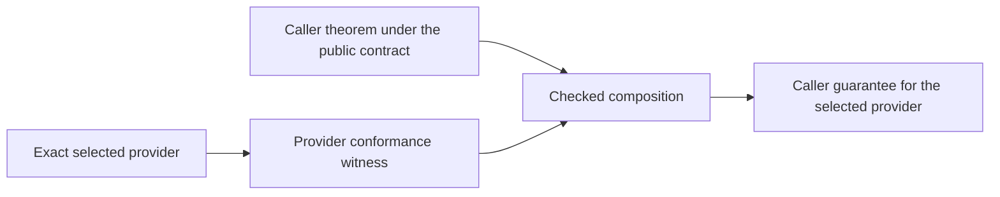

# Modular caller proof under an explicit provider contract

- **Date:** 2026-11-24
- **Research:** RT-05, RT-20, RT-32
- **Baseline:** `283d509986076c47ee945d293bc87be20528e638` (main after PR #467)
- **Evidence:** A Lean theorem over all mathematical integers and finite typed-SPG observations for two fixture source surfaces

One Lean caller theorem applies to both exact providers through separate conformance witnesses. The theorem depends on the public contract. Each witness depends on the selected provider and establishes successful return and the ordered trace for every input in the model.

## Model and comparisons

The caller evaluates `emit("before", op("provide", n) + emit("after", 10))`. Its public provider contract permits either `n + 1` or `n + 2` and requires the trace `first, last`. The caller contract permits the corresponding value plus ten and the trace `before, first, last, after`. The [Lean model](public-refinement-pilot/ModularCaller.lean) uses a deterministic function from an integer to an optional value and trace. Its central theorem quantifies over the provider function and assumes that function yields a successful observation satisfying the contract at every input.



| Provider model | Conformance witness | Outcome |
| --- | --- | --- |
| Returns input plus one, ordered effects | Proved for every integer | Instantiates the caller theorem |
| Returns input plus two, ordered effects | Proved for every integer | Instantiates the same caller theorem after rebinding |
| Returns input plus one, reversed effects | Refuted at zero | The theorem's premise cannot be discharged |
| Returns input plus three, ordered effects | Refuted at zero | The theorem's premise cannot be discharged |
| No successful observation | Refuted at zero | The theorem's totality premise cannot be discharged |

The [exact receipt replay](PUBLIC-INTERFACE-VERIFICATION-REBIND-2026-11-24.md) demonstrates that an old concrete caller receipt becomes stale when the provider premise changes. The modular theorem keeps the public contract and caller transform fixed and constructs a new composition with the replacement provider's witness. An implementation would need to retain both the reusable theorem and the selected witness's provenance and establish source correspondence for each. A changed public contract, caller transform or observation model requires a new applicability check. No verification-cost savings were measured.

## Source observations and limits

The same SPG caller address and distinct bindings appear in the two successful cases. Five inputs, including a negative one, are executed through each of two source surfaces for all five fixtures. The 100 observations cover the selected provider alone and the caller that uses it. The runner compares the surfaces and asks Lean to check 50 equalities between the model and the observed outcomes. It also checks an axiom audit for the generic theorem, the two concrete compositions and the three refutations.

As a negative check on the theorem, replacing its caller transform's final `after` effect with another `before` effect made Lean reject the unchanged proof against the original caller contract.

The universal result concerns the handwritten Lean model. Source compilation and evaluation are checked on the recorded finite inputs. In the missing-outcome fixture the source harness exhausts call fuel, while the model returns `none`. The observation projection records absence of a successful result and omits partial effects and the reason for missing observations. Failure traces, divergence, nondeterminism, ownership, foreign calls and proof-artifact authorization remain open.

## Reproduce

Run with Python 3.12.14 and Lean 4.36.0 (`611c117bfaf7b7ae1cfcf246ce6fba31e8f509e9`). The [ledger](public-refinement-pilot/modular-provider-results.json) records input SHA-256 values, the generated Lean hash and exact fixture observations.

```sh
pilot=research/semantic-representation/RT-05/public-refinement-pilot
replay_dir=$(mktemp -d)
python3 -B "$pilot/modular_provider.py" --output "$replay_dir/modular-provider-results.json"
cmp "$pilot/modular-provider-results.json" "$replay_dir/modular-provider-results.json"
```
