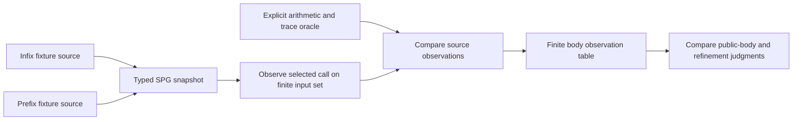

# RT-05/20 — Bind finite provider judgments to observed SPG fixture calls

**Status:** Scoped source-surface, exact snapshot and checker comparison complete.

**Baseline:** `9ec0601d2686129d01f1ae87165a83c4efb17215` on main.

**Evidence type:** Executable typed-graph fixture, independent scalar observation oracle and kernel-checked finite verdicts.

**Tracking:** PLAN §1.3.1 and the [finite refinement pilot](PUBLIC-INTERFACE-FINITE-REFINEMENT-PILOT-2026-11-24.md).

## Question

The first refinement study used declared body tables. This follow-up obtains their scalar and ordered-effect observations by compiling known expressions through two existing typed SPG fixture surfaces and interpreting the exact selected graph. It tests whether the direct and separate provider judgments continue to distinguish the observed behavior when an exact provider binding changes.



Both source surfaces use the same existing type checks, graph representation and evaluator. The independent arithmetic and trace oracle supplies the expected observations for these inputs. The finite Lean checker evaluates judgments on the observed table and the declared contracts.

## Method and alternatives

The [fixture driver](public-refinement-pilot/spg_observations.py) fixes inputs `0`, `1` and `2`. The public table allows values `n + 1` or `n + 2` with trace `first, last`. The narrower provided table promises `n + 1` with the same trace. The operation call resolves a provider from the snapshot. A direct call pins the primary implementation. Two more providers emit the wrong order or omit the last effect. A low fuel limit leaves the call observation UNKNOWN.

The driver independently spells out the infix and prefix bodies, checks each interpreted observation against the scalar oracle and checks equality of their selected snapshot roots. The observation adapter stores a scalar placeholder for ownership. Its table has no ownership semantics, capability policy, or FFI behavior. The supplied finite contract tables are explicit checker inputs and remain outside the prototype's authoritative graph: the embedded graph contract declares only an effect trace set.

## Results

| Fixture | Observed distinction | Direct public body | Separate body and refinement |
| --- | --- | --- | --- |
| Base operation | Selected primary yields `n + 1` | Admit | Admit |
| Rebound operation | Selected alternate yields `n + 2` | Admit | Admit |
| Rebound operation, stale provided promise | Same observed alternate body violates the separate `n + 1` promise | Admit | Reject |
| Rebound direct call | Snapshot binds the alternate for operation calls. The direct call still yields `n + 1` through the primary. | Admit | Admit |
| Reordered effects | Same arithmetic result with `last, first` | Reject | Reject |
| Omitted effect | Same arithmetic result with `first` only | Reject | Reject |
| Exhausted observation budget | The bounded interpreter yields no observation | Unknown | Unknown |

The two surfaces, both over all three input values, match the oracle on **42** source observations: 36 completed outcomes and six fuel-limited unknowns. Seven pairs of snapshot roots agree across surfaces. The stable operation caller body retains its identity across the rebind while the selected binding and exact callee differ. A separate control rejects a Boolean implementation result declared as `Int` before executing it. Matching fixture signatures admit all seven well-typed cases even when behavioral admission rejects or remains unknown.

The Python and Lean checks agree on all **21** verdicts. The kernel-checked finite theorem depends on no axioms. The [ledger](public-refinement-pilot/spg-results.json) records snapshot, binding, caller and actual implementation identities, observations and source digests. Exact identity provides a binding for evidence. The same fixture also demonstrates that a stored, well-typed call needs independent checking of its ordered behavior.

## Reproduction and limits

Use CPython 3.12.14 and Lean 4.36.0 at commit `611c117bfaf7b7ae1cfcf246ce6fba31e8f509e9` on x86-64 Linux. From the repository root:

```sh
pilot=research/semantic-representation/RT-05/public-refinement-pilot
python3 -B "$pilot/spg_observations.py" --lean "$(command -v lean)" \
  --output /tmp/llmlang-spg-provider-observations.json
cmp "$pilot/spg-results.json" /tmp/llmlang-spg-provider-observations.json
```

The counts enumerate the stated fixed cases. The theorem checks the finite verdicts after observation-table encoding. Shared lowering, observation encoding and the contract-table correspondence still need independent validation before general source or backend claims. The result leaves owned values, cleanup and cancellation, export authority, dynamic dispatch, wider contract scope and independent scientific review open. No language or binding policy is selected. Mermaid source was checked without local rendering.
