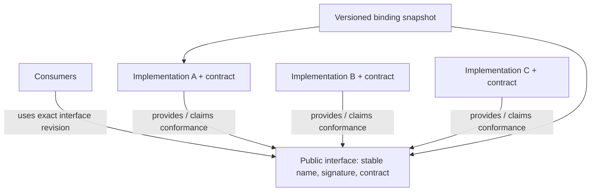
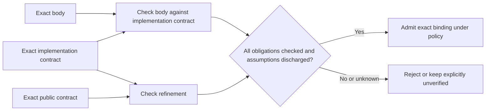
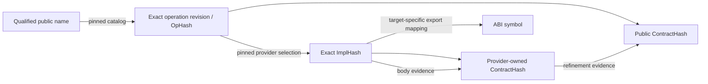

# Public interfaces — stable names and verified contract refinement

**Status:** Candidate architectural proposal; not adopted language semantics  
**Date:** 2026-11-24  
**Research:** RT-05, RT-20; related RT-06/07/11/12/18/23/24/32/33/34/35  
**Evidence:** Model proposal only; no new executed experiment or checked proof  
**Integration baseline:** `c0340243ff1a9789278c14e79076b541b3eaa34f` (main after PR #433; same tree as original proposal head `61f434b5e9f3a1cc58876db4b180cedc0ad90780`). Exact source and resulting blobs are retained in Git history.

## 1. Problem and hypotheses

A caller needs a stable public name and behavioral guarantees without depending on a particular implementation. Existing [typed SPG](RT-05-TYPED-SEMANTIC-PROGRAM-GRAPH.md) already distinguishes design operations and concrete providers, [RT-20](../../toolchain-and-collaboration/RT-20/RT-20-CONTRACT-IDENTITY-AND-COMPATIBILITY.md) distinguishes required/provided contracts, and [Scenario 10](../../packages-and-ecosystem/RT-12/RESEARCH-SCENARIO-10-CONTRACT-IMPLEMENTATION-BINDINGS.md) explores binding snapshots. This proposal unifies those mechanisms at an explicit public interface boundary, not a replacement for hash-based calls or structural type identity.

H1: a stable named interface with immutable contract revisions permits sound modular verification and provider replacement without rewriting interface-level caller proofs when their exact assumptions are unchanged.
H2: exact revision-bound conformance and binding evidence detects incompatible or stale providers even when names and signatures match.
H3: a separate resolution snapshot preserves deterministic builds when several implementations exist.

## 2. Candidate model and alternatives

A Public Interface is an exported, governed semantic entity, independent of its implementation. It has a stable namespace-qualified name, logical lineage/ID (candidate; final ID scheme open), immutable revisions containing typed signature, public contract, visibility, semantic profile and version metadata, and explicit relations to implementation bindings. It can represent an operation or a group of operations with shared state/protocol invariants. An implementation has its own contract and exact body identity. Private functions need not have public names or a distinct interface. Name uniqueness is scoped to a namespace and version policy. Renaming is an explicit migration or alias, never an unnoticed break; name reuse must not impersonate an older interface.

| Identity | Meaning |
| --- | --- |
| Public name / logical ID | Discovery and continuity; not an execution hash |
| Interface revision | Immutable public semantic payload; investigate mapping to existing OpHash rather than introduce a redundant hash |
| ContractHash | Exact contract value |
| ImplHash | Exact implementation and hash-relevant dependencies |
| CCHash | Optional existing conformance-class definition with constraints, not proof or discovered membership list |
| Binding revision | Exact selected provider(s), scope, target/profile and resolution policy |
| Evidence ID | Checked claim and all exact inputs, assumptions and checker identity |

Candidate aliases may evolve without changing the semantic contract if the approved identity policy separates name metadata. Public visibility, access/authority, ABI and semantic compatibility are distinct; a stable name is not an ABI guarantee.



Consumers can reason against the public contract. The mapping chooses an exact provider for a given build or execution context; a provides edge alone is not evidence.

Compare: (A) concrete hash calls only (simple, but provider changes propagate); (B) named signatures without behavior checks (weak guarantee); (C) named, contract-bearing immutable operation with verified binding (proposed); (D) runtime dynamic dispatch under a verified admission policy (flexible but introduces trust and reproducibility obligations). Do not assume C and D are interchangeable. RT-35 discovery may locate public interfaces by intent but must resolve to exact identities; similarity is not proof.

## 3. Formal model and assumptions

Let P denote public and I implementation contracts in a common typed observation model, or with an explicitly checked abstraction relation. For public-admitted initial states and inputs:

- Pre_P implies Pre_I, including input domain, ownership, capabilities and environment assumptions. No stronger caller obligations.
- Pre_P and Post_I imply Post_P for corresponding outcomes; output guarantees can be stronger.
- Every observable implementation trace/outcome allowed on the public domain is permitted by P, respecting error alternatives, frame conditions, ordering, multiplicity, atomicity and history constraints.
- Public invariants hold under the abstraction relation. Private effects are hidden only when proven unobservable under the declared model.
- Termination, liveness, fairness, cancellation, resource ownership and security promises need dedicated obligations, not merely finite trace inclusion. A diverging implementation must not pass a total-correctness contract by having no terminating traces.
- Resource upper bounds must be no worse under the same size, cost, environmental and asymptotic models (RT-34). Exact, lower or optimality promises require their own relation.
- Check type and calling-convention compatibility independently (input contravariance/output covariance when sound; mutable/invariant positions, generics, ABI and adapters need specific rules). No new caller-visible error or required capability outside the public allowance. A required observable effect cannot be omitted merely because the effect set is smaller.

Write I refines P for the complete judgment, not just signature equality or literal equality of contracts. Check consistency, satisfiability and realizability as applicable; impossible contracts and unsupported fragments must not yield vacuous success.

Two independent obligations: Body satisfies I; I refines P. Under aligned semantics, abstraction, assumptions, totality/progress obligations and trusted evidence composition, conclude Body satisfies P. A direct Body satisfies P proof is an alternative, and should not be mislabeled as proof of an independently claimed I.



The second diagram identifies the two proof inputs and fail-closed admission. An interface declaration without any provider is useful for conditional design/proofs but cannot silently become executable. Multiple providers may be admitted; ambiguous selection requires explicit policy, not arbitrary lookup. Adapters are implementations with their own proof obligations. Protocol/interface groups need joint invariants, not just independent per-method checks.

### Illustrative syntax (not grammar)

```text
public interface collections.sort @1:
    input: xs: List<Int>
    output: ys: List<Int>
    requires: true
    ensures: sorted(ys) and permutation(xs, ys)
    effects: pure
    time: O(n log n) under comparison_cost_model
    terminates: true

implementation merge_sort implements collections.sort @1:
    contract:
        requires: true
        ensures: sorted(result) and permutation(xs, result)
        effects: pure
        time: O(n log n) under comparison_cost_model
        terminates: true
    body: ...

binding production:
    collections.sort @1 -> exact ImplHash of merge_sort
```

This example assumes a well-defined cost model and input size, including list representation, and is a declaration sketch, not evidence about any actual implementation. The public contract does not promise stability of equal-element ordering unless specified; use records with keys and identities for a stable-sort guarantee.

## 4. Evolution and evidence

A change to a provider body invalidates its exact body proof and binding/build evidence. An unchanged interface and assumptions may preserve modular caller proofs; closed executable/system evidence and caches dependent on the provider must be revalidated. Changing public semantics creates a new immutable revision even when a compatible evolution keeps the same name. A new revision is backward compatible only when it refines the old public contract for its existing callers, plus separately checked signature/protocol/source/ABI requirements as applicable. Old binaries or reproducible builds keep old pinned bindings. Incompatible changes need a new supported major version or explicit migration, with no silent weakening of guarantees.

Evidence binds exact interface revision, both contract hashes, body/ImplHash, binding scope, checker/version, translation/profile, obligation digest, abstraction/environment/assumption identities and proof artifact. Keep PROVEN, DISPROVEN, UNKNOWN, NOT_CHECKED and bounded evidence distinct; policy cannot promote tests to universal proofs. Caller-only evidence is conditional until provider obligations are discharged. Treat a stale, forged or mismatched certificate as inadmissible. RT-32 PDG should track conditional assumptions, RT-33 should select/check backend capabilities; RT-23/24 mapping changes need atomic, conflict-aware publication.

## 5. Planned experiments and method

Start with a finite typed oracle independent of a refinement checker; enumerate complete bounded domains and traces, compare with generated SMT/Lean obligations for a supported subset, then add SPG-to-model correspondence. Record exact source, fixtures, versions, assumptions, raw outputs and counterexamples. No experiment has been run in this proposal.

| Fixture | Expected result under the proposed profile |
| --- | --- |
| Same public and implementation contract, valid body | Admit after proof |
| Weaker precondition / stronger postcondition | Admit |
| Stronger precondition or weaker postcondition | Counterexample |
| Missing promised effect, additional observable write, reordered required trace | Reject |
| New unhandled failure or stronger capability requirement | Reject |
| Added caller cleanup duty / borrowed instead of promised owned return | Reject |
| Divergence despite totality, starvation despite fairness promise | Reject or UNKNOWN if unsupported |
| O(n²) provider for O(n log n) upper bound | Reject if proven violation in same cost model |
| Same contract but incorrect body | Reject |
| Inconsistent/unrealizable contract, unsupported theory | Diagnose; do not admit vacuously |
| Same public name, wrong revision or stale proof | Reject |
| Compatible provider replacement | Reuse eligible interface proofs; invalidate dependent exact evidence |
| New interface revision, weaker public guarantee | Breaking; migrate or retain prior version |
| Multiple admissible providers / no provider | Deterministic explicit selection / unresolved execution |
| Concurrent edits to bindings, target/profile mismatch | Conflict or reject |
| State protocol with per-method proofs but broken joint invariant | Reject |
| Two conforming but observationally different providers | Do not claim equivalence or refactoring correctness |

The [finite refinement pilot](PUBLIC-INTERFACE-FINITE-REFINEMENT-PILOT-2026-11-24.md) checks these first admission distinctions with Python and Lean. It uses declared finite observation tables. General correspondence and the planned protocol, liveness and resource controls remain open.

The [typed-SPG observation follow-up](PUBLIC-INTERFACE-SPG-OBSERVATION-PILOT-2026-11-24.md) connects the scalar fixture evaluator to both admission judgments under explicit exact-snapshot and observation-table assumptions.

## 6. Findings, limitations and decision boundary

The existing RT-20 compatibility boundary is the natural starting point; RT-05 already distinguishes operation and implementation, so avoid parallel incompatible identity models. The proposal does not prove any theorem or establish language-wide soundness, canonical hashing, dispatch semantics, ABI, or complete contract taxonomy coverage. Rich refinement is undecidable in general; supported fragments, proof assistance, explicit UNKNOWN and policy-controlled evidence are necessary. Security hyperproperties, probabilistic contracts, concurrent history and resource models require separate semantics and proof rules. Independent review and compiler/runtime correspondence remain open.

Recommendation: register public interfaces in the concept as a candidate architectural entity; explore the above refinements under RT-05/20 and cross-link RT-32/33/34/35. Do not change normative or candidate draft rules without evidence and a decision. Q1–Q5: not independently reviewed; no measured result, no executable reproduction, diagrams authored but rendering not checked.

## 7. Related material

- [RT-20 contract identity and compatibility](../../toolchain-and-collaboration/RT-20/RT-20-CONTRACT-IDENTITY-AND-COMPATIBILITY.md)
- [Scenario 14 behavioral contracts and refinement](../../language-design/RT-02/RESEARCH-SCENARIO-14-FORMAL-BEHAVIORAL-CONTRACTS-AND-REFINEMENT.md)
- [RT-05 typed SPG](RT-05-TYPED-SEMANTIC-PROGRAM-GRAPH.md)
- [RT-23 interface mapping merge](../../toolchain-and-collaboration/RT-23/RT-23-INTERFACE-MAPPING-MERGE.md)
- [RT-32 verified SPG-to-Lean pipeline](../../formal-verification/RT-32/RT-32-VERIFIED-SPG-TO-LEAN-PIPELINE.md)
- [RT-33 backend selection](../../formal-verification/RT-33/RT-33-PROOF-BACKEND-SELECTION-AND-ORCHESTRATION.md)
- [RT-34 complexity inference](../../formal-verification/RT-34/RT-34-AUTOMATIC-COMPLEXITY-INFERENCE.md)
- [RT-35 semantic function discovery](../RT-35/RT-35-SEMANTIC-FUNCTION-DISCOVERY-AND-RETRIEVAL.md)

## 8. Repository integration and resolution model

The review identifies an existing interface concept in the global artifact store and libraries, exact operation identity in the glossary, typed SPG provides relations, Scenario 10 binding snapshots, Scenario 14 refinement, RT-23 external mappings and RT-32 conditional proofs. The public-interface proposal integrates these rather than introducing a competing identity system. The accepted [architecture decision](../../../draft/ARCHITECTURE-DECISIONS.md) preserves immutable published components and single-toolchain build compatibility; neither a cross-toolchain ABI promise nor runtime negotiation follows.



This is a logical separation, not a requirement for three databases. Exact catalog/binding/mapping revisions are immutable; authorized heads may advance atomically. Names used in observable external protocols are semantic where the chosen observation model says so; metadata aliases may be separate. An interface group has member operations and possibly joint invariants and needs a separate group model, not a fabricated new hash acronym. Do not duplicate the authoritative provider-owned Contract reference in callers or bindings. Resolve each exact reference and include it in evidence inputs.

### Proof composition and revision impact

For public domain D, abstraction A and aligned semantics S, the proof chain is Body models C_impl under S and C_impl refines C_pub under A/S/D; only then conclude Body models C_pub, after discharging all assumptions. An abstract caller theorem may be valid conditional on C_pub while a closed execution claim remains unresolved. A direct proof against C_pub is useful but cannot certify an unproved provider contract. A client that relies on stronger facts than C_pub needs a separately modeled requirement. A provider satisfying C_pub need not be observationally equivalent to another provider satisfying it. Inlining or transparent rewrites may require equivalence, not only refinement.

| Change | Name resolution | Modular caller proof | Provider/refinement proof | Exact build or closed proof |
| --- | --- | --- | --- | --- |
| Alias/catalog edit | Recheck affected and negative reads | Reuse only if exact resolved inputs unchanged | Reuse if inputs unchanged | Recheck affected resolution closure |
| Body-only change | Unchanged | May reuse | Body proof invalidated; rebind evidence, refinement may be reused if inputs unchanged | Invalidate dependent link/execution evidence |
| Provided contract change | Unchanged | May reuse | Recheck body and refinement | Recheck admission and dependent closure |
| Public contract change | New operation revision | Keep old pins; prove or migrate new ones | Recheck against new revision | New exact closure where migrated |
| Provider selection change | Unchanged | May reuse | Verify exact selected provider evidence | Recheck selected closure |
| ABI mapping change | May be unchanged | Recheck if model observes ABI | Recheck applicable ABI obligations | Recheck target/link closure |

This table is a candidate invalidation model; reuse is conditional on complete dependency tracking and stable applicable assumptions, not a promise of zero rebuilds.

### Integration inventory

The accompanying changes update concept (EN/RU), glossary, architecture decision navigation, PLAN/TODO/feature registry/taxonomy, SPG and identity, binding/refinement scenarios, dependency and cache, package/library and index, semantic verification and proof orchestration, complexity/discovery, Toolchain and publication, security, ABI, access/coherence, error/module evolution and benchmark design. Historical measured reports and executable schemas are not rewritten; where a follow-up is appended it is explicitly outside the original result. The original proposal is [PR #433](https://github.com/aivibeflow/LLMLang/pull/433); the exact integration changed-path list is in [PR #434](https://github.com/aivibeflow/LLMLang/pull/434). No executable result, human review, complete repository semantic audit, or Mermaid rendering is claimed by this integration pass.

### Candidate admission procedure and falsification boundaries

The user's proposed public-provider model requires a declared implementation contract and both proof obligations. A direct proof against the public contract alone does not satisfy this two-stage admission rule; it is an alternative research vector only if the project explicitly adopts a different model. An implementation can use the public contract as its own exact contract where the semantics allow identity refinement, but must still prove the body and validate the exact relation/profile.

1. Resolve the scoped public name against a pinned catalog. Reject unresolved/ambiguous/unauthorized selections; retain the exact operation revision, public contract and negative lookup dependencies.
2. Resolve the candidate provider and its single owned contract at exact identities. Check signature/type/ownership/ABI/profile compatibility before generating behavioral obligations.
3. Independently generate and check body-to-provider and provider-to-public obligations. Require applicable abstraction and observation models, environmental assumptions, consistent/realizable contract domain, and any explicit termination/liveness/resource guarantees. Do not silently discard a clause when translation is unsupported.
4. Verify certificate provenance, exact claim and input identities, evidence kind, checker policy and dependency closure. A finite test is not a universal proof. Treat a refuted, unsupported, stale or incomplete proof as non-admissible under proof-required policy; preserve its distinct diagnostic.
5. Publish an immutable binding revision only against the expected semantic/catalog/binding baseline under authorized policy. Pin the selected provider in the build/execution context. Closed-system claims discharge the selected provider assumptions; modular caller proofs are separately tracked.

A candidate proof obligation is not automatically a theorem. The basic pre/post rules hold only for a compatible typed state/outcome model with corresponding initial states and terminal outcomes; more general trace, relational, probabilistic and concurrent guarantees require their respective semantics. Interface-only design remains possible, but it is not a claim that a provider exists. Neither name stability nor contract refinement implies identical traces, runtime determinism across providers, universal ABI compatibility, or arbitrary transparent rewrites.

**Validation boundary:** documentation integration only. The next executable milestone is a complete finite fragment with an independent oracle, negative and UNKNOWN controls, followed by backend/source correspondence and exact admission/cache tests. Existing archived measurements remain unchanged.

## Explicit assumptions and conditional verification (RT-36; proposed)

An opaque foreign provider may be modeled by an explicit assumed body-to-provider conformance claim while provider-to-public refinement is checked. Keep strict verified admission fail-closed; investigate separately labeled conditional admission under authorized trust policy, with exact artifact/ABI and adapter correspondence, residual assumptions and revocation. This does not relax the proposed proof-required rule. See [RT-36 — Formal Verification Assumptions, Trust Boundaries and Conditional Proof Management](../../formal-verification/RT-36/RT-36-FORMAL-VERIFICATION-ASSUMPTIONS-AND-TRUST.md). This is a candidate follow-up, not an adopted rule or new experimental result.
