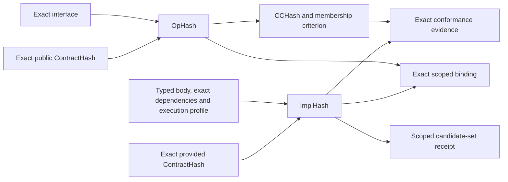

# RT-05 candidate operation, implementation and conformance envelopes

A caller names an immutable semantic operation or pins one exact implementation. Search and proof attach different information to those subjects. This study specifies exact field roles for a bounded candidate and checks which addresses change under a revision. The domains and byte format below give replayable experiment identities. Project-wide standardization requires the cross-aspect decision recorded in the plan. [Proposed glossary](../../../draft/GLOSSARY.md#core-terms)

## Identity fields

A required field is a canonical typed value or an exact typed reference. An explicit canonical empty value denotes a profile with no additional context or dependencies. Missing obligations, unresolved references and an unsupported profile cannot supply an exact admitted claim.

| Identity | Required payload in the candidate | Related value kept separately |
|---|---|---|
| `ContractHash` | Observation/contract profile and exact behavioral relation. The relation specifies input and initial-state domain, promised outcome and trace constraints, effects, errors, and any stability or progress constraints used by the profile. | A declaration using a contract, the independent conformance result, and mutable documentation |
| `OpHash` | Exact public interface reference, exact `ContractHash`, and exact call-semantics context. The interface supplies ordered argument and return roles, exact types, and ownership obligations. The context supplies any profile rules needed to interpret the call beyond the referenced interface and contract. | External catalog aliases, stable lineage identifier, chosen provider, permission record, generated code and discovery candidates |
| `ImplHash` | Exact canonical implementation body, typed exact semantic dependencies, exact provider-declared `ContractHash`, and exact execution-profile context. Dependency order and occurrence roles follow the typed body profile. | Physical compilation actions and output blob digests. For an abstract operation call in the body, the operation's late-bound provider belongs to the binding context consulted during execution |
| `CCHash` | Exact `OpHash`, exact typed applicability constraints, and exact versioned membership criterion | Discovered candidates and evidence that one specific implementation satisfies the criterion |
| Optional `CandidateSetHash` | Canonically sorted unique `ImplHash` values and an exact discovery scope identifier | Rank order, presentation metadata and proved membership |
| Conformance evidence | Exact `ImplHash`, exact `CCHash`, assumptions and checked scope, checker identity, exact checked proof or observation result, and the variant's policy scope | Registry discovery metadata and any subsequent revocation or applicability decision |

The fixture uses symbolic typed-field values where other work supplies the exact artifact. In a concrete instance each typed reference must resolve to the expected kind/version and bytes. The separate provider-declared contract can change while public operation and executable bytes remain identical. Multiple public operations may use the same exact provider if each has its own evidence and binding. The class denotes all implementations satisfying its criterion, including unseen ones. Discovery can change the finite candidate set independently.



The experimental preimage is an ASCII JSON object with an explicit `llmlang-research/<kind>/1` domain and a `fields` object. Map keys are sorted, separators contain no whitespace, and the result is SHA-256 encoded as lowercase hexadecimal with kind, version and algorithm in the display identifier. Only the fixture's strings, arrays and nested field maps are covered. The encoding is deliberately local to the candidate and does not supply a production registry or type decoder.

## Checked boundaries

Single and pairwise edits to 17 inputs yield 153 checks against a separately declared influence table. The matrix checks exact propagation of field changes across the six domains. Revising the public contract changes the operation, class and associated evidence without changing a provider that continues to declare the same promise. The provider's contract, body or exact dependencies change `ImplHash`, a candidate set containing that member and its evidence. Adding a different discovered implementation changes only discovery identity. Revising the checker or policy scope changes the evidence identity without revising the semantic class. Display metadata changes none of the six. Independent controls require different domains to produce different addresses and reordered fields to produce the same preimage.

The [native operation study](RT-05-PERMISSIVE-OPERATION-IDENTITY-2026-11-25.md) observed six conforming provider pairs with distinct permitted values or traces despite the same operation contract. Substituting provider equality for operation identity loses useful semantic sharing. The [provided contract study](RT-05-PROVIDED-CONTRACT-IDENTITY-2026-11-25.md) found 29 pairs where executable plus public identity collapses opposite admission outcomes. The [conformance class study](RT-05-CONFORMANCE-CLASS-IDENTITY-2026-11-25.md) checked 120 exact requests and found 100 request pairs where class and implementation alone cannot establish equal evidence applicability. Including each exact subject preserves the boundary between provider behavior, public refinement and eligibility to use a receipt.

For a direct implementation call the typed exact reference participates in the caller body's dependency envelope. For abstract dispatch the immutable call names the operation and a separate runtime/build input pins any consulted binding. A generated artifact's digest answers byte identity, and the action key answers exact reproduction inputs. Neither determines the provider's declared contract automatically.

## Verify and limits

The [runner](CANDIDATE-ENVELOPES-01/check.py) and [ledger](CANDIDATE-ENVELOPES-01/evidence.json) use CPython 3.12.14 and Git 2.56.1 at `2426691c3b0200edf9b6dfb8bb5083050b3b7b28`. They pin the three underlying ledgers and check the finite influence matrix. Hash seeds 37 and 71 produce identical output.

```bash
fixture=research/semantic-representation/RT-05/CANDIDATE-ENVELOPES-01
PYTHONHASHSEED=37 python3 -B "$fixture/check.py" > /tmp/llmlang-candidate-envelopes.json
cmp "$fixture/evidence.json" /tmp/llmlang-candidate-envelopes.json
```

The precise ABI, runtime, target and native-toolchain field projections require separate comparisons. Open decisions include the portable canonical wire format, trust and revocation handling, and adoption of the operation envelope after cross-aspect synthesis. [LL-001](../../../PLAN.md#ll-001--define-the-canonical-ophash-envelope) · [LL-003](../../../PLAN.md#ll-003--specify-contract-based-analogue-discovery-and-substitution)
