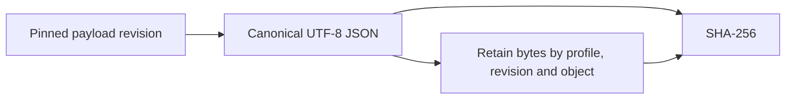
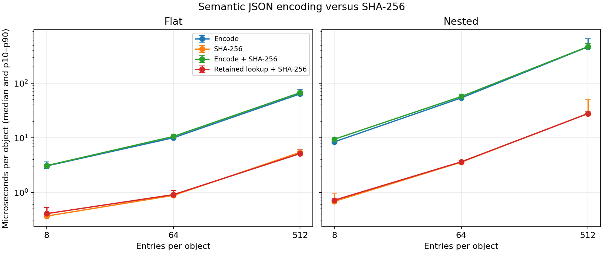

# RT-05 canonical encoding and SHA-256 cost

A content digest normally requires canonical bytes. Repeated consumers can reuse verified bytes for the same immutable payload and encoding profile. This pilot separates canonical encoding, hashing prepared bytes, encoding plus hashing, and scoped retained lookup plus hashing. It uses the current `ContentStore` prototype's canonical JSON encoder on payloads. The complete object envelope and dependency list remain outside the measured boundary. [Prototype encoder](../../PROTOTYPES/DEPENDENCY-GRAPH-01/src/semantic_graph.py)



The corpus uses flat integer maps and nested maps containing Unicode keys and values, lists, booleans and null. Each shape has 8, 64 or 512 entries per object. Four immutable objects repeat for 16 rounds in each scope. Every phase returns exact canonical bytes or digest bytes and checks them after timing. Reversing insertion order preserves canonical bytes. Insertion-order serialization changes the bytes. Changing payload revision under the same logical object identifier produces distinguishable canonical bytes and a different cache key. The cache key assumes the supplied identity resolves to the intended immutable value.

## Measurements

Ten independently launched trial processes per profile run all four phases in randomized order. Four retained entries are prepared with a separately recorded setup timer. The retained measurement includes dictionary lookup and hashing for every repeated call. It retains canonical payload bytes and still computes SHA-256 for each request. Table values are medians in microseconds per object.

| Shape and entries | Encode | SHA-256 on prepared bytes | Encode and hash | Retained lookup and hash, including amortized setup | Canonical bytes retained for four objects |
| --- | ---: | ---: | ---: | ---: | ---: |
| Flat, 8 | 3.03 | 0.37 | 3.07 | 0.63 | 485 |
| Flat, 64 | 9.95 | 0.87 | 10.54 | 1.57 | 4,066 |
| Flat, 512 | 63.48 | 5.38 | 66.86 | 9.73 | 34,392 |
| Nested, 8 | 8.39 | 0.68 | 9.37 | 1.36 | 2,879 |
| Nested, 64 | 53.51 | 3.55 | 56.72 | 7.22 | 23,465 |
| Nested, 512 | 461.78 | 27.61 | 465.91 | 56.38 | 192,703 |



All 60 trials verify 64 outputs per phase. In the measured profiles encoding takes more time than hashing prepared bytes. The benefit of retaining bytes depends on reuse, structure, and the memory needed to keep the immutable entries. The setup-inclusive result amortizes one preparation across 16 repetitions. The retained-byte column covers payload bytes, with dictionary and other runtime overhead outside that count. Timing includes normal Python batch iteration and allocation of the result tuples. Metering comes from one pinned CPU on an AMD EPYC 9V74, Linux 6.18.57 and CPython 3.12.14, with zero throttled cgroup periods. Cold persistent cache reads, mutation, representative object distributions, algorithm selection and a production cache policy remain open. [Raw samples](CANONICAL-HASH-COST-01/evidence/samples.csv) · [Summary](CANONICAL-HASH-COST-01/evidence/summary.json) · [Run configuration](CANONICAL-HASH-COST-01/evidence/config.json)

## Reproduction

Use CPython 3.12.14 and Matplotlib 3.10.8 on Linux with cgroup CPU accounting. Choose a CPU allowed by the runner. Timings vary across runs.

```sh
study=research/semantic-representation/RT-05/CANONICAL-HASH-COST-01
build=$(mktemp -d)
LC_ALL=C PYTHONHASHSEED=37 PYTHONDONTWRITEBYTECODE=1 python "$study/measure.py" \
  --cpu 4 --seed 20261125 --trials 10 --output "$build/evidence"
LC_ALL=C MPLBACKEND=Agg MPLCONFIGDIR="$build/plot-cache" python "$study/summarize.py" \
  --evidence-dir "$build/evidence"
```

[Collector](CANONICAL-HASH-COST-01/measure.py) · [Summary and chart generator](CANONICAL-HASH-COST-01/summarize.py)
