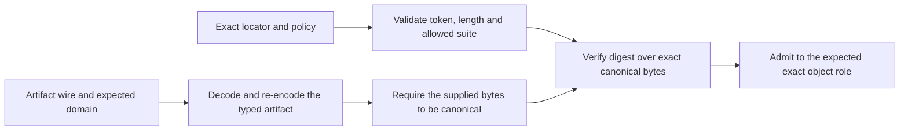

# RT-05 candidate canonical typed wire and digest-suite admission

The candidate separates exact artifact bytes, their typed interpretation and their digest locator. This lets a receiving store validate byte identity without confusing domains or treating algorithm support as authority to admit an older suite. The check combines the existing independent canonical decoders with an additional suite policy.

## Canonical profile and locator

The bounded profile uses strict UTF-8 with an explicit tuple envelope `[profile-version, domain, typed-value]`. For the tested JSON subset, arrays retain order and canonical maps sort keys by UTF-8 byte order. Keys are unique. A string retains its exact Unicode scalar sequence. The strict reader checks the supported version and expected domain, decodes typed fields, runs the canonical encoder, and compares the resulting bytes to the supplied bytes. A separate ingestion route may normalize an equivalent transport representation before assigning and publishing a canonical identity.

For the supported integer algebra, the tagged decimal scalar has a single exact lexeme. Bare indistinguishable host numbers, noncanonical negatives such as `-0`, and silent rounding are excluded from that profile. The independent cross-runtime comparison found that ordinary JavaScript Number changes 56 of 181 I64 inputs and collapses 46 distinct pairs, while three exact representations preserve all inputs. The separate F64 fixture preserves all 210 input words with tagged exact bits. A future F64 domain still needs a semantics decision about NaN payloads and signed zero. These floating-point bits are evidence for a possible scalar extension. They are outside the suite fixture's decoded value algebra. [I64 encoding](RT-05-CROSS-RUNTIME-I64-ENCODING-2026-11-25.md) · [F64 identity](RT-05-CROSS-RUNTIME-F64-IDENTITY-2026-11-25.md)

The research locator is `algorithm:lowercase-hex`. Each registry entry specifies a fixed algorithm, exact digest length and verification function. The domain and profile version are in the preimage. A reference carries an independently expected kind and supported version. Canonical byte identity is checked before an observed value is admitted to its typed role. In the suite fixture, `sha256` requires 64 hexadecimal digits and `sha512` requires 128. Historical policy admits both for explicit historical use. The fixture's active policy admits only `sha512` to distinguish algorithm implementation from policy authorization. It supplies no production preference between the algorithms.



Adding a suite can create another locator for byte-identical content if both digests can be checked. Migrating to a reader without the legacy suite requires rewriting all exact embedded references and validating the entire new closure. A transport alias cannot remove old embedded references. The old and rewritten addresses remain separate exact evidence subjects. See the [migration and collision study](RT-05-DIGEST-MIGRATION-AND-COLLISION-2026-11-25.md) for the 20 migration controls and the two candidate migration routes.

## Checks

Both Python and JavaScript agree on the typed-byte outcomes of seven source frame forms crossed with two expected domains. The independent locator check then crosses those 14 outcomes with two policies, two suites and four digest spellings. It agrees with the expected results on 224 requests.

| Disposition | Requests |
|---|---:|
| Admitted | 6 |
| Locator spelling or length invalid | 112 |
| Suite out of scope | 28 |
| Wrong typed domain | 30 |
| Wrong envelope | 12 |
| Malformed UTF-8 | 12 |
| Noncanonical bytes | 6 |
| Invalid typed value | 12 |
| Incorrect digest | 6 |

Three additional controls refuse an unknown registry token, a locator without an algorithm, and a wrong-suite digest length. A correct raw digest cannot make alternate serialization or a different semantic domain eligible. The earlier [31-frame canonical admission study](RT-05-CANONICAL-WIRE-ADMISSION-2026-11-25.md) likewise found 11 raw-digest admissions that strict typed checking refused. Strict canonical publication provides one verified byte representation. Explicitly normalizing a transport helps interoperability before publication, while accepting arbitrary raw bytes for a typed address loses those identity guarantees.

## Verify and limits

The [runner](WIRE-SUITE-01/check.py) and [ledger](WIRE-SUITE-01/evidence.json) use CPython 3.12.14 and Node v24.22.3, with four supporting ledgers read from Git tree `42402234d7caee9bcdd7c3d26e3f4eb041d4d37d`. Python checks suite policy, length and digest. The two decoder routes independently check typed bytes. Hash seeds 37 and 71 give identical output.

```bash
fixture=research/semantic-representation/RT-05/WIRE-SUITE-01
LC_ALL=C PYTHONHASHSEED=37 python3 -B "$fixture/check.py" > /tmp/llmlang-wire-suite.json
cmp "$fixture/evidence.json" /tmp/llmlang-wire-suite.json
```

The scope is a closed typed identity profile. Production parser resource limits, complete scalar and composite schemas, authenticated digest registry transitions, operational migration and performance need separate evidence or approval. [LL-004](../../../TODO.md#ll-004--choose-canonical-encoding-and-hash-algorithm-policy)
