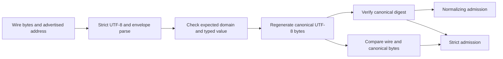

# RT-05 — Admit exact typed bytes at an identity boundary

## Question and method

How should a receiving store verify an advertised typed address when multiple serialized inputs decode to the same value? The [portable identity fixture](RT-05-PORTABLE-IDENTITY-BYTES.md) compares encoding from typed values. This replay starts with raw bytes and checks both strict byte admission and normalization at ingestion. It reuses the existing Python and JavaScript encoders, with new independent byte decoders and admission logic in each runtime. [PLAN §1.2](../../../PLAN.md#12-semantic-identity-hashes-and-canonical-encoding) · [#289](https://github.com/aivibeflow/LLMLang/issues/289) · [LL-004](../../../PLAN.md#ll-004--choose-canonical-encoding-and-hash-algorithm-policy)

The tested frame carries an expected domain, algorithm and digest separately from its raw UTF-8 JSON bytes. The profile admits a tagged array envelope with an exact version marker, domain, and typed value. Its typed map keys sort by UTF-8 bytes. Scalar text retains exact Unicode scalar spelling. The tested address format uses lowercase 64-digit hexadecimal SHA-256.

- Strict admission decodes the envelope and typed value, regenerates canonical bytes, and requires those bytes to match the supplied wire and its digest.
- Normalizing admission accepts an alternate wire spelling only when the regenerated typed bytes match the advertised canonical digest.
- The raw-digest control checks only the algorithm and digest of the wire bytes.



## Results

Python and JavaScript agree with the expected outcomes for all 31 wire fixtures under all three admission models.

| Admission model | Accepted | Rejected |
| --- | ---: | ---: |
| Strict canonical bytes | 9 | 22 |
| Normalize and verify canonical digest | 16 | 15 |
| Verify raw digest alone | 20 | 11 |

The 31 fixtures include six identity domains on the same typed value, Unicode map-key permutations, insignificant JSON whitespace, alternate escapes, invalid encodings and inconsistent advertised addresses. The normalizing route accepts seven alternate wire spellings under the canonical digest, including five rearranged key orders, escaped Unicode and whitespace. An unsorted map advertised under its own raw digest fails both typed routes. These routes accept distinct composed and decomposed scalar spellings under their distinct canonical addresses.

The raw-digest control accepts 11 inputs that strict typed admission refuses. They include the unsorted raw-addressed map, a digest-correct object presented under a wrong domain, malformed UTF-8, duplicate typed keys and a bare integer outside the portable number representation. The digest binds the supplied bytes in those fixtures. Schema, type and domain checks give the receiver the separately required interpretation.

The fixture distinguishes a transport preprocessor that explicitly normalizes incoming content from a content store that admits only exact canonical bytes. Ingestion can normalize before publication if the result is then stored and checked at its canonical address. The operation and evidence markers remain distinct preimages for the same payload. The experiment leaves production schema, Unicode identifier policy, untrusted input limits, digest registry and cryptographic assumptions open. It does not select a hash algorithm or a migration path.

## Reproduce

The baseline was `56e2e13b61fcad8ae8038f49f51e1ed1a65ca5b3` on `research/all`. The host ran Debian 13 x86-64 Linux 6.18.57 with CPython 3.12.14 and Node v24.22.3. Run from the repository root:

```sh
fixture=research/semantic-representation/RT-05/CANONICAL-WIRE-01
out=$(mktemp)
python3 -B "$fixture/run.py" > "$out" &&
  cmp "$fixture/evidence.json" "$out" &&
  python3 -B "$fixture/chart.py" &&
  python3 -B research/semantic-representation/PROTOTYPES/IDENTITY-BYTES-01/compare.py
```

The [ledger](CANONICAL-WIRE-01/evidence.json) preserves the raw hex strings, addresses and all dispositions. The [table generator](CANONICAL-WIRE-01/chart.py) renders the categorical comparisons. The existing encoder suite also passed all 127 comparisons under the replay runtimes. [Python runner](CANONICAL-WIRE-01/run.py) · [JavaScript receiver](CANONICAL-WIRE-01/decode.mjs)
