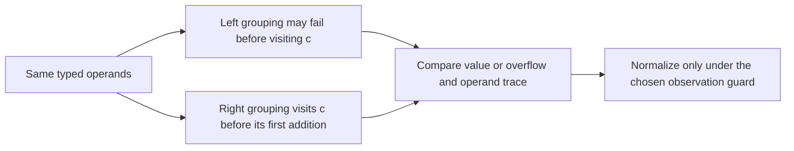

# RT-05 — Reassociate checked additions only under the relevant observation contract

## Question and method

Can canonicalization remove the grouping of a three-term sum without changing its meaning? The [numeric semantics survey](../../language-design/RT-03/RESEARCH-SCENARIO-45-NUMERIC-SEMANTICS-AND-OVERFLOW.md) distinguishes wrapping and checked arithmetic. This study tests grouping in a strict expression model with ordered observations of operand evaluation. The baseline is `1c8ba4aa5d41c82d0e18e7b3895dee075509450a` on `research/all`.

The two trees are `(a+b)+c` and `a+(b+c)`. Evaluation proceeds left to right. Visiting an operand records its position. In the checked profile, an out-of-range intermediate sum stops the evaluation and yields one overflow result. In the wrapping profile, addition is total on the fixed-width domain. The tests compare value or overflow alone and the pair of that outcome with all visited operand positions.

Let `L` mean `a+b` fits the range, `R` mean `b+c` fits, and `F` mean the mathematical sum of all three fits. For checked arithmetic, the exact equality conditions in this model are different:

- The value-or-overflow outcomes agree when `¬F ∨ (L ↔ R)`.
- The complete observations agree when `L ∧ (R ∨ ¬F)`.

If the left intermediate sum overflows, the third operand is skipped. The right tree always reaches the third operand before either addition can overflow. When both intermediates fit, the trees agree even if the final checked addition fails.



## Results

The executable evaluator enumerates all 4,096 triples of signed four-bit operands in the range −8 through 7. It independently checks each derived equality condition against the executable tree observations.

| Comparison | Cases |
|---|---:|
| Wrapping trees agree on result and trace | 4,096 |
| Checked trees disagree on value or overflow | 672 |
| Checked trees agree on value or overflow but disagree on trace | 688 |
| Checked trees disagree on the complete observation | 1,360 |
| Both partial sums are in range | 2,392 |
| Both partial sums are in range but the final sum fails | 344 |

Two witnesses separate the failures. For `(7,1,-1)` the left grouping overflows and the right returns seven. For `(7,1,1)` both overflow, but the left skips the last operand. A digest that erases grouping under this observation contract would collapse both pairs. [Counts and witnesses](CHECKED-REASSOCIATION-01/evidence.json)

Lean checks the two exact equality conditions for the modeled checked operator, the sufficient guard that both partial sums fit, and both distinguishing examples. The three characterization or guard theorems use only `propext`. The two examples have no axiom dependencies. The theorem model assumes that leaves themselves produce their supplied values and the recorded visits. It leaves backend correspondence, other arithmetic profiles, operand failure and additional effect observations open. [Lean source](CHECKED-REASSOCIATION-01/Reassociate.lean)

These results define a scoped normalization rule. A wrapping profile can use the grouping-free representation within the tested finite model. A checked profile needs to preserve grouping or supply a semantic guard that covers the admitted inputs and observations. The trace comparison controls whether an interrupted computation can be treated as the same failure. [RT-05 tracking](https://github.com/aivibeflow/LLMLang/issues/288)

## Reproduction

Use CPython 3.12.14 and Lean 4.36.0 at `611c117bfaf7b7ae1cfcf246ce6fba31e8f509e9`. The [runner](CHECKED-REASSOCIATION-01/run.py) records exact source hashes, the complete domain, observed counts and the Lean axiom report. Hash seeds 1 and 2 produced identical bytes. The diagram was checked as Mermaid source.

```bash
fixture=research/semantic-representation/RT-05/CHECKED-REASSOCIATION-01
LC_ALL=C PYTHONHASHSEED=1 python3 -B "$fixture/run.py" --lean "$(command -v lean)" \
  > /tmp/llmlang-rt05-reassociation.json
cmp "$fixture/evidence.json" /tmp/llmlang-rt05-reassociation.json
```
