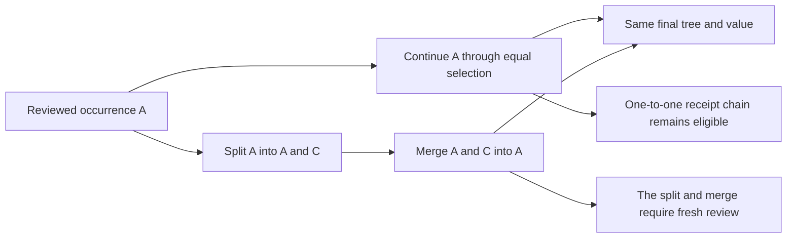

# RT-05 — Occurrence review across composed split and merge histories

A split followed by a merge can return to the same Git tree, selection revision, stable ID and immutable value. In the fixture that history still requires a new occurrence review. A rule that follows only exact, one-to-one continuations with unchanged review inputs distinguishes the history from a genuinely continued occurrence.

## Experiment

A fixture review covers one managed occurrence, its immutable value and its semantic context. Under the declared policy it can follow a one-to-one continuation while the value and context remain unchanged. A semantic split or merge needs fresh review. Review evidence here is a synthetic input to compare transfer rules.

Twelve native Git histories hold the selected slot, stable ID, alias, value and context in a tracked fixture file. Each record reconstructs its value and context hashes in a fresh content store. Separately retained experiment receipts bind typed selection relations to exact parent and child commit IDs and the two reconstructed selection revisions. The existing RT-05 comparison validates the cardinality and unique endpoints of each relation. The runner compares value-and-context equality, the same equality with a stable ID, unrestricted reachability through typed relations, and exact one-to-one continuation at every retained edge. It compares each policy with predeclared eligible selections.



## Results

| Policy | Excess successor grants | Missing eligible grants | Unknown histories |
| --- | ---: | ---: | ---: |
| exact-continuation | 0 | 0 | 2 |
| reachable | 6 | 0 | 1 |
| stable-id | 7 | 0 | 0 |
| value | 20 | 0 | 0 |

Counts are successor selections granted beyond the four predeclared eligible selections or omitted from them. The last column counts entire histories with insufficient evidence. Alias-only change, a move with the same semantic context, one explicitly continued original beside an independent copy, and a continued equal selection all preserve the bounded review. Value equality also grants unrelated equal-value selections. Matching a stable ID omits the history of a split, merge, restored context or reused ID. Reachability follows both split outputs and a merge with an independently managed occurrence.

The actual merge of split outputs, a delete/recreate history and context change followed by restoration end at exactly the same selection file as the baseline. The exact gate rejects reuse on each path. A separate control binds a valid relation to an earlier commit with the same selection revision as the true parent. Revision-only lineage accepts that stale receipt. Exact commit binding and missing lineage both produce unknown. The ledger retains path commits, Git trees, rule decisions and a digest of the admitted receipt chain.

## Implementation boundary

Occurrence review and value-bound analysis have different reuse conditions. A system with stable entity IDs can encode lifecycle continuity through allocation and retirement rules, or carry scoped lineage receipts when an occurrence moves. This experiment compares endpoint ID equality with explicit composed evidence. It does not test an allocator that rejects ID reuse. The fixture uses linear Git history with logical split and merge relations. Authorization of relation issuers, later review of a split, Git multi-parent reconciliation and production SPG admission remain open.

## Reproduce

Use Git 2.52.0 and CPython 3.12.14 from the repository root. The test uses temporary repositories with fixed author metadata and timestamps.

```sh
fixture=research/semantic-representation/RT-05/COMPOSED-LINEAGE-01
output=$(mktemp)
python3 "$fixture/run.py" --output "$output"
cmp "$fixture/evidence.json" "$output"
python3 "$fixture/chart.py"
```

[Runner](COMPOSED-LINEAGE-01/run.py) · [Evidence ledger](COMPOSED-LINEAGE-01/evidence.json) · [RT-05 lifecycle comparison](RT-05-IDENTITY-LIFECYCLE-EXPERIMENT.md) · [Selection continuity in native Git](../../toolchain-and-collaboration/RT-24/RT-24-GIT-SELECTION-LIFETIMES-2026-11-24.md)
