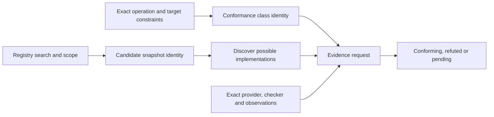

# RT-05 — Conformance class, discovery snapshot and evidence identity

## Question and scope

Which changes affect the identity of a class of compatible implementations, and which changes affect discovery or the current ability to establish membership? The [glossary proposal](../../../draft/GLOSSARY.md#conformance-class-hash-cchash) gives these separate meanings. This fixture tests the split against the full source-bound [native operation cohort](RT-05-PERMISSIVE-OPERATION-IDENTITY-2026-11-25.md). It uses archived native outcomes and a new decoder/checker for their correlated return and ordered trace. [PLAN §1.2](../../../PLAN.md#12-semantic-identity-hashes-and-canonical-encoding) · [#289](https://github.com/aivibeflow/LLMLang/issues/289)

Each class definition commits the exact operation address, required target, maximum event count and membership criterion. The baseline is the wrapping operation on Linux x86-64 with up to three events. Three controls change the event constraint to two, switch to the saturating operation, or require AArch64. This last case checks the existing x86-64 builds against a different target requirement. It gives no information about artifacts built for AArch64.

For one class, four discovery snapshots vary the returned implementations, their order and the search scope. The fixture also compares requests for each exact class and native implementation while varying its available evidence. The fixture checker recalculates the 256 membership observations to create the exact records. The controls withhold a record or change the class address, implementation address, checker revision or input ledger digest. These are local records in a trusted harness.



## Results

Discovery initially returns two candidates and one with established finite membership. Adding a provider increases those counts to three and two, and changes the candidate snapshot hash. Reordering the same set preserves that hash. Changing only the search scope changes it again. All four snapshots query the same class. A changed contract interpretation, target or event constraint creates a different class with a different finite membership predicate. The symbolic relation template has one digest across the classes. The interpreted contract has two digests, one per arithmetic context. Changing the class constraint or target retains the wrapping contract digest.

| Class | Conforming | Refuted | Pending |
| --- | ---: | ---: | ---: |
| wrap-general | 3 | 2 | 25 |
| wrap-short | 1 | 4 | 25 |
| saturate-general | 3 | 2 | 25 |
| wrap-aarch64 | 0 | 5 | 25 |

All 100 missing or mismatched record cases leave the request pending. The 20 exact records yield seven conforming and 13 refuted outcomes under the declared class. The two-event class admits only the stay provider in the fixture. Its stricter trace constraint leaves the wrapping operation definition itself intact. A pending record does not determine whether the implementation satisfies the underlying membership predicate.

| Reuse key | Request pairs with the same key and different dispositions |
| --- | ---: |
| Class alone | 516/7,140 |
| Class and implementation | 100/7,140 |
| Class, implementation and exact evidence inputs | 0/7,140 |

Class and implementation identify the claim whose membership is in question. Current evidence availability remains part of the decision to establish that claim. An exact evidence request also commits to the checker and observation ledger. Registry enumeration on its own does not establish membership, and an exact addressed implementation can be the subject of a membership check without depending on discovery order.

## Reproduce and limits

The baseline was `194d14896509e551bc916fc30f4f78507c8d6b12` on `research/all`. The [archived native ledger](OPERATION-IDENTITY-01/evidence.json) has SHA-256 `61c4d7bf9d35c8eee5ebf42265eaf4cfc1fc2d6242f2d45ff09ba5fceb2d84c7`. Its report contains the native replay and Lean commands. This separate checker ran on Debian 13 x86-64 Linux 6.18.57 with CPython 3.12.14:

```sh
fixture=research/semantic-representation/RT-05/CONFORMANCE-CLASS-IDENTITY-01
out=$(mktemp)
python3 -B "$fixture/run.py" > "$out" &&
  cmp "$fixture/evidence.json" "$out" &&
  python3 -B "$fixture/chart.py"
```

The [ledger](CONFORMANCE-CLASS-IDENTITY-01/evidence.json) records the 120 requests, class and snapshot identities, and exact dispositions. The [table generator](CONFORMANCE-CLASS-IDENTITY-01/chart.py) renders the categorical class outcomes. The fixture supports the separation of class definition, discovery snapshot and evidence. It leaves authority and revocation, effects beyond the observed event sequences, independent ecosystem completeness and canonical production encoding open. [Runner](CONFORMANCE-CLASS-IDENTITY-01/run.py)
