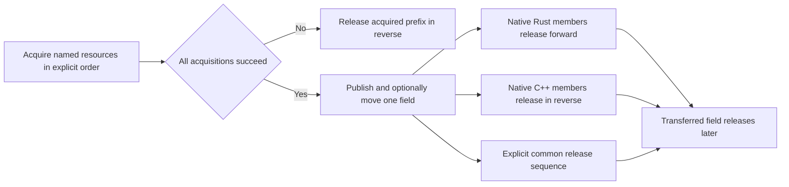

# Cross-profile identity for named-record teardown

This RT-05 and RT-04 experiment compares implicit record destruction in Rust and C++ with an explicit cross-profile cleanup sequence. It asks when a semantic graph can share an exact body across profiles even though each compiler has native rules for completed member destruction. The observables distinguish failure during acquisition, successful publication, release at the record scope and release of a moved field.

## Profile alternatives

The fixture stages acquisitions of three unique owned tokens before building a record. All six acquisition orders and six field declaration orders are tested independently. Rust propagates a fixture `Result` with `?`. C++20 throws and catches a fixture error. Both record the first failed field. Each successful acquisition has one observable release. A program can retain any one field across the record's scope. The remaining fields release before a separate marker. The moved field releases after that marker.

The native route relies on Rust struct field destruction and C++ destructor order for aggregate members. The explicit route moves each remaining holder to a release operation in the specified sequence, leaving its original slot empty. In both languages a transferred field leaves its record slot empty. In C++ the token's move operation makes the old token inert. The contract models a nonthrowing release and permits no extra side effect from dropping an empty or moved-from holder.



The exact graph separates named roles, acquisition, early cleanup, completed cleanup and transfer. A named release sequence is included in body identity when observable. Toolchain-specific build identity and physical layout are outside this graph projection.

## Measured comparison

Each profile runs 72 sources at optimization levels zero and three, with eight failure masks and four transfer choices. Both optimizations agree in their own profile, for 9,216 native executions. The separately derived oracle and the evaluator of stored exact graphs agree with every native result. Every acquired token releases exactly once in the observed runs.

The table pairs Rust and C++ by declaration order, acquisition order, teardown route and input. Each route includes 36 source pairs, 1,008 early-exit input pairs and 144 successful input pairs.

| Route | Shared exact graphs | Early-exit disagreements | Completed disagreements |
|---|---:|---:|---:|
| Native implicit teardown | 0/36 | 0/1008 | 144/144 |
| Explicit ordered teardown | 36/36 | 0/1008 | 0/144 |

Implicit native cleanup agrees on all failure paths. On success Rust drops remaining members in declaration order and C++ drops them in reverse. The profile-derived graphs therefore differ for all 36 source pairs with implicit teardown. An identity that elides completed release order would equate programs with differing traces. The explicit sequence makes both native profiles agree on every observed path and gives the same exact graph for all 36 source pairs. No change is needed to the independent lifetime of the transferred field.

## Limits and replay

The comparison covers staged construction of a three-token record, infallible traced release, one optional move and two local compiler configurations per language. It does not establish interoperability for throwing destructors, cancellation, custom aggregate cleanup, ABI layout, foreign calls, callbacks, or compiler lowering beyond this closed generator. General SPG source correspondence and independent review remain open. A candidate architecture can retain a common exact graph where it lowers an explicit common cleanup sequence, and separate profile-dependent meanings where native cleanup remains observable.

Use CPython 3.12.14, Rust 1.85.1 and Debian GCC/G++ 14.2.0-19 on x86-64 Linux. The initial LLMLang base is `c05b3ab72b55059d8c300afc7c5c7ec0ea45b886`. The ledger records compiler versions and targets, exact generated source hashes and per-input traces. Run from the repository root.

```bash
fixture=research/semantic-representation/RT-05/CROSS-PROFILE-CLEANUP-01
PYTHONHASHSEED=1 python3 -B "$fixture/run.py" > /tmp/llmlang-rt05-cross-profile-cleanup.json
cmp "$fixture/evidence.json" /tmp/llmlang-rt05-cross-profile-cleanup.json
python3 "$fixture/chart.py"
```

See the [source generator and runner](CROSS-PROFILE-CLEANUP-01/run.py), [measured ledger](CROSS-PROFILE-CLEANUP-01/evidence.json), [table generator](CROSS-PROFILE-CLEANUP-01/chart.py), and [RT-04 disposal scenarios](../../language-design/RT-04/RESEARCH-SCENARIO-75-AUTOMATIC-DISPOSAL-AND-LIFETIME.md).
