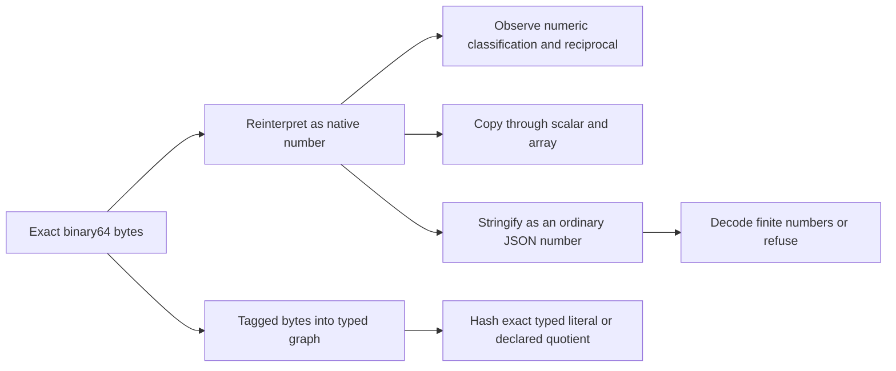

# Compare exact and numerical F64 identity across runtimes

Binary64 has distinct encodings for positive and negative zero and many encodings for NaN, which represents a result outside the ordinary numerical domain. A typed graph can retain those encodings, or it can identify values according to a stated observation contract. This experiment measures how four identity and wire policies affect exact reconstructability and selected numeric observations. [Floating-point reproducibility survey](../../language-design/RT-03/RESEARCH-SCENARIO-78-FLOATING-POINT-REPRODUCIBILITY-AND-IEEE-EDGES.md) · [Cross-runtime I64 encoding](RT-05-CROSS-RUNTIME-I64-ENCODING-2026-11-25.md)

## Encodings and observations

The literal corpus has 210 distinct binary64 words. It contains 2 zeros, 6 subnormal values, 174 normal values, 2 infinities and 26 NaNs. It includes both signs, quiet and signaling NaN encodings with multiple payloads, directed boundary values and 160 deterministic finite draws. The typed fixture hashes its fixed big-endian bytes under an `F64` study domain. This hash only identifies a literal in the fixture.

Each native numeric observation records the classification, whether the value equals itself, and the IEEE reciprocal bits. A NaN reciprocal is observed as a common `nan` marker. Rust and Node execute the reciprocal on the native value. CPython independently unpacks the bytes and evaluates the nonzero inputs. Its oracle supplies signed infinity for zero using the input sign because Python division by zero raises. Separately, each runtime observes bits after a scalar copy and a single-element array or list round trip. These paths separate ordinary numeric observations from exposure of the exact literal bits.



The exact policy stores a lowercase hexadecimal string of exactly 16 digits tagged as binary64. A tagged NaN-normalizing policy maps every NaN to one canonical quiet NaN and retains the sign of zero. A second quotient follows SameValueZero, the equality used by JavaScript `Set`, and additionally merges both zeros. The fourth policy uses ordinary Node `JSON.stringify` and admits only finite JSON numbers at the receiver. CPython independently consumes each JSON number wire value, and both Node modes check the tagged format and sixteen control messages.

## Native outcomes

| Identity and wire policy | Accepted | Refused | Changed literal bits | Changed numeric vectors | Merged literal pairs | Merged numerically distinct pairs |
|---|---:|---:|---:|---:|---:|---:|
| Tagged exact bits | 210 | 0 | 0 | 0 | 0 | 0 |
| Canonical NaN with signed zero | 210 | 0 | 25 | 0 | 325 | 0 |
| SameValueZero quotient | 210 | 0 | 26 | 1 | 326 | 1 |
| Ordinary JSON number | 182 | 28 | 1 | 1 | 1 | 1 |

The pair counts cover the 21,945 unordered pairs of distinct literals. The numerical vector retains reciprocal sign. `+0` and `−0` compare equal while their reciprocals are different infinities. The SameValueZero projection yields the same 184 keys as Node's native `Set`, so the quotient merges that observed distinction. Canonicalizing only NaNs retains the sampled numeric vector and discards the NaN representation distinctions. The exact policy retains both. Bare JSON turns nonfinite numbers into `null` and emits `0` for negative zero. The raw negative-zero control `-0` retains its sign in Node and loses it when CPython parses it as an integer before converting to binary64. The spelling `-0.0` preserves it in both decoder checks.

| Native profile | Changed after scalar bit copy | Changed after array round trip |
|---|---:|---:|
| Node default | 0 | 12 |
| Node without JIT | 0 | 12 |
| Rust O0 | 0 | 0 |
| Rust O3 | 0 | 0 |
| CPython | 0 | 0 |

Every profile reports the same numeric vector on each of 210 originals. The Node `DataView` scalar path preserves every original bit word. Its JavaScript array path changes all 12 signaling NaNs into quiet encodings in both settings. For example `7ff0000000000001` becomes `7ff8000000000001`. The observed Rust and CPython array or list copies retain the input words. The tagged binary path carries a checked word without relying on V8's representation of a numeric array element.

## Constraints and replay

If literal bits can be observed, the encoding can retain them separately from native numeric storage. A NaN-normalizing identity is compatible with the measured numeric profile if observation excludes the NaN representation. An identity that merges signed zeros requires an observation contract that also removes the tested reciprocal distinction. Ordinary finite JSON input can have a smaller interoperable range of representation than the exact typed format. General floating-point arithmetic semantics, signaling and status flags, optimizations, architectures, cross-language ABI, canonical graph adoption and independent review remain open.

Use CPython 3.12.14, Node 22.23.5 with V8 12.4.254.21-node.57, and Rust 1.85.1 at `4eb161250e340c8f48f66e2b929ef4a5bed7c181` on Linux x86-64. The initial LLMLang baseline is `ebecbdd6f7a24d8d5dc2555051d61d276d233c5d`. The ledger includes native versions, source digests, exact encodings, classification, reciprocal bits, graph keys, and decoder controls.

```bash
fixture=research/semantic-representation/RT-05/CROSS-RUNTIME-F64-01
PYTHONHASHSEED=1 python3 -B "$fixture/run.py" > /tmp/llmlang-cross-runtime-f64.json
cmp "$fixture/evidence.json" /tmp/llmlang-cross-runtime-f64.json
python3 "$fixture/chart.py"
```

[Native Node](CROSS-RUNTIME-F64-01/observe.js) · [Native Rust](CROSS-RUNTIME-F64-01/observe.rs) · [Corpus and policy runner](CROSS-RUNTIME-F64-01/run.py) · [Observation ledger](CROSS-RUNTIME-F64-01/evidence.json) · [Table generator](CROSS-RUNTIME-F64-01/chart.py)
