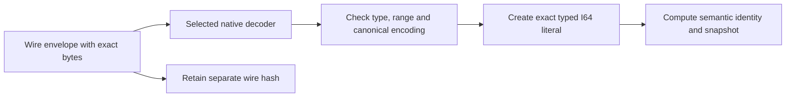

# Preserve exact signed integers across SPG wire adapters

This RT-05/24 experiment compares the transport of signed 64-bit literals across CPython and Node. A decoder can silently change a value before the semantic graph hashes it. The study checks which proposed encodings preserve exact numeric values and a complete typed SPG snapshot, while separately comparing their serialized sizes and canonical forms.

## Formats and model

The logical type is `I64`. A semantic observation hashes a domain prefix and eight signed big-endian bytes. Each adapter result is also imported as an immutable typed literal at a fixed logical slot using LLMLang's existing ContentStore. Rendered wire bytes have their own hash, and the chosen transport tag remains outside this literal's semantic identity.

The experiment uses a two-field JSON envelope. Its payload is a bare decimal number, a decimal string or 16 lowercase hexadecimal digits in big-endian two's-complement order. The Node routes compare ordinary `JSON.parse` and `Number`, the safe-integer restriction, original numeric token text from the parse reviver, decimal text to `BigInt`, and hexadecimal to signed `BigInt`. The exact routes verify the signed range and canonical envelope bytes. A Python decoder independently interprets all three encodings and checks the same fixtures.



The fixed corpus contains 181 values near 32-bit and 53-bit boundaries, both signed endpoints, small numbers and 40 reproducible full-width values generated from fixed digest inputs. Every route also receives 22 controls. They include decimal point and exponent spellings, negative zero, duplicated or reordered fields, escaped aliases, unsigned overflow, below-minimum numeric text and invalid hexadecimal widths. The strict canonical envelope rejects aliases for the same semantic value.

## Results

The table gives counts for the finite corpus. Wrong values count accepted results whose exact extracted integer differs. A merged pair has two distinct accepted inputs with the same resulting decoded value. The wire-byte denominator is all 181 authored envelopes in that route.

| Decoder | Accepted values | Wrong values | Distinct pairs merged | Noncanonical or invalid controls accepted | Wire bytes |
|---|---:|---:|---:|---:|---:|
| Default JavaScript Number | 172/181 | 56 | 46 | 7 | 7,321 |
| Safe-integer subset | 105/181 | 0 | 0 | 0 | 7,321 |
| Exact numeric source lexeme | 181/181 | 0 | 0 | 0 | 7,321 |
| Canonical decimal text | 181/181 | 0 | 0 | 0 | 7,864 |
| Fixed-width hexadecimal | 181/181 | 0 | 0 | 0 | 7,602 |

Default `Number` accepts 172 values, changes 56 of them and collapses 46 distinct pairs before hashing. Restricting to safe integers avoids erroneous accepted values and covers 105 inputs. The exact lexeme route, decimal text and hexadecimal reproduce all 181 values and exactly the same complete SPG snapshot as the Python baseline. All three reject the 22 invalid or noncanonical controls.

Keeping the original numeric token preserves the smallest wire size in this fixture and requires the runtime's source-lexeme capability together with exact validation. Decimal text works through the usual string interface. Fixed-width hexadecimal gives an explicit byte representation and is smaller than the decimal-text form on this mixed-width sample. Encoding cost depends on the value distribution.

## Limits and replay

The sample tests one integer type, a deliberately small JSON envelope and pinned Node and Python versions. It leaves general object canonicalization, other scalar types, syntax tooling, arbitrary nesting, package integration and independent review open. A production format choice needs broader encoding coverage and explicit decoder capability guarantees. The observed compatibility depends on choosing an exact decoder before deriving the graph identity.

Use CPython 3.12.14 and Node 22.23.5 with V8 12.4.254.21-node.57. The initial LLMLang baseline is `e9bcee946cd85871d258177a46674f2be19c9c12`. The ledger pins both decoder sources, exact wire and semantic hashes, reconstructed graph roots and all native outcomes. Replay from the repository root.

```bash
fixture=research/semantic-representation/RT-05/CROSS-RUNTIME-I64-01
PYTHONHASHSEED=1 python3 -B "$fixture/run.py" > /tmp/llmlang-rt05-i64.json
cmp "$fixture/evidence.json" /tmp/llmlang-rt05-i64.json
python3 "$fixture/chart.py"
```

See the [Node decoder](CROSS-RUNTIME-I64-01/decode.js), [Python oracle and runner](CROSS-RUNTIME-I64-01/run.py), [measured ledger](CROSS-RUNTIME-I64-01/evidence.json), and [table generator](CROSS-RUNTIME-I64-01/chart.py).
