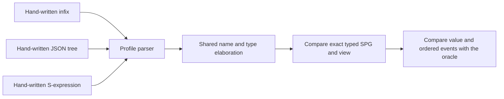

# Verify that multiple syntaxes can represent one typed SPG

**Scope:** PLAN §1.1, [#288](https://github.com/aivibeflow/LLMLang/issues/288). Closed expression subset at `cfed7169d95ba816b98ce77a59f5f339fcf3c141` on `research/all`.

## Question and method

Can distinct surface syntax forms represent one exact typed Semantic Program Graph when declarations and elaboration rules are held fixed? [RT-31](../../language-design/RT-31/RT-31-CROSS-PROFILE-SPG-2026-11-24.md) tested three frontends using source generated from a common expression tree. We replay that corpus and add a set of hand-written inputs outside the shared generator. The same name and type elaborator resolves each abstract term. Graph equality in this study means equality of the serialized graph bytes.

The three profiles are infix text, a JSON expression tree, and an S-expression. The [six source bodies](CROSS-SYNTAX-SPG-01/sources.json) describe a lazy branch whose true path emits two ordered events and calls a provider. One group uses an operation binding, and the other group names the primary implementation exactly. The branch and provider contracts are fixed inputs. A separate observation table calculates the result and ordered event list without inspecting the graph.



A backend-specific representation could keep each surface tree as its semantic graph. That would avoid an elaboration boundary but would leave common identity and comparison dependent on surface spellings. Here the normalized typed graph supports shared identity for the scoped inputs. The source strings can still carry their own provenance.

## Results

The original runner reproduced its entire byte-for-byte ledger, SHA-256 `4788a42753933dccd37a1afa9851b3321202f9ff1127bc191f29b835837bd934`. It covers 32 program configurations, nine ordered syntax-profile conversions and 4,032 result/trace observations, plus syntax, typing and effect-order negative controls.

All hand-written profiles produced the same canonical graph bytes within each of the following four configurations. Each row covers 14 inputs per syntax, giving 168 checked observations in total. For a false condition, every configuration returns `x − 2` with the single event `fallback`.

| Call form | Catalog selects | True branch result | Ordered events |
| --- | --- | ---: | --- |
| Operation binding | Primary | −3 | left, right, compute |
| Pinned implementation | Primary | −3 | left, right, compute |
| Operation binding | Alternate | 8 | left, right, compute |
| Pinned implementation | Alternate | −3 | left, right, compute |

The operation and pin groups have different graph identities even under the primary binding, where every tested observation matches. The alternate binding distinguishes their execution. This control prevents interpreting same observations under one catalog as sufficient evidence of graph identity. The [machine-readable output](CROSS-SYNTAX-SPG-01/evidence.json) records all 168 observations and all four graph digests.

The existence of multiple syntaxes for the same graph is established for these expression profiles under the stated elaboration and declarations. The fixture does not claim equivalence for arbitrary source, whole-language syntax, ownership, module systems, effects outside the traced fragment, representability of every SPG, or general SPG-to-source reconstruction. The decision about which syntax profiles to support remains open.

## Reproduce

Run with CPython 3.12.14 and Git 2.56.1. Both the [RT-31 runner](../../language-design/RT-31/CROSS-PROFILE-SPG-01/run.py) and the [hand-written control runner](CROSS-SYNTAX-SPG-01/observe.py) use the exact archived elaborator.

```sh
set -eu
scratch=$(mktemp -d)
git archive cfed7169d95ba816b98ce77a59f5f339fcf3c141 research | tar -x -C "$scratch"
upstream="$scratch/research/language-design/RT-31/CROSS-PROFILE-SPG-01"
python3 -B "$upstream/run.py" --output "$scratch/upstream.json"
cmp "$scratch/upstream.json" "$upstream/evidence.json"
fixture=research/semantic-representation/RT-05/CROSS-SYNTAX-SPG-01
cp -R "$fixture" "$(dirname "$scratch/$fixture")/"
python3 -B "$scratch/$fixture/observe.py" > "$scratch/observations.json"
cmp "$scratch/observations.json" "$fixture/evidence.json"
```

The counts enumerate the stated fixtures. Mermaid source was inspected directly.
