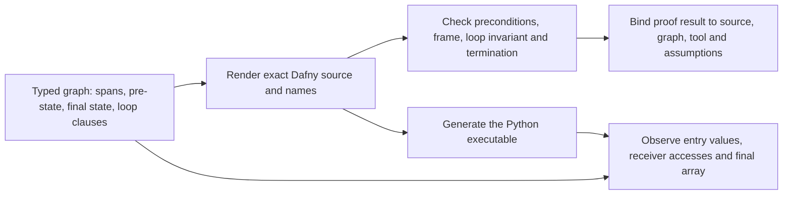

# Map a typed overlapping-copy contract to Dafny

A typed Semantic Program Graph (SPG) can describe a copy that reads old values from one interval of a mutable array and writes them to another. Overlap makes the ordering of reads and writes significant. A graph contract also needs to distinguish the final values outside the destination from the set of locations written during execution. This study maps one candidate contract graph into checked Dafny obligations and compares two implementations and two controls. [Dafny candidate contract core](../../DAFNY-TRANSFER-ANALYSIS.md#3-candidate-contract-core) · [Mutable reference topology](RT-05-MUTABLE-REFERENCE-TOPOLOGY-2026-11-25.md)

## Supported graph and translation

The inputs are a mutable array of mathematical integers and natural-number source, destination and length. Both intervals are half-open and must fit inside the same array. The postcondition copies the source's pre-state values into the destination and keeps every other element equal to its pre-state value. Source and destination regions share the same receiver identity. The execution assumptions are a sequential call without another array writer and unbounded integer values. The graph records these assumptions explicitly.

The supported graph contains span bounds, an optional forward-overlap guard, an old-state value projection, a pointwise final-state condition, an object-level Dafny `modifies` target, and typed identifiers for the read and write intervals. Loop clauses name the processed prefix or suffix and the natural measure that decreases. The renderer emits those requirements, invariants and measures for a fixed body template. Unknown types, frame shapes, invariants or assumptions are refused. It renders the same graph with two sets of Dafny parameter names. Their source hashes differ and the graph hash is shared.

A Dafny `modifies` clause controls which object may be changed. It does not specify which array elements keep their old state. The generated full contract expresses element preservation explicitly. The span projection is checked separately from the proof of final values, using actual accesses to the generated Python array. This fixture does not emit a universal access-trace theorem from the graph's span fields.



## Implementations and controls

- **Snapshot copy** captures a sequence of the source span and writes it in forward order. The invariant fixes the captured sequence and states that the processed prefix has the expected values. The extra sequence stores one value per copied element.
- **Directional copy** reads the array directly. It copies forward if the destination is at or before the source and backward otherwise. The active invariant marks the processed prefix or suffix. A directed proof step establishes that the next source element was outside the portion already changed. The invariant's old array is ghost state, erased by the compiler.
- **Forward copy** requires `destination <= source || source + length <= destination`. The verifier rejects a generated control that drops this premise. The harness deliberately calls the same compiled body on out-of-scope but valid array coordinates to observe the effect of ignoring the premise.
- **Snapshot with an extra write** satisfies a destination-only postcondition and `modifies array`. When the destination starts after index zero, it increments element zero. The verifier rejects adding the full outside-destination postcondition to this body. Its execution shows why a destination-only contract cannot represent the full graph contract.

## Results

Both Dafny source profiles pass eight verification units with each of Z3 4.12.1 and 4.14.1. Both solvers reject the two negative graph mutations. The renderer also refuses an unsupported write-span change before generation. The proof receipts have one typed graph digest and separately bind the exact emitted source, method contracts, verifier distribution, solver, flags and assumptions.

The executable corpus has 5,663 cases per source profile. It covers all arrays of length up to four with elements from `{−1, 0, 1}` and every legal span pairing, yielding 5,407 cases. Another 256 seeded cases use lengths from five to 32 and wider integer values. Both generated Python profiles agree on every final array and ordered access trace. The table counts cases, so one case with several out-of-span operations counts once.

| Generated route | Final arrays different from specification | Accesses outside declared spans | Traces different from snapshot |
|---|---:|---:|---:|
| Snapshot copy | 0 | 0 | 0 |
| Directional copy | 0 | 0 | 1,505 |
| Forward copy without applying its precondition | 254 | 0 | 1,505 |
| Snapshot with an extra write under coarse frame | 4,045 | 4,045 | 4,045 |

The verified forward precondition admits 5,337 cases and refuses 326. The forward implementation matches the full array specification in every admitted case. Ignoring the premise changes 254 final arrays. The other 72 refused cases happen to match on their particular values. Separate evidence is required to extend the verified domain.

For input `[−1, 1, 0]` with source zero, destination one and length two, the snapshot reads positions 0 and 1 before writing positions 1 and 2. Directional copy reads 1, writes 2, reads 0, then writes 1. Both produce `[−1, −1, 1]`. The unchecked forward body writes over its next source before reading it and returns `[−1, −1, −1]`. The weak-frame body copies correctly then changes index zero, returning `[0, −1, 1]`.

Under final-array observation, the snapshot and directional implementations meet the same Dafny contract. If LLMLang exposes operand-level memory order, the observed traces distinguish the two in 1,505 cases. The graph needs an explicit choice of observation boundary before treating them as interchangeable. A pointwise frame constraint rules out the observed extra write through its final value. Prohibiting an outside write even when restored requires an access-level guarantee.

## Limits and replay

This is a restricted candidate graph and emitter for one Dafny method family. It supplies typed preconditions, postconditions, final-state frame clauses, explicit observations, loop invariants, termination measures and ambient assumptions. The generated Dafny verifier results cover the exact emitted source. The Python corpus checks concrete graph-to-source observations and name independence. A general source-to-Dafny correctness theorem, generalized heap ownership, interference, verified trace correspondence, exact allocation cost, LLMLang source syntax and independent review remain open.

The initial repository baseline is `2c97691651ab9fa7bb3fd8bf79802e8af4b0654e`. Replay uses Dafny 4.11.0 at `fcb2042d6d043a2634f0854338c08feeaaaf4ae2`, its bundled Z3 4.12.1 and 4.14.1, and CPython 3.12.14 on Linux x86-64. The runner checks the official distribution archive and installed verifier and solver files against it. Verification uses one worker and a 20-second limit per obligation batch. The ledger contains exact inputs, final arrays, per-case trace digests, the full distinguishing trace, generated code hashes and proof receipts. [Dafny release](https://github.com/dafny-lang/dafny/releases/tag/v4.11.0)

```bash
fixture=research/semantic-representation/RT-05/DAFNY-SPG-COPY-FRAME-01
LC_ALL=C PYTHONHASHSEED=1 python3 -B "$fixture/run.py" \
  --dafny "$DAFNY_ROOT/dafny/dafny" --archive "$DAFNY_RELEASE_ZIP" \
  > /tmp/llmlang-dafny-copy-frame.json
cmp "$fixture/evidence.json" /tmp/llmlang-dafny-copy-frame.json
python3 "$fixture/chart.py"
```

[Typed graph](DAFNY-SPG-COPY-FRAME-01/graph.json) · [Dafny body template](DAFNY-SPG-COPY-FRAME-01/copy.dfy.in) · [Renderer](DAFNY-SPG-COPY-FRAME-01/render.py) · [Access probe](DAFNY-SPG-COPY-FRAME-01/observe.py) · [Runner](DAFNY-SPG-COPY-FRAME-01/run.py) · [Observation ledger](DAFNY-SPG-COPY-FRAME-01/evidence.json) · [Table generator](DAFNY-SPG-COPY-FRAME-01/chart.py)
