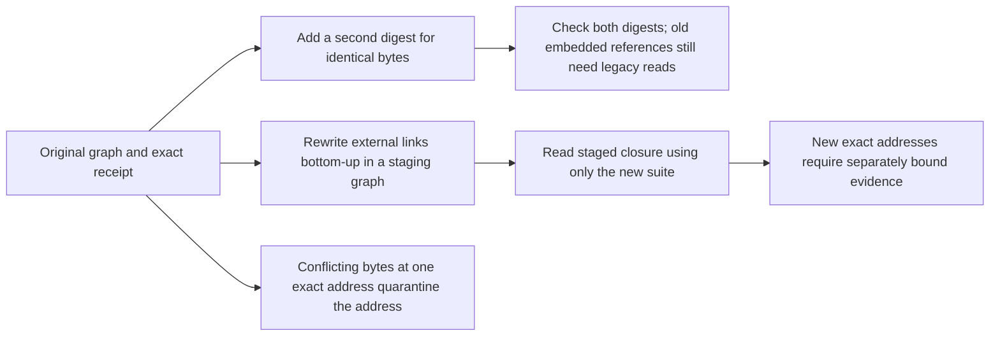

# Compare digest migration with exact references and collision quarantine

**Scope:** PLAN §1.2, [#289](https://github.com/aivibeflow/LLMLang/issues/289) and [LL-004](../../../PLAN.md#ll-004--choose-canonical-encoding-and-hash-algorithm-policy). Closed candidate fixture at `2a780731513f21c0028bf43e94bfae9d37041ac5` on `research/all`.

## Question and candidate rules

Which properties can a migration preserve when a digest suite changes and objects reference one another by exact address? [Scenario 91](RESEARCH-SCENARIO-91-VERSIONED-CONTENT-ADDRESSES-AND-DIGEST-MIGRATION.md) compares Git's compatibility mapping, typed OCI descriptors and self-describing IPFS CIDs. We compare its byte-preserving dual address and graph rewrite alternatives on a small typed graph and exercise the failure conditions.

The fixture reuses the repository's canonical JSON function for a closed schema. Each envelope has a version, an artifact kind, a payload and typed outgoing reference roles. SHA-256 and SHA-512 are interchangeable only as candidate algorithms for this fixture. The two suite labels distinguish addresses. They imply no choice of canonical format, digest algorithm or exact production `OpHash`, `ImplHash` or `CCHash` fields.

The graph has one snapshot, two callers, a two-member recursive group, one operation, an implementation, a conformance class and a contract. The group contains local member edges by selector. Its external operation edge uses an exact address. A conformance receipt binds the exact operation, implementation and class, along with the tool tag. The class is a declared rule in this model. It does not contain a list of candidate implementations.



Adding a locator preserves the envelope bytes. Rewriting an embedded address changes its parent's bytes. A migration may preserve the represented structure while changing the exact evidence subject.

## Results

The [fixture](DIGEST-MIGRATION-01/run.py) ran 20 controls. Ten completed under their permitted conditions and ten failed with the expected diagnostic. The [ledger](DIGEST-MIGRATION-01/evidence.json) records the exact address maps, scope keys and dispositions.

| Route | Checked result | Limitation |
| --- | --- | --- |
| Dual addresses | All eight old/new pairs independently reproduce both addresses and contain byte-identical envelopes. A reader supporting both suites obtains the original typed structure. | A new-suite-only reader rejects the dual root's old-suite child. Alias admission cannot repair a closure that the reader cannot interpret. |
| Rewrite references | A new-suite-only reader obtains the same closed fixture structure and member selectors. The original graph has eight objects and 1,810 canonical bytes. The new graph has eight objects and 2,450 bytes. Across both graphs there are 15 distinct byte sequences, since the leaf has no references to rewrite. | The old exact receipt produces a different binding key from the rewritten tuple of operation, implementation and class. Structural equality in this fixture supplies no general correspondence theorem or new receipt. |
| Interrupted staging | Removing the rewritten operation object makes the new closure ineligible. The exact old root remains independently readable. Restoring the missing input and rerunning the rewrite produces the same exact addresses. | Missing staged input is an in-memory control. It does not model durable publication, process crashes or filesystem ordering. |
| Alias and collision checks | An alias to a separately valid but different payload fails byte comparison. Missing targets, reversed direction and corrupt stored bytes fail separately. A synthetic equal digest for distinct typed bytes quarantines the address and blocks reads and retries. | The collision uses a deliberate constant digest only for the test. It says nothing about the likelihood or construction of a SHA-256 or SHA-512 collision. |

The alias check verifies each address against its envelope and compares bytes. In a published mapping, preserve the type, schema and exact direction. If an occupied address ever receives different canonical bytes, retain the original and quarantine it without resolving either payload through that address. In a durable design, retain enough evidence to investigate and re-evaluate dependent admissions. Migrate affected objects from independently identified canonical sources. A mapping from the ambiguous address alone cannot establish a selected target.

## Migration policy and trade-offs

Maintain exact old roots for readers and signatures that still reference them. Dual locators allow gradual transition when a reader can use both suites. For new-suite-only roots, rebuild the closed graph bottom-up, using the canonical group's local edges for recursive members. Stage, validate and publish the new root with an atomic selection change in the production protocol. A stable logical identifier can navigate the two revisions, but its mapping requires authority and cannot substitute for the exact address in a proof or signature.

Retain old proofs and conformance records against their exact inputs and trust policy. A consumer using a byte-identical locator can resolve the original object under the original claim. Replacing exact references in a receipt requires either new verification or a checked migration correspondence rule. Do not alias across a semantic change or canonical-schema change just because lineage is shared.

The fixture is small and held in memory. Canonical-schema evolution, general recursive canonicalization, mixed-client routing policy, authenticated mapping publication, atomic recovery and retention, migration workload cost, and independently checked evidence transfer remain open. This is evidence for the candidate policies and does not close the production migration decision.

## Reproduce

Use CPython 3.12.14 and Git 2.56.1. The [runner](DIGEST-MIGRATION-01/run.py) compares all controls and records the canonical helper and fixture digests.

```sh
set -eu
scratch=$(mktemp -d)
git archive 2a780731513f21c0028bf43e94bfae9d37041ac5 research | tar -x -C "$scratch"
fixture=research/semantic-representation/RT-05/DIGEST-MIGRATION-01
cp -R "$fixture" "$(dirname "$scratch/$fixture")/"
python3 -B "$scratch/$fixture/run.py" > "$scratch/evidence.json"
cmp "$scratch/evidence.json" "$fixture/evidence.json"
```

The byte counts are exact for this graph and do not measure storage formats, memory or runtime. Mermaid source was inspected directly.
