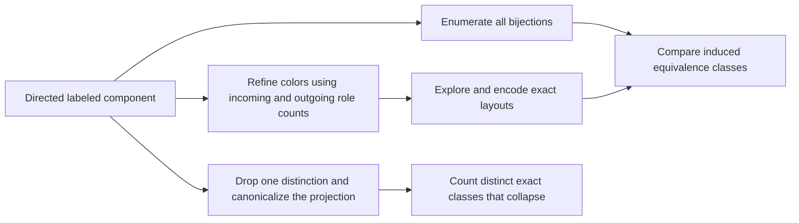

# RT-05 — Directed roles and multiplicities in recursive component identity

An exact label-aware search agreed with exhaustive relabeling on the equivalence classes of 2,496 strongly connected components. Erasing direction, roles or multiplicity collapsed distinct components, even with exact canonicalization of the resulting projection. Typed refinement alone also collided on a pair of symmetric components.

## Method

A component contains colored vertices and directed edges. A pair of vertices can have several edges with the same label, and a vertex can refer to itself. The labels `call` and `read` are fixture values for distinguishing typed reference roles. The independent oracle tries every vertex bijection and chooses the least directed labeled matrix. The candidate groups vertices by color, refines cells using separate counts of incoming and outgoing roles, then individualizes one vertex at a time until it can encode the whole matrix. It prunes a candidate only when exchanging two vertices preserves every color and directed edge multiset.

The corpus iterates all assignments of absent, call or read to the six directed pairs of distinct vertices. It crosses two vertex-color patterns with three configurations of self-loops and repeated self-loops. Admission requires that every vertex can reach every other vertex. Both exact algorithms retain the same directed graph information, and their selected byte order may differ.



## Results

| Dropped distinction | Colliding projected classes | Largest collapsed family |
| --- | ---: | ---: |
| direction | 611 | 8 |
| multiplicity | 832 | 2 |
| roles | 71 | 64 |

A collision is one projected class containing more than one of the 1,956 exact classes. A collapsed family is the set of those exact classes sharing the projected result. Of 4,374 generated candidates, 2,496 satisfy the strong connectivity requirement. All 14,976 relabeling checks preserve the candidate bytes. The candidate selects different canonical bytes from exhaustive minimization in 1,156 cases while preserving the same equivalence classes. The difference matters if a format or cache expects exact byte compatibility. The small corpus visits at most four search partitions per admitted graph.

On the separate controls, reversing an oriented labeled cycle, changing a single typed role and repeating a single edge all change exact identity. Each change disappears under its corresponding projection. Replacing each edge of the triangular prism and the complete bipartite graph with two directed call edges gives them the same typed refinement key. Exact search distinguishes them, taking 19 and nine visits. The one-visit budget returns an explicit budget failure and emits no canonical key.

## Implementation boundary

Direction, role and multiplicity need explicit meaning before the project defines the identity of a recursive component. Exact search with validated pruning is a candidate for roles whose order is declared irrelevant. Ordered argument positions, executable SPG recurrence semantics and source-to-edge correspondence need separate evidence. The experiment covers small exhaustive cases and six-vertex symmetry controls. Production canonical bytes, larger complexity limits and workload measurements remain open.

## Reproduce

Use CPython 3.12.14 from the repository root. The runner exhaustively enumerates the small inputs and pins its witness relabeling seed.

```sh
fixture=research/semantic-representation/RT-05/DIRECTED-RECURSIVE-01
output=$(mktemp)
python3 "$fixture/run.py" --output "$output"
cmp "$fixture/evidence.json" "$output"
python3 "$fixture/chart.py"
```

[Runner](DIRECTED-RECURSIVE-01/run.py) · [Evidence ledger](DIRECTED-RECURSIVE-01/evidence.json) · [Symmetric SCC comparison](RT-05-UNORDERED-RECURSIVE-CANONICALIZATION-2026-11-24.md)
