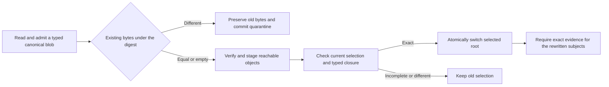

# RT-05 durable digest migration and collision quarantine

Digest locators name exact bytes in a typed domain. A suite change can preserve those bytes and add a second locator, or rewrite embedded references to remove a legacy-suite dependency. This candidate defines which migration checks belong before publication and which properties an exact evidence consumer must still verify. The experiment applies the existing eight-object typed fixture to a local SQLite WAL store.

## Candidate publication

When an occupied locator is presented with different canonical bytes for the same suite, preserve the original bytes, commit a quarantine record before returning the collision disposition, and refuse subsequent reads and writes through that locator. Equal-byte retry is idempotent until a locator is quarantined. Resolve affected objects from independently identified canonical inputs. A digest alone cannot determine which of two byte strings was intended. Future replication of quarantine state and rechecking affected actions need their own authority.

For a verified dual locator, both digest algorithms must independently produce the advertised addresses for the same canonical bytes. Readers still need support for any suite referenced inside those bytes. To remove the legacy suite from a retained closed graph, rewrite external references bottom-up, using local selectors for internal recursive-group references. Validate the staged closure under the new suite, check the expected original snapshot and compare exact typed structure in the modeled profile. A production publisher also needs current authorization and a causal selection generation. Publish a new selection atomically, then retain the old snapshot according to policy.



The [earlier in-memory study](RT-05-DIGEST-MIGRATION-AND-COLLISION-2026-11-25.md) completes ten permitted routes and refuses ten negative controls. A dual locator preserves bytes and leaves legacy links. A graph rewrite removes those links and changes the exact operation, provider and class addresses. The retained proof or receipt continues to name the original subjects. Applying it to rewritten subjects requires new verification or a separately checked correspondence rule.

## Native local checks

The parent stages the fixture data. The child opens an immediate transaction, checks the exact old root and staged closure, and updates the selected slot. Each observation reopens the database in the parent process.

| Case | Observed selection after reopen | Old closure readable |
|---|---|---|
| Normal committed migration | New | Yes |
| Process exit after slot update and before commit | Old | Yes |
| Process exit after commit and before response | New | Yes |
| Missing staged operation object | Old | Yes |
| Stale expected root | Old | Yes |
| Complete digest-valid graph with different typed structure | Old | Yes |

All six databases pass SQLite integrity checking. The old and rewritten fixtures contain eight objects each. Selected and retained old closures decode to the expected typed structure in each case. The interruption tests exercise process exit and transaction visibility, with the same temporary filesystem and SQLite build. They do not establish power-loss durability or a remote publication protocol. This fixture compares the exact selected root and does not test a generation check across a root that leaves and later returns.

The quarantine control uses a deliberate constant digest in an isolated test suite to supply two different byte strings under one locator. It has no bearing on finding a real digest collision. A new reader refuses the locator after reopening, both attempted retries remain quarantined, and the retained bytes match the original exactly. Concurrent in-flight readers and reporting authority after an uncommitted quarantine remain outside this check.

## Verify and limits

The [runner](DURABLE-MIGRATION-01/check.py) and [ledger](DURABLE-MIGRATION-01/evidence.json) use CPython 3.12.14 and SQLite 3.53.1 with WAL and synchronous FULL. The source ledger records SHA-256 for the runner and both reused fixture sources. The study was claimed at `3856c0165e2c7f6122291e2adb6e97bd16ba6792`. Hash seeds 37 and 71 give identical output. The ledger contains categorical outcomes rather than latency measurements.

```bash
fixture=research/semantic-representation/RT-05/DURABLE-MIGRATION-01
LC_ALL=C PYTHONHASHSEED=37 python3 -B "$fixture/check.py" > /tmp/llmlang-durable-migration.json
cmp "$fixture/evidence.json" /tmp/llmlang-durable-migration.json
```

Mixed-client routing, authenticated alias publication, distributed quarantine consistency, production identity policy, performance and independent evidence transfer remain open. [LL-004](../../../TODO.md#ll-004--choose-canonical-encoding-and-hash-algorithm-policy)
