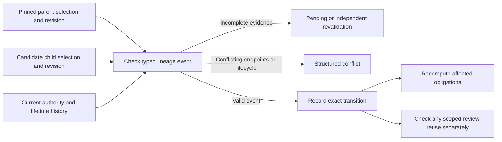

# RT-05 immutable SPG evolution and revision-bound lineage

An SPG update publishes a new selection over immutable values. A separate lineage record explains which managed occurrences continued and which were retired, split, merged or replaced. This model lets equal-valued selections have different lifetimes and gives audit, caller impact and proof reuse explicit inputs. The candidate was checked against a finite transition matrix and reconciled with two archived native Git studies.

## Typed transitions

An endpoint contains an exact causal revision, selected slot, managed lifetime and exact value. For a parent and child snapshot, the change record contains a role-tagged list of parent endpoints and a role-tagged list of child endpoints. The receiver independently checks exact membership, uniqueness, arity and lifetime constraints. Multi-input and multi-output relations record the complete endpoint list as a single relation.

| Change | Endpoints | Occurrence lifecycle |
|---|---|---|
| Add | None to one | Allocate a new lifetime |
| Remove | One to none | Retire the old lifetime |
| Continue | One to one | Retain one lifetime across a rename, move or exact value edit |
| Replace | One to one | Retire the source and allocate a distinct successor lifetime |
| Split | One to several | Retire the source and allocate each distinct successor |
| Merge | Several to one | Retire each source and allocate one distinct successor |

A copy can be described by a continuation of the original occurrence and a separate addition for the copy, with scoped provenance if needed. Equal addresses can be valid endpoints on either side of any of these changes. They establish equality of the immutable value. A late edit or stale relation with the same terminal tree still needs its exact causal revision. Reuse of retired identifiers anywhere in the lifetime history requires a complete lifecycle or tombstone check. This fixture checks adjacent selections.



The graph publication transaction should bind the whole parent and child selections and any required lineage records. Independent caller-impact and contract checks decide which uses survive. An edit under a preserved lifetime can change behavior. A split or merge can increase or change obligations. A review scoped to an exact value can have different reuse conditions from a review of one managed occurrence and context. A production authority must check the relevant scope and continuity before transferring either.

## Checked cases and alternatives

The [finite transition runner](EVOLUTION-BOUNDARY-01/check.py) crosses six kinds, zero through two endpoints on each side, current or stale parent-child authority, exact or stale endpoint selections, and both same-lifetime and fresh-lifetime candidates. The distinct validation and expected-result paths agree over 864 cases. Eight configurations match the requested change, 424 have conflicting endpoints or lifecycle, and 432 remain pending because the authority is stale. Cases for an empty side can vary a flag that has no endpoint to change. A separate duplicate-endpoint control refuses a split even though its raw endpoint count is two. The split and merge entries describe cardinality and retirement, with the matrix bounded to two endpoints per side.

[Composed lineage in native Git](RT-05-COMPOSED-LINEAGE-AUTHORITY-2026-11-24.md) checks 12 histories. Matching endpoints by value yields 20 excess grants. Stable-ID matching yields seven, and following every reachable lineage yields six. The exact scoped policy preserves all four declared grants and keeps two histories unknown. Exact bytes recur after a delete/recreate path, an intervening context change and a split followed by a merge.

[Multi-parent lineage in native Git](RT-05-MULTI-PARENT-LINEAGE-2026-11-24.md) checks 12 additional histories with an explicit signed parent selection. Its exact policy preserves the three declared grants, rejects three recreated lifetimes and leaves six incomplete or unverifiable cases unknown. Parent order and selecting any or all parents as a group give different grant failures. A multi-parent resolution must record the exact causal choice for each continued selection. A semantic merge event can record a new successor with several origins.

Typed transitions are more expressive than ordinary graph-value differencing, which cannot recover lifetimes from equal payloads. Authoritative explicit lineage costs additional records and validation. Where evidence is unavailable, callers can recalculate obligations against the resulting selection without inferring continuity.

## Verify and limits

The [ledger](EVOLUTION-BOUNDARY-01/evidence.json) records the exact input ledger digests and results at `e8ac755bf6a7339aa3967b5e6afe3c4d41a1312d`. CPython 3.12.14 and Git 2.56.1 produce byte-identical output at hash seeds 37 and 71. The archive crosswalk uses the prior native studies without replaying their Git histories.

```bash
fixture=research/semantic-representation/RT-05/EVOLUTION-BOUNDARY-01
PYTHONHASHSEED=37 python3 -B "$fixture/check.py" > /tmp/llmlang-evolution-boundary.json
cmp "$fixture/evidence.json" /tmp/llmlang-evolution-boundary.json
```

The transition matrix covers one event at a time. Production validation also requires checks for overlaps between events, whole-inventory completeness, trusted issuers, multi-parent registration and transactional publication. Final lifetime allocation and retirement choices remain tracked by LL-002. [Stable-ID lifecycle question](../../../PLAN.md#ll-002--define-operation-stable-id-lifecycle)
