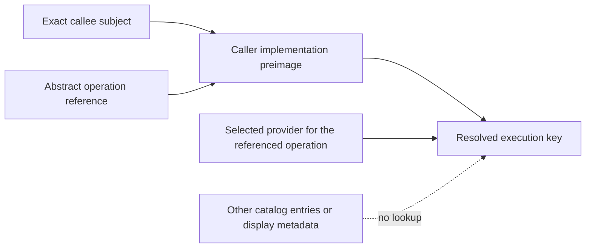

# RT-05 — Exact dependency propagation through direct and contract calls

## Question and model

When must a caller receive a new implementation identity, and when must a new execution identity be recorded even though the caller's implementation subject is unchanged? The [change planning proposal](../../toolchain-and-collaboration/RT-20/RT-20-LLM-PATCH-PLANNING-AND-HASH-PROPAGATION.md) separates contract migration from hash propagation. The [recursive topology experiment](RT-05-RECURSIVE-TOPOLOGY-EDITS-2026-11-25.md) exercises exact calls through SCC boundaries. This study isolates exact propagation and contract dispatch in an acyclic observation model. [PLAN §1.2](../../../PLAN.md#12-semantic-identity-hashes-and-canonical-encoding) · [#289](https://github.com/aivibeflow/LLMLang/issues/289)

The semantic term consists of literals, a direct call with an exact child body, an abstract call with an operation reference, or an ordered sequence. Each direct or abstract call emits its position. An abstract call also emits the operation identity and the selected provider observation from its binding map. A selected implementation subject retains direct dependencies and the abstract operation reference. The execution subject additionally binds the concrete observations for the operations the term can consult.



## Checked proof

Lean checks injectivity of every fixed ordered context made from direct calls and either side of a sequence. Replacing a different closed child therefore changes every enclosing exact preimage along such a path. The mathematical preimage is a typed tree. A Merkle representation needs faithful encoding and exact address admission, including collision handling, to transfer the property to digest-based references. The proof does not assume SHA-256 injective.

Lean also proves that two binding maps that agree on all consulted operation IDs yield the same result trace for any term in this model. A separate theorem distinguishes two executions of the same abstract-call subject when its selected binding changes. The three direct or witness facts have empty axiom sets. The agreement theorem depends on `propext`. [Lean model](DEPENDENCY-PROPAGATION-01/Propagation.lean) · [Axiom output](DEPENDENCY-PROPAGATION-01/axioms.txt)

## Finite comparison

A separate Python oracle compares observation vectors across 64 profiles and all 2,016 unordered profile pairs. The coordinates vary a directly called value, the abstract operation, its two possible binding entries, an ordered sibling value and a display label. The fixture compares candidate Merkle-style subjects and execution keys against those observations.

| Key | Safe reuse | Stale reuse | Missed reuse |
| --- | ---: | ---: | ---: |
| Local body | 96 | 384 | 0 |
| Exact implementation subject | 96 | 128 | 0 |
| Subject with resolved bindings | 96 | 0 | 0 |
| Whole state | 0 | 0 | 96 |

A direct child edit can remain invisible to a key that keeps the call text alone. The exact subject detects that edit, but a selected-provider change can still alter the trace with the same subject. Recording the consulted binding eliminates the remaining stale reuse in this family. The project can retain broader execution inputs when it lacks reliable dependency extraction. In the fixture, whole-state keys lose all 96 safe reuses. The resolved key refuses a missing required binding and permits a missing unconsulted one.

## Reproduce and limits

The baseline was `c7655b98e947cc068b92db4228243e9451dce708` on `research/all`. The host ran Debian 13 x86-64 Linux 6.18.57. Use CPython 3.12.14 and Lean 4.36.0 at revision `611c117bfaf7b7ae1cfcf246ce6fba31e8f509e9`:

```sh
fixture=research/semantic-representation/RT-05/DEPENDENCY-PROPAGATION-01
proof=$(mktemp)
out=$(mktemp)
lean -DwarningAsError=true "$fixture/Propagation.lean" > "$proof" &&
  cmp "$fixture/axioms.txt" "$proof" &&
  python3 -B "$fixture/run.py" > "$out" &&
  cmp "$fixture/evidence.json" "$out" &&
  python3 -B "$fixture/chart.py"
```

The [ledger](DEPENDENCY-PROPAGATION-01/evidence.json) records the finite observations, key collisions and exact source hashes. The [table generator](DEPENDENCY-PROPAGATION-01/chart.py) reproduces the comparisons. This supports transitive propagation over admitted exact calls and separate binding dependencies for abstract calls. Effectful selection, absent alternatives in dynamic lookup, real source dependency extraction, recursive operational semantics and production commit atomicity remain open. [Runner](DEPENDENCY-PROPAGATION-01/run.py)
