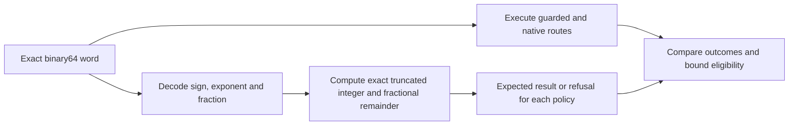

# Compare checked and native binary64 conversion to signed I64

An LLMLang F64-to-I64 operation needs a defined outcome when its operand is fractional, nonfinite, or outside the signed 64-bit range. A lowering needs the same success or refusal and the same integer on success. This comparison tests explicit guards and native alternatives on the same input words. [Numeric semantics and overflow](../../language-design/RT-03/RESEARCH-SCENARIO-45-NUMERIC-SEMANTICS-AND-OVERFLOW.md) · [F64 literal identity](RT-05-CROSS-RUNTIME-F64-IDENTITY-2026-11-25.md) · [I64 encoding](RT-05-CROSS-RUNTIME-I64-ENCODING-2026-11-25.md)

## Candidate rules and method

- **Checked truncation** refuses NaNs and infinities. It truncates finite inputs toward zero and accepts the result if it is in `[−2^63, 2^63−1]`. The tested binary64 guard is `−2^63 <= x && x < 2^63` after the finite check.
- **Checked integral** uses the same finite and range bounds and also refuses fractional inputs. It accepts both signed zeros as integer zero. Within binary64, every finite input outside the range is already integral, so the two refusal tests have disjoint domains here.
- **Rust saturating cast** truncates ordinary finite values toward zero, clamps values outside the signed range and infinities to the corresponding endpoint, and maps NaN to zero.
- **Node integral then wrap** passes the Number to `BigInt` and then `BigInt.asIntN(64, value)`. Conversion to BigInt refuses fractions and nonfinite inputs. The final step reduces successful integers modulo `2^64` and interprets the result as signed.
- **CPython unbounded integer** uses `int(float)`, which truncates all finite inputs and can return integers of arbitrary precision. The accepted count includes values that cannot be represented as I64.



The oracle decodes binary64 words with integer arithmetic, including the implicit leading bit for normals and exponent handling for subnormals. The corpus comprises 72 directed words and 144 finite words drawn with seed `20261125`, 12 per exponent stratum. The directed cases cover signed zeros, NaNs, infinities, subnormal edges, fractional values and adjacent values on either side of the signed range. Seven configurations execute the 216 words, for 1,512 input/configuration runs. GCC `-O0` and `-O2`, Rust `-C opt-level=0` and `3`, and Node default and `--jitless` agree within each pair. GCC, Rust and Node guarded outcomes agree with the oracle. CPython supplies an additional native observation of truncation to unbounded integers.

## Observed outcomes

Each row counts the same 216 inputs. Differences compare exact accepted integer values or refusal categories with the checked-truncation row.

| Policy | Accepted | Range refusal | Fraction refusal | Nonfinite refusal | Different from checked truncation |
|---|---:|---:|---:|---:|---:|
| Checked truncation | 153 | 55 | 0 | 8 | 0 |
| Checked integral | 68 | 55 | 85 | 8 | 85 |
| Rust saturating cast | 216 | 0 | 0 | 0 | 63 |
| Node integral then wrap | 123 | 0 | 85 | 8 | 140 |
| CPython unbounded integer | 208 | 0 | 0 | 8 | 55 |

All seven configurations produced binary64 word `43e0000000000000` when converting `INT64_MAX` to F64. That word represents exactly `+2^63`. The inclusive upper check against the rounded maximum falsely admits that word in the corpus. The C probe records this weak check's eligibility and casts only when the exclusive upper bound and finite lower bound both hold. At that positive boundary, Rust saturation yields `9223372036854775807`, Node wrapping yields `−9223372036854775808`, and CPython yields `9223372036854775808`. Both checked routes refuse it. Its immediate predecessor `43dfffffffffffff` yields `9223372036854774784`. Exactly `−2^63` is admissible, and the next lower word `c3e0000000000001` is refused.

Integral-only conversion rejects 85 inputs that checked truncation accepts. For example, `−1.5` becomes `−1` on the truncating route and yields a fraction refusal on the integral route. If LLMLang exposes both policies, the typed operation and its conformance evidence must distinguish them. A saturating operation can give every input a bounded result. A caller that needs explicit range or nonfinite failure must retain those observations in its lowering. A BigInt adapter needs an explicit range check before wrapping to implement that behavior.

## Scope and replay

This is a bounded Linux x86-64 experiment using ordinary runtime arithmetic. It leaves the LLMLang operation contract, signaling and status flag behavior, other types and targets, proof of the range checks over all binary64 words, compiled lowering correspondence, and independent review open.

The initial repository baseline is `c9cb445c6e68ccae45a362e0bcc95fc4a235198d`. Replay uses CPython 3.12.14, Debian GCC 14.2.0-19, Rust 1.85.1 at `4eb161250e340c8f48f66e2b929ef4a5bed7c181` with LLVM 19.1.7, and Node 22.23.5 with V8 12.4.254.21-node.57. The evidence ledger preserves the input words, exact decoded fields, outcomes, profile names, rounded maximums, source digests and versions.

```bash
fixture=research/semantic-representation/RT-05/F64-I64-CONVERSION-01
PYTHONHASHSEED=1 python3 -B "$fixture/run.py" > /tmp/llmlang-f64-i64.json
cmp "$fixture/evidence.json" /tmp/llmlang-f64-i64.json
python3 "$fixture/chart.py"
```

[Native C](F64-I64-CONVERSION-01/observe.c) · [Native Rust](F64-I64-CONVERSION-01/observe.rs) · [Native Node](F64-I64-CONVERSION-01/observe.js) · [Runner and oracle](F64-I64-CONVERSION-01/run.py) · [Observation ledger](F64-I64-CONVERSION-01/evidence.json) · [Table generator](F64-I64-CONVERSION-01/chart.py)
