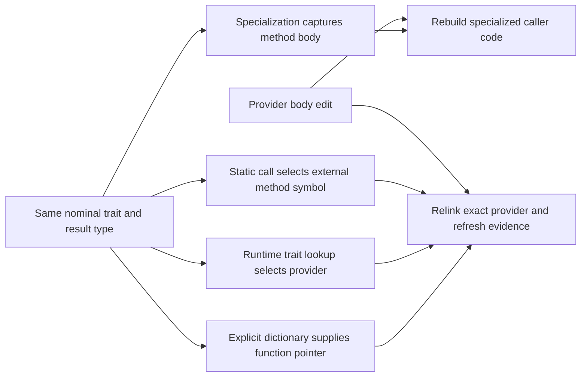

# Preserve provider identity across generic specialization and late dispatch

A generic call can preserve its nominal type and contract while a new provider version changes the selected method body. LLMLang needs to know when such a provider change invalidates caller code and when it invalidates only the executable binding. This experiment compares inlined and separately linked static specializations, a Rust trait object and an explicit function-pointer dictionary on the same native wrapping arithmetic. [Generics and dispatch survey](../../language-design/RT-04/RESEARCH-SCENARIO-42-GENERICS-CONSTRAINTS-AND-DISPATCH.md)

## Native comparison

The provider crate defines a `Rule` trait and two nominal providers, `Amber` and `Cobalt`. The inlined specialization copies the body into the caller. The separately linked specialization selects a fixed provider symbol and leaves the body in the provider crate. The two runtime-selected routes use a separately compiled lookup and call through either the Rust vtable or a dictionary field containing a function pointer. Dispatch chooses `Amber` or `Cobalt` by a scalar tag. All routes expose the same C-callable wrappers to the driver. The trait objects and dictionaries stay within the pinned Rust toolchain boundary.

The original provider adds 13 to three times the input along the Amber route and subtracts 7 from five times the input for Cobalt. A body edit changes only the Amber addition to 19. An unrelated edit preserves both bodies and changes an independent exported function read by the C driver. All three versions retain the same nominal types and signatures. The fixture independently builds caller objects and provider archives at O0 and O3, then links every pair of caller-object and provider-archive versions without link-time optimization. The driver also records the unrelated export to confirm which provider archive was linked.



One native executable evaluates every route for both provider tags and 128 signed inputs per tag. The corpus contains both signed bounds, six other fixed inputs and 120 deterministic samples. A Python oracle calculates wrapping arithmetic independently. There are 18 linked binaries and 18,432 native result values.

## Results

| Optimization | Stale inlined results | Stale static-linked results | Stale trait-object results | Stale dictionary results |
|---|---:|---:|---:|---:|
| O0 | 512 | 0 | 0 | 0 |
| O3 | 512 | 0 | 0 | 0 |

The denominator is 2,304 results per route and optimization level. The four cross-link pairs per level that disagree on the Amber body each retain 128 stale specialized values. Every inlined specialization rebuilt against the selected revision matches the reference. The standalone static-link route and both runtime-selected routes observe the linked method body in every pair. An unrelated edit changes the provider archive and the observed unrelated export while leaving both compiled caller objects byte-identical.

| Optimization | Inlined caller text, bytes | Static-linked caller text, bytes | Trait-object caller text, bytes | Dictionary caller text, bytes |
|---|---:|---:|---:|---:|
| O0 | 86 | 86 | 29 | 25 |
| O3 | 38 | 48 | 23 | 16 |

The code sizes include the exported caller wrapper for each route. Both static routes include their two specialization instances. Those instances contain either inlined arithmetic or a transfer to the linked method. The numbers exclude provider text, vtables, dictionary construction, linking overhead, debug metadata and runtime latency. Both runtime-selected routes have one computed transfer in their wrappers at O0 and O3. The two statically selected routes have no computed transfer in their wrappers, as observed with `nm` and `objdump`.

## Identity implications and limits

The native result distinguishes the generic declaration and type arguments, the resolved implementation and method body consumed while specializing, and the exact provider bound at executable link time. A caller artifact that incorporates a body must capture it in its semantic input and rebuild key. A caller object that leaves the method in a separate provider can be reused in this fixture. Even with static method selection, executable behavior and evidence still depend on the linked provider and the verified ABI and contract. Tracking only a whole provider archive is sufficient to notice these revisions but invalidates the specialized caller on an unrelated edit whose compiled object is unchanged.

This study uses controlled cross-linking under one compiler, two settings and one Rust/C ABI wrapper. It leaves general generics and type resolution, stable external dictionary ABI, trait layout compatibility across versions, mixed toolchains, LTO, indirect-call costs, representative compile/runtime measurements and independent review open. No compilation or type architecture is selected.

Replay with CPython 3.12.14, Rust 1.85.1 at `4eb161250e340c8f48f66e2b929ef4a5bed7c181` with LLVM 19.1.7, GCC 14.2.0-19 and GNU Binutils 2.44 on x86-64 Linux. The initial LLMLang base is `0ea3aedb211e564f9ec0f0cf6d14daa95e1b3180`. The ledger records source, provider archive and consumer object digests, exact inputs, per-route native results and symbol-derived measurements.

```bash
fixture=research/semantic-representation/RT-05/GENERIC-PROVIDER-BINDING-01
PYTHONHASHSEED=1 python3 -B "$fixture/run.py" > /tmp/llmlang-generic-provider-binding.json
cmp "$fixture/evidence.json" /tmp/llmlang-generic-provider-binding.json
python3 "$fixture/chart.py"
```

[Native runner](GENERIC-PROVIDER-BINDING-01/run.py) · [Provider template](GENERIC-PROVIDER-BINDING-01/provider.rs.in) · [Caller](GENERIC-PROVIDER-BINDING-01/consumer.rs) · [Observation ledger](GENERIC-PROVIDER-BINDING-01/evidence.json) · [Table generator](GENERIC-PROVIDER-BINDING-01/chart.py)
