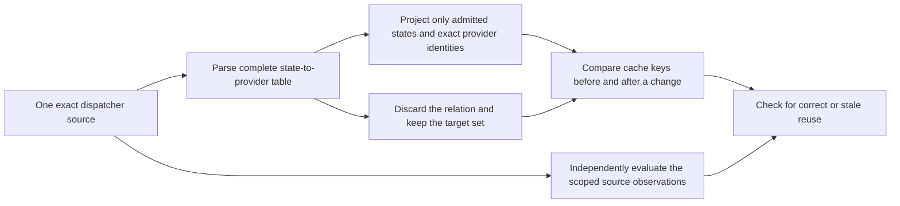

# RT-05 — Scoped identity for guarded provider dispatch

The set of possible providers can stay identical while dispatch changes which provider serves each input. Over 19,200 comparisons, using only the set allows 1,708 stale reuses. A key that binds each admitted input state to the exact selected provider has no stale reuses in the same fixture.

## Method

The source fixture lists one unconditional case per scalar flag state. Every case calls one of two providers. Each provider adds its own two operands, emits that value, and returns it. The source dispatcher is pure. All observations consist of each admitted state's ordered emission and returned value.

The experiment prepares all 16 dispatch tables over four flag states, all 15 nonempty scopes and five provider-edit choices. The provider choices include changed outputs, an unrelated declaration change, and a changed provider body with the same sum. Each immutable snapshot selects a dispatcher source and exact provider bodies. Every comparison uses the same scope before and after the edit. The independent reference evaluates the generator's dispatch tuples directly. The candidate parses the written source, rejects unknown or ambiguous declarations and evaluates the parsed selection.



The whole-snapshot key pins every selected value, including unrelated declarations. The exact-selector key pins the entire dispatcher and exact bodies of all possible providers in the scope. The scoped-relation key records the ordered state-to-provider relation for just the admitted scope, including each exact provider address. The two reduced controls retain only the first observed dispatch, or the set of possible providers and their exact bodies. All keys include the same scope and fixture profile.

## Results

| Key | Safe reuse | Stale reuse | Conservative recomputation | Required recomputation |
| --- | ---: | ---: | ---: | ---: |
| exact-selector | 675 | 0 | 3,183 | 15,342 |
| one-trace | 3,338 | 3,382 | 520 | 11,960 |
| scoped-relation | 3,187 | 0 | 671 | 15,342 |
| target-set | 3,187 | 1,708 | 671 | 13,634 |
| whole-snapshot | 240 | 0 | 3,618 | 15,342 |

Each row has 19,200 paired source comparisons. A safe reuse keeps the key and the independent observations. A stale reuse keeps the key when observations change. Conservative recomputation changes the key when observations stay equal. Required recomputation changes the key and observations.

The native Git witness reads both exact commits and reconstructs their distinct semantic roots. For state 2 and state 3 it changes the respective emitted and returned values from 10 and 20 to 20 and 10. The two exact providers and their hashes stay in the same possible-target set. The scoped relation changes and rejects reuse. In a separate control, reversing the source rows changes the exact selector identity while keeping the checked relation and its key. A missing row, unknown guard or duplicate case produces no supported selector.

## Implications for implementation choice

A may-depend set can tell which providers warrant revalidation when their bodies change. Scoped execution reuse also needs the relationship that selects a provider for each admitted state, or an exact selector identity that conservatively retains it. The projected relation reduces unnecessary recomputation for this pure finite dispatcher. Exact provider identities still cause conservative misses when two bodies happen to behave identically on the fixture.

The key identifies an execution scope in this experiment. The proposed operation, implementation, conformance-class, candidate-set and evidence identities retain their distinct meanings. General guards, mutable state, side effects in selection, proof-evidence reuse, state abstraction and independent review remain open. [Identity terminology](../../../draft/GLOSSARY.md) · [Conditional dependency closure](../RT-06/RT-06-CONDITIONAL-DEPENDENCY-CLOSURE-2026-11-25.md)

## Reproduce

Use CPython 3.12.14 and Git 2.52.0 from the repository root.

```sh
fixture=research/semantic-representation/RT-05/GUARDED-DISPATCH-IDENTITY-01
output=$(mktemp)
python3 "$fixture/run.py" --output "$output"
cmp "$fixture/evidence.json" "$output"
python3 "$fixture/chart.py"
```

[Runner](GUARDED-DISPATCH-IDENTITY-01/run.py) · [Evidence ledger](GUARDED-DISPATCH-IDENTITY-01/evidence.json)
