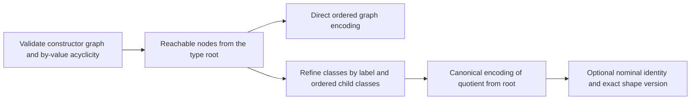

# RT-05 — Structural and nominal identity for guarded recursive types

- **Evidence** — Executable comparison with a finite product-graph oracle and an explicit correctness argument.
- **LLMLang baseline** — `773518c38ce35e0899145e6b1f633be6b6cec592`.
- **Tracking** — [PLAN §1.1](../../../PLAN.md#11-semantic-program-graph-and-program-representation) · [Type aliases and nominal wrappers](../../language-design/RT-04/RESEARCH-SCENARIO-70-TYPE-ALIASES-NEWTYPE-AND-OPAQUE-ABSTRACTIONS.md).

## Question and model

When two recursive declarations describe the same infinite unfolding, should they share a structural type value? A stored declaration graph can differ after one unfolding even if every finite observation of its type is identical. A nominal policy also needs to distinguish two independently declared wrappers over the same shape. This experiment compares those boundaries using ordered records, scalar leaves, and two distinguishable indirections called Box and Borrow. Their fixture roles are type constructors with an indirect edge. Neither constructor assigns an actual representation or ownership protocol. [Prior ordered recursive declaration groups](RT-05-ORDERED-SCC-CANONICAL-TRAVERSAL-2026-11-24.md)

A type is the tree obtained by repeatedly following ordered constructor arguments from the root. Here a finite graph can represent an infinite regular tree. Every by-value record path must be acyclic. Edges from either indirection constructor break the by-value containment path. A cycle is rejected if it remains after cutting those edges, even if another path between the same nodes passes through a guard. Duplicate fields, dangling references and ill-formed constructor arity also fail.



Direct encoding preserves the explicit graph, including the placement of unfoldings and sharing. The quotient merges nodes with the same constructor observations at every finite depth. The nominal candidate keeps a qualified declaration identity alongside the resulting shape digest.

## Structural equality and its oracle

Starting with classes for constructor labels and ordered field names, split existing classes by the ordered list of child classes. Equal classes after one refinement agree on one further level of observations. Class counts only grow until they stabilize. At stabilization, related nodes have equal labels and related children in matching positions. This gives a bisimulation, a relation that matches the two rooted unfoldings at every finite depth. Conversely, nodes equal under this unfolding observation stay in the same class in every round. Encode the quotient from the root in first-encounter order, scanning each node's argument positions in order.

The independent oracle traverses paired nodes directly from two roots and rejects at the first differing constructor, field label, arity or ordered continuation. It avoids revisiting pairs and requires no canonicalization of either graph.

| Candidate | Value equality and implication |
| --- | --- |
| Direct graph equality | Preserves exact finite graph shape. A legal unfolding changes its bytes. That behavior can be useful for source presentation and graph-sensitive editor operations. |
| Structural equality under unfolding | Merges duplicate representations of equal regular trees. Field order, the indirection constructor and scalar type still participate. Guard and representation validity remain separate judgments. |
| Nominal declaration and exact shape | Separates independent declarations over the same structure. The same declaration can select an updated shape without losing its qualified identity. Versioned value identity still changes with the shape. |

## Results

The exhaustive corpus contains 128 rooted types. Each graph has two records with two ordered indirect edges. The two record label options and four binary edge choices exhaust the fixture, with either record chosen as root. The direct paired-path oracle agrees with the structural canonical bytes on all 8,256 pairs with replacement. It reports 1,712 equal pairs and 26 distinct structural values.

One unfolding of a boxed list adds a fourth explicit node. The structural quotient reduces it to the same three nodes and bytes as the base type. Two independently named wrappers over the same structure retain distinct nominal records. A shape edit under one name preserves its qualified identity and changes its immutable shape digest. Swapping ordered fields, replacing Box with Borrow, and changing an integer leaf to Boolean each changes the structural value. Five malformed or unguarded cases are rejected. [Machine-readable evidence](RECURSIVE-TYPES-01/evidence.json)

The scale fixtures use alternating records and indirections in symmetric or singly marked cycles. The largest case has 256 reachable nodes. The symmetric cycle stabilizes in one refinement round and yields two quotient nodes. The marked cycle retains all 256 nodes and takes 254 rounds. These counts expose the cost of a straightforward repeated partition refinement on long discriminating paths. They do not measure runtime, allocator cost or peak memory. Renaming and reversing all declarations preserves exact output at each tested size.

## Implementation consequence

A structural profile can give equivalent regular types one canonical value while retaining separate nominal declaration identities. A graph-sensitive source representation can keep unfolding and sharing details for editing. Bisimulation is a stronger equality here than isomorphism of the explicit declaration graph, so code identity results for recursive function definitions cannot be transferred to type identity without a type-specific rule.

Keep guard admission explicit and scoped. This model assumes indirection edges break by-value storage recursion. It provides no layout sizes, validity of values, recursive ownership, variance, nominal subtyping or public ABI compatibility. Transparent aliases, recursive generic types, unordered fields and a faster partition algorithm need separate evidence if they enter the selected type profile.

## Reproduction

Run from the repository root with CPython 3.12.14. Five Python hash seeds yield identical evidence. All 25 focused existing graph representation and admission tests passed. [Type graph and canonicalizer](RECURSIVE-TYPES-01/types_graph.py) · [Independent oracle and corpus](RECURSIVE-TYPES-01/check.py)

```sh
study=research/semantic-representation/RT-05/RECURSIVE-TYPES-01
PYTHONHASHSEED=1 python3 -B "$study/check.py" > /tmp/llmlang-rt05-recursive-types.json
cmp "$study/evidence.json" /tmp/llmlang-rt05-recursive-types.json
(cd research/PROTOTYPES/DEPENDENCY-GRAPH-01 && python3 -B -m unittest \
  tests.test_recursive_identity tests.test_spg_representation tests.test_spg_admission)
```
