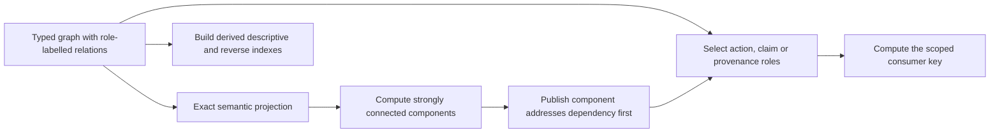

# RT-05 hash-relevant graph edges and cycle boundaries

SPG tools consume relations for different purposes. A source map, a proof receipt and a semantic dependency can all point back to the same object. Treating all those links as dependencies of its semantic address can create a cycle even if executable meaning is acyclic. This candidate assigns each edge to the identity of the object or judgment that depends on it.

## Edge roles and consumers

| Role | Include in the exact key of | Representative facts |
|---|---|---|
| Semantic | Typed source object and its exact semantic closure | Type, interface, contract, direct implementation or operation target used by the typed body |
| Action/build | Execution or build action over a semantic subject | Resolved provider if consulted, generator/tool version, target and action options |
| Evidence | Exact verification or admission claim | Property and semantic subject, assumption set, checker, proof payload and relevant policy scope |
| Source provenance | Exact source or generated correspondence claim | Source inventory/revision, ordered occurrence and byte range, generated output subject where relevant |
| Descriptive and navigation metadata | Versioned metadata projection | Rationale, human-facing summary, display alias and reverse links |

Classify a relation by its observed effect and role under the declared profile. For example, a name used to resolve calls belongs to the exact resolution context, while an additional display alias does not alter the resolved body. A tool version can affect the reproducible build action without changing the immutable source-level implementation. A proof receipt can point to an implementation. Its publication does not retroactively alter the implementation's semantic address. A reverse-use or evidence index can be rebuilt from checked forward relations and exact subjects. Consent, approval and artifact retention have separate authority.



Strongly connected components are sets of mutually reachable nodes in the exact semantic projection. Condense them into an acyclic component graph. At publication, internal references use canonical local selectors, and edges across components use the already identified external group and member. On a topology edit, recompute the affected groups before publishing the new root. A split or join changes the relevant group and all exact dependents. Check and retain old roots while their existing callers use them. Action, evidence and source closures can impose different completeness and cycle checks. For example, a proof that cites its own unverified receipt does not independently discharge the obligation. It does not create a semantic SCC.

## Checked comparisons

The finite graph fixture crosses six edge states across the six directed non-self pairs on three nodes. Per pair an edge can be absent, semantic, build, proof, source or descriptive. A direct path oracle independently determines mutual semantic reachability. It agrees with the implementation on all 46,656 cases. The graph has a semantic cycle in 4,031 cases. Counting all roles gives cycles in 45,575 cases and groups at least one extra node pair in 44,856 cases.

Five targeted back-edge controls start with the same semantic forward edge. A semantic reverse edge changes the semantic projection and all three consumer projections that include it. A source, action, proof or descriptive reverse edge changes only its corresponding view. The fixture permits only one role per pair. A richer graph can retain several role-labelled edges and ordered occurrences with multiplicity, as required by the typed profile.

This extends two earlier checks. Across 2,016 profile pairs, using the implementation key for evidence and navigation permits 384 stale verification reuses and 256 stale navigation reuses. Separately scoped keys agree with the independent fixture oracles. Across 23,040 root comparisons from exact-edge edits, keyed and structural group addresses agree with the independent closure oracle, including 720 merges and 720 splits among the edited graphs. Local bodies can miss 9,216 changed traces, and whole snapshot roots overinvalidate 9,216 unchanged exact roots. [Typed edge projections](RT-05-TYPED-EDGE-PROJECTIONS-2026-11-25.md) · [Recursive topology edits](RT-05-RECURSIVE-TOPOLOGY-EDITS-2026-11-25.md)

One universal dependency graph retains links but introduces artificial semantic cycles and invalidation. A body-only graph loses real exact edges. Per-role projections preserve the addresses needed for each decision, with the cost of complete edge extraction and separate scoped evidence.

## Replay and limits

The [runner](ROLE-CYCLE-BOUNDARY-01/check.py) and [ledger](ROLE-CYCLE-BOUNDARY-01/evidence.json) use CPython 3.12.14 and Git 2.56.1 with three supporting ledgers at `9e8644f39c6b3ba650bcf2e48e81363dd3d701bb`. Hash seeds 37 and 71 reproduce the same enumerated counts.

```bash
fixture=research/semantic-representation/RT-05/ROLE-CYCLE-BOUNDARY-01
PYTHONHASHSEED=37 python3 -B "$fixture/check.py" > /tmp/llmlang-role-cycle-boundary.json
cmp "$fixture/evidence.json" /tmp/llmlang-role-cycle-boundary.json
```

The fixture does not prove that a general frontend extracts all required roles, that a versioned canonicalizer handles all SCCs, or that revalidation and publication are atomic in a selected backend. Those are independent work items. [LL-005](../../../PLAN.md#ll-005--define-hash-relevant-dependency-edges-and-cycles)
