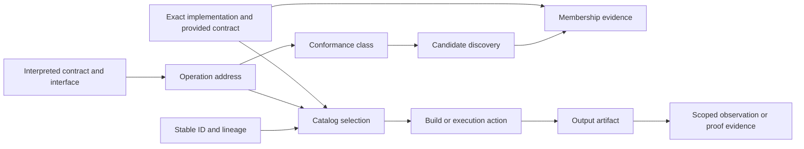

# RT-05 — Identity roles and change-impact crosswalk

## Question and scope

Which exact claims can a key support at the boundaries between editing, binding, building, storing, executing and verifying? This consolidates 11 executable studies in Plan §1.2. It uses the [draft glossary](../../../draft/GLOSSARY.md) spelling `ImplHash` for the proposed implementation address. The role definitions below describe a candidate decomposition and the recorded checks that distinguish the roles. The production hash envelopes and architectural selection remain open. [PLAN §1.2](../../../PLAN.md#12-semantic-identity-hashes-and-canonical-encoding) · [#289](https://github.com/aivibeflow/LLMLang/issues/289)

The crosswalk replay regenerated all 11 archived ledgers and four Lean axiom outputs byte for byte on one environment. It checked 13 discriminators directly against the regenerated ledgers. The [structured replay record](IDENTITY-CROSSWALK-01/evidence.json) pins the source ledger digests, axiom output digests and checked values. The source reports give their own assumptions and completeness boundaries.



The arrows indicate which inputs a dependent record can commit to or use. Discovery proposes implementations for an evidence check. It does not add a member to the semantic class definition. An exact binding selects a concrete provider and supplies that selection to actions that need it.

## Roles

| Identity | Question it answers | Distinguishing evidence |
| --- | --- | --- |
| Stable logical ID | Which managed lifetime or lineage is this? | The same bytes appear in independent lifetimes. Rename, revision and retirement produce different lookup and admission effects. [Operation lifetime](RT-05-OPERATION-LIFETIME-2026-11-25.md) |
| Typed semantic value address | Which exact canonical semantic object and identity-relevant references does this location identify? | A precise reachable closure detects recursive group splits and merges. Digest-only admission accepts invalid semantics or a different identity domain. [Recursive topology](RT-05-RECURSIVE-TOPOLOGY-EDITS-2026-11-25.md) · [Wire admission](RT-05-CANONICAL-WIRE-ADMISSION-2026-11-25.md) |
| Contract address | Which exact interpreted domain and allowed-observation relation is stated? | Integer arithmetic context and the correlation of values with ordered traces affect the contract. [Operation identity](RT-05-PERMISSIVE-OPERATION-IDENTITY-2026-11-25.md) |
| `OpHash` | Which exact semantic call target commits the operation interface, contract and relevant context? | Six pairs of providers satisfy the same scoped operation while producing different permitted observations. [Operation identity](RT-05-PERMISSIVE-OPERATION-IDENTITY-2026-11-25.md) |
| `ImplHash` | Which exact immutable implementation and dependencies does an implementation address select? | Exact code identity can remain when a provided declaration changes. The two-stage admission subject must resolve the exact declaration. [Provided contract](RT-05-PROVIDED-CONTRACT-IDENTITY-2026-11-25.md) |
| Exact binding | Which concrete provider is selected for the operation and applicable target scope? | An unchanged caller binary can load a different provider, and an unchanged abstract call can resolve differently. [Native implementation](RT-05-NATIVE-IMPLEMENTATION-IDENTITY-2026-11-25.md) · [Exact dependency propagation](RT-05-EXACT-DEPENDENCY-PROPAGATION-2026-11-25.md) |
| `CCHash` | Which complete membership predicate combines the exact operation and required constraints? | Target and event-bound revisions change the class definition without changing the operation. [Conformance class](RT-05-CONFORMANCE-CLASS-IDENTITY-2026-11-25.md) |
| Optional `CandidateSetHash` | Which finite scoped discovery result was observed? | Finding another provider changes discovery while preserving the class. Evidence disposition varies independently of both. [Conformance class](RT-05-CONFORMANCE-CLASS-IDENTITY-2026-11-25.md) |
| Action key | Which exact request and result-determining inputs are being reused? | Changing an unused compiler macro changes the build action without changing the caller bytes. Selected bindings and guarded dispatch can affect execution despite equal body or provider-set keys. [Native implementation](RT-05-NATIVE-IMPLEMENTATION-IDENTITY-2026-11-25.md) · [Exact dependency propagation](RT-05-EXACT-DEPENDENCY-PROPAGATION-2026-11-25.md) · [Guarded dispatch](RT-05-GUARDED-DISPATCH-IDENTITY-2026-11-25.md) |
| Artifact hash | Which exact output or input bytes does this locator identify under the admitted digest suite? | Byte-preserving aliases and rewritten embedded references have different evidence consequences. Equal bytes can follow different build requests. [Digest migration](RT-05-DIGEST-MIGRATION-AND-COLLISION-2026-11-25.md) · [Native implementation](RT-05-NATIVE-IMPLEMENTATION-IDENTITY-2026-11-25.md) |
| Evidence identity | Which exact claim, subject, assumptions, checker and result does this record carry? | Reusing implementation, class or ordinary byte identities as evidence subjects loses policy, provided-contract or source-revision dependencies. [Typed edges](RT-05-TYPED-EDGE-PROJECTIONS-2026-11-25.md) · [Provided contract](RT-05-PROVIDED-CONTRACT-IDENTITY-2026-11-25.md) · [Conformance class](RT-05-CONFORMANCE-CLASS-IDENTITY-2026-11-25.md) |

## Change impact and choices

| Intervention | Identity change or retained fact in the checked fixture |
| --- | --- |
| Catalog-only alias rename | The managed lifetime and old published pair persist. Current alias lookup changes independently of exact pin retrieval. |
| Add a discovered implementation | The discovery snapshot changes. The definition of the class it queries remains fixed. |
| Swap an exact provider under an unchanged abstract contract | The operation address stays fixed. The selected binding and scoped execution subject can change, and the actual observations can differ. |
| Revise only the provided contract | The executable artifact stays fixed. The exact declaration and affected admission judgments change. |
| Edit a compiler flag with unchanged output | The build request changes. The verified exact output and dependent resolved execution inputs can stay equal. |
| Edit a source span or verifier input | Source navigation or verification can require revalidation even with an equal implementation subject. |
| Close or remove a recursive return edge | Exact reachable callers acquire new addresses where their closure changes. A distinct independent closure stays reusable. |
| Rewrite exact references to a new digest suite | An exact receipt over the former reference tuple needs revalidation or a separately justified transfer. |

A single snapshot key is conservative when it includes every relevant input and the request kind. The archived controls show avoidable misses on unchanged roots and execution observations. A single immutable subject key offers finer reuse but misses changed bindings, evidence or provenance when those matter to the request. Typed keys allow each boundary to commit to what it uses. Their soundness depends on extracting and enforcing the complete inputs for that boundary. A further equivalence-based reuse rule would need a checked relation for the affected observation scope. The finite examples distinguish these options without selecting a project-wide representation.

## Reproduce and remaining decisions

The baseline was `379d0eefaadb575c35c3aff230577c07ba813b29` on `research/all`. Replay used Debian 13 x86-64 Linux 6.18.57, glibc 2.41, CPython 3.12.14, Node v24.22.3, Git 2.52.0, GCC 14.2.0-19, GNU Binutils 2.44 and Lean 4.36.0 at `611c117bfaf7b7ae1cfcf246ce6fba31e8f509e9`. Put the pinned tools on PATH and run from the repository root:

```sh
fixture=research/semantic-representation/RT-05/IDENTITY-CROSSWALK-01
out=$(mktemp)
python3 -B "$fixture/run.py" > "$out" &&
  cmp "$fixture/evidence.json" "$out"
```

The [runner](IDENTITY-CROSSWALK-01/run.py) checks source-bound observations and reproduces the axiom outputs. Independent review, general source correspondence, verified identity-input extraction and authorized evidence remain required. The final compatibility audit needs the full project registry and its own predecessor gates.
