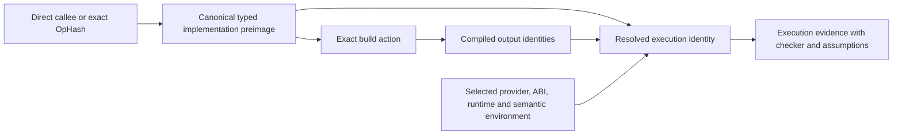

# RT-05 implementation identity, native execution and exact propagation

Changing a compiler option, native library or abstract provider can affect different identities even when the original typed caller stays the same. This candidate specifies where to record those inputs and gives a propagation invariant for actual semantic changes. It combines checked native and Lean evidence with a finite field-influence model.

## Exact dependency rule

Define the typed implementation preimage by its canonical body, declared provider contract, typed exact dependencies, and any semantic context the implementation uses. Preserve ordered reference occurrences and their roles. Within the supported profile, a semantic change to any of those inputs must change the exact preimage. A digest address represents that change when its type and canonical bytes are independently admitted and competing preimages are rejected as a collision. This is a statement about faithful preimages and typed store admission. It assumes no mathematical injectivity property for SHA-256.

A direct call includes the callee's exact immutable implementation identity at the reference occurrence. Recursively replacing that reference reconstructs each dependent preimage in reverse dependency order. Publish mutually dependent members through the exact component address and member selector. Body edits need an updated group, and topology changes require recomputing the affected group partition. For an abstract call the exact reference in the body selects `OpHash`. Changing the chosen provider preserves that body while changing the consulted execution closure. Recompiling a reusable abstract caller can keep the same build key when the provider is outside its actual inputs. A build that inlines or specializes a provider must include the consulted provider and the checked selection conditions in its own key. Missing extraction evidence requires revalidation or a broader checked dependency key.



## Target, ABI and runtime properties

| Property | Record in the candidate |
|---|---|
| Target ISA, data layout, instruction representation | Native implementation or resolved execution whenever used. Also include in the typed semantic profile when the source-level meaning depends on it |
| Externally promised calling convention, native entry and structural layout | Exact interface when part of the public operation semantics. Include the selected native calling and representation requirements in resolved implementation identity |
| Resolved provider, loader, runtime library and behavior-relevant execution configuration | Exact native execution closure. Static dependencies committed by a native implementation are part of its exact native identity. Bind deployment-selected dependencies through a separately exact activation context |
| Toolchain, command line, generator, headers and build environment | Exact build input closure. Promote a setting to semantic identity when the resulting typed implementation or the semantic interpretation changes |
| Checker, observation profile and assumptions | Exact evidence scope over the semantic or resolved subject used by the claim |
| Catalog notes and unused environment | Separate metadata, unless resolving the program actually consumes that input |

A profile can intentionally retain a target-independent typed `ImplHash` and give lowered native artifacts their own exact typed identities. Preserving a public ABI across executions requires a contract scoped to the exact boundary and supported targets. Full native correspondence also depends on the ordinary platform and runtime assumptions. Name and record layout alone cannot establish calling convention.

## Checked comparisons

The archive checker recomputes all 28 pair comparisons from the eight Linux profiles, each of which has eight vectors. Caller bytes alone collapse eight pairs with distinct observations. The resolved implementation and evidence keys collapse zero. All four unused-macro pairs have different build action keys and the same resolved implementation subject. The original native fixture matched two supported conventions, refused cross-convention pairs at the explicit gate, and held its runtime library versions fixed. [Native identity](RT-05-NATIVE-IMPLEMENTATION-IDENTITY-2026-11-25.md)

The existing [propagation study](RT-05-EXACT-DEPENDENCY-PROPAGATION-2026-11-25.md) checks 2,016 profile pairs and proves injectivity of the modeled ordered direct contexts in Lean. Exact typed subjects still permit 128 stale execution reuses when an abstract binding is omitted. The consulted-binding key has zero stale reuses and preserves 96 safe ones. The whole-state key also has zero stale reuses and loses those 96. The Lean proof concerns typed preimages and the modeled lookup and trace relation. Its consulted-map agreement theorem uses `propext`. [Axiom audit](DEPENDENCY-PROPAGATION-01/axioms.txt)

The new matrix crosses single and paired changes to 14 fields with both direct and abstract calls. The separate field-influence rule agrees on 210 checks. It treats the abstract build as a reusable compilation that does not consult the provider. A changed provider affects the typed identity for direct calls and the resolved closure for abstract calls. A changed toolchain or build-only configuration alters the recipe when the selected output and semantic profile remain fixed. A runtime library or runtime configuration changes the resolved subject even when its reusable caller is unchanged. Those runtime changes are model controls. No alternative native runtime was exercised.

## Verify and limits

The [runner](IMPLEMENTATION-BOUNDARIES-01/check.py) and [ledger](IMPLEMENTATION-BOUNDARIES-01/evidence.json) use CPython 3.12.14 and Git 2.56.1. They read native and exact propagation evidence from `5f01f24c9056dff64baa2de7ec26d4151c2f06fb`. Two hash seeds reproduce identical checks.

```bash
fixture=research/semantic-representation/RT-05/IMPLEMENTATION-BOUNDARIES-01
PYTHONHASHSEED=37 python3 -B "$fixture/check.py" > /tmp/llmlang-implementation-boundaries.json
cmp "$fixture/evidence.json" /tmp/llmlang-implementation-boundaries.json
```

The separation gives implementation authors an exact rule for the studied call modes. Production closure extraction, general dynamic loaders, runtime substitutions, portability and an approved implementation envelope remain open. [LL-005](../../../PLAN.md#ll-005--define-hash-relevant-dependency-edges-and-cycles) · [LL-007](../../../PLAN.md#ll-007--separate-target-profile-semantics-from-implementation-identity)
