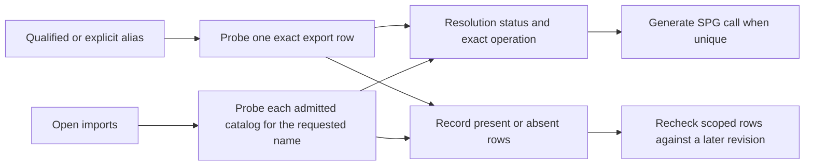

# RT-05 — Resolve source aliases and record missing export lookups

**Evidence** — Five source forms, six concrete revisions and a complete sweep of 972 cache comparisons.

## Question and policies

Can qualified, explicit and open imports lower to the same exact SPG call? Which catalog dependencies must the toolchain record to reuse that resolution safely after an export revision? Scenario 81 identifies shadowing and open imports as syntax and dependency concerns. The existing scalar SPG has explicit operation references. This comparison adds a small static source resolver before that compiler. [Import prior art and test cases](../../language-design/RT-31/RESEARCH-SCENARIO-81-IMPORT-BINDING-SYNTAX-AND-NAMESPACE-POLLUTION.md) · [Typed Semantic Program Graph](RT-05-TYPED-SEMANTIC-PROGRAM-GRAPH.md)

The experiment parses a small Python-shaped research surface as syntax. It does not load modules or execute Python imports. A qualified alias and an explicit symbol alias each query one export key. Open imports query the same name in each admitted module. Within the fixture, one distinct exact operation is a unique result, two distinct operations are ambiguous, and two paths to the same operation still resolve. A missing export means the known catalog was inspected and had no such row. An unavailable catalog fails the fixture's completeness check.



For the same normalized request, candidate cache policies use the complete catalog digest, only rows that selected the previous operation, or every exact row read including absences. A resolution result includes both its status and exact operation revision. A reuse is unsafe if either result field changes. An invalidation is counted as unnecessary for result reuse when those two fields stay equal. The latter metric does not say whether provenance or newly found paths should be refreshed.

## Results

The sweep uses two modules. Each can expose the target name as one of two exact operation revisions or omit it. An unrelated key may also appear in the first module. The eighteen catalog states are compared in both directions for qualified, explicit and open lookups. A separate operation-by-operation oracle agrees on all 972 baseline and later result pairs.

| Policy | Reuses | Unsafe reuses | Invalidations with unchanged result |
| --- | ---: | ---: | ---: |
| Whole catalog | 54 | 0 | 254 |
| Previously selected rows only | 524 | 248 | 32 |
| Every scoped row, including absences | 252 | 0 | 56 |

All five source forms lower to one exact caller hash at the baseline, including reversed open-import order and alias-only renames. When a new competing export appears in the other module, the open query becomes ambiguous without changing its previously selected row. The selected-only key would reuse the earlier answer. The qualified and explicit queries stay bound to their original export and the scoped key reuses them. A second path to the same operation preserves the typed call, while the changed read set still invalidates the scoped cache. Rebinding the initial export to a different operation changes the typed caller and produces a different result at all three sampled integers.

The fixture rejects relative imports, an unbound qualifier, an unsupported call argument, a non-import statement and an unavailable catalog. This separates absence in a complete catalog from lack of evidence about the catalog.

## Implementation implications

Resolve local aliases before building semantic call identity. Include the normalized request, scope and resolution policy when comparing evidence across immutable catalog revisions. A narrow dependency record can retain named hits and misses while avoiding invalidation on unrelated exports. Open lookup needs coverage of every module admitted by that source scope. The experiment leaves nested namespaces, visibility and re-export policy, cyclic imports, dynamic lookup, authenticated catalog publication and task-level performance open. The chosen open-import rule is a candidate in this experiment.

## Reproduction

Use CPython 3.12.14 from the repository root:

```sh
study=research/semantic-representation/RT-05/IMPORT-RESOLUTION-01
PYTHONHASHSEED=991 python3 -B "$study/run.py" --output /tmp/llmlang-import-resolution.json
cmp "$study/evidence.json" /tmp/llmlang-import-resolution.json
(cd research/PROTOTYPES/DEPENDENCY-GRAPH-01 && python3 -B -m unittest \
  tests.test_spg_representation tests.test_semantic_dependency_index tests.test_dependency_discovery)
```

The [harness](IMPORT-RESOLUTION-01/run.py) reads and normalizes the sources, performs the finite comparison and checks the exact typed references. The [ledger](IMPORT-RESOLUTION-01/evidence.json) preserves source forms, reads, lookup outcomes, caller and snapshot identities, execution samples and aggregate counts.
