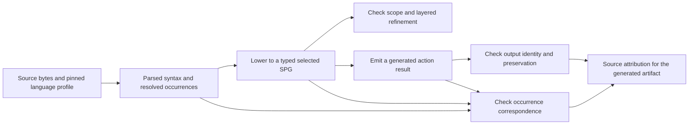

# RT-05 typed SPG, layered judgments and artifact boundaries

The Semantic Program Graph (SPG) represents the exact values and relationships used to interpret a program under a named semantic profile. This report defines a candidate boundary for three logical views and the source and output artifacts around them. It resolves which evidence can support each class of claim in the studied subset. The audit checks exact existing ledgers and a small policy model.

## Typed representation

A selected SPG under profile `P` consists of an immutable store of typed values, exact references between them, and an immutable selection of logical declarations and bindings. A managed declaration slot can retain continuity across edits if checked lineage relates the selections. An exact value address commits to its typed semantics and exact dependencies under the profile. Separate slots can select the same exact value. Independently declared observations and current policy establish whether a selected graph is eligible for a particular operation.

| View | Typed objects and relationships | What a checked claim establishes |
|---|---|---|
| Specification | Requirements, contracts, invariants, types and named observation profiles | The versioned permitted outcomes and required input or state scope |
| Design | Operations, exact interfaces, declared contract references, components and permitted dependencies | Its actual behavior relation respects the specification over the pinned required scope |
| Implementation | Typed bodies, exact call references and snapshot-specific operation bindings | The implementation covers the required inputs and produces only behavior admitted by the design |

Views can share exact type or contract values. A design `refines` edge and implementation `provides` edge name the exact endpoints of a claim. Their typed shape establishes what is being asserted. For the finite layered release model, the independent judgment must check `∅ ≠ I(x) ⊆ D(x) ⊆ S(x)` for each required `x`. Here `I`, `D` and `S` are observable outcome sets in the three views. A different proof claim might assert only endpoint conformance, with a separately named scope and weaker conclusion. An implementation-only graph can be structurally well formed without claiming that a separately specified design was verified.

Operation calls select the exact operation and a provider via the pinned binding context. Direct calls select the exact implementation. Keeping the binding context explicit lets a changed provider alter an operation call without changing the caller body. Typed admission independently checks kinds, signatures, ordered occurrences and agreement between executable references and declared edges. Persistence checks content integrity before typed admission. Closed-graph admission does not infer that unrepresented source files or references are absent.

## Source and generated evidence



Source text retains exact bytes including comments and layout. A syntax or syntax-and-trivia representation encodes parsing, expansion and resolved occurrences for a versioned source profile. It supports editing and correspondence. The SPG retains typed meaning after lowering, including order, arity, binding, and observable behavior distinctions. Provenance attaches source revision, encoding, typed occurrence and byte range to the exact graph. One generated instruction can need several ordered source occurrences. An action result binds semantic subject, compiler/backend, options, platform and exact output bytes. Its semantic-preservation judgment also binds the observation model and assumptions used to verify emission.

A source relocation or formatting change can retain exact graph identity while requiring a new source map. A semantic edit can require new graph identity and current downstream checks even when a source lexeme or a generated byte sequence is unchanged. Mapping evidence establishes attribution. Transformation evidence establishes agreement of observations. These are separately scoped. An emission may be used in the candidate model if it has an exact current action and preservation receipt and does not rely on source attribution. A debugger or other attribution consumer needs both.

## Checked contrasts and counts

- The typed-store study reports 32 cross-syntax pairs with equal graph exports and 224 paired numeric and trace observations. Its independent admission study contains nine cases where a digest-valid malformed or incomplete graph fails typed admission. A well-typed unexpected event passes structural admission and violates its declared contract. [Typed model](RT-05-TYPED-SEMANTIC-PROGRAM-GRAPH.md) · [Admission checks](RT-05-TYPED-SPG-IMPORT-VALIDATION.md)
- The pinned layered ledger checks 2,304 finite combinations and five axiom-free Lean propositions. Exact pointwise refinement and required coverage admit 49. Pointwise inclusion admits 176 additional incomplete cases. Comparing only projected outcome sets overlooks 928 pointwise violations. The proof concerns the supplied predicates and required input set. [Per-input study](RT-05-PER-INPUT-LAYERED-REFINEMENT-2026-11-25.md)
- Six source revisions share graph bytes and root. Of 30 ordered cross-revision pairs, 28 have different stored location coordinates. Swapped spans over identical expressions can match the source revision and bytes while incorrectly identifying occurrences. In the sharing fixture a fully accepted map accompanies an eager lowering with two disagreements on 20 pure-partial inputs. [Source occurrences](RT-05-SOURCE-OCCURRENCE-EVIDENCE-2026-11-25.md) · [Shared instruction provenance](RT-05-SHARED-INSTRUCTION-PROVENANCE-2026-11-25.md)

The separate gate model enumerates seven Boolean evidence fields and 128 combinations. Each field means independently verified, applicable evidence for the same subject. Missing, stale or equivocal evidence sets the relevant field to false. The table distinguishes held and permitted claims. It does not evaluate a real compiler or verifier.

| Claim | Required evidence beyond persistence and typed admission | Permitted combinations |
|---|---|---:|
| Evaluate the typed fixture | None for structural evaluation | 32 |
| Claim all-layer refinement | Independent required-scope closure and checked refinement with coverage | 8 |
| Locate source | Current source occurrence correspondence | 16 |
| Use the generated result in its checked context | Checked exact action/output and preservation | 16 |
| Attribute the generated result to source | Checked source occurrences, output and preservation, and exact generated map | 4 |

The alternatives have distinct failure modes. Trusting an imported content address admits the typed-store counterexamples. Collapsing the three views allows an incomplete or invalid middle layer to disappear from the proof obligation. Folding locations into the executable hash loses reuse across harmless formatting edits. Reusing coordinates or mapping coverage as a behavioral proof admits the observed swaps and transformation fault. A typed graph with independent scoped evidence supports narrowly scoped reuse and preserves these failure distinctions.

## Replay and release limits

The [runner](LAYER-AUTHORITY-01/check.py) and [ledger](LAYER-AUTHORITY-01/evidence.json) use Git 2.56.1 and CPython 3.12.14 on pinned tree `262b1e140cf2d4cef191ac94f89faf94c64bb86f`. They validate the three ledgers and source digests, preserve the prior Lean kernel audit and check the finite policy counts. The two hash-seed runs produce identical bytes. The archived Lean claims and typed-store results were not retimed or executed by this crosswalk.

```bash
fixture=research/semantic-representation/RT-05/LAYER-AUTHORITY-01
PYTHONHASHSEED=37 python3 -B "$fixture/check.py" > /tmp/llmlang-layer-authority.json
cmp "$fixture/evidence.json" /tmp/llmlang-layer-authority.json
```

Canonical wire schema, source and repository inventory completeness, full-language and backend correspondence, and policies for authorizing evidence producers require their own work. The candidate gates preserve exact subjects so those dependencies can be verified or replaced independently. They do not establish a release claim for the full language.
