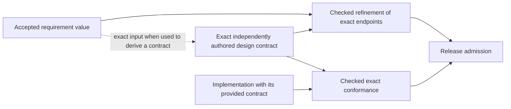

# RT-05 — Version-bound judgments across Specification, Design and Implementation

- **Evidence** — Executable finite comparison using the current experimental Content Store.
- **Baseline** — `3a26f405daad72bbe36b478cad026b89513d0034`.
- **Tracking** — [PLAN §1.1](../../../PLAN.md#11-semantic-program-graph-and-program-representation) · [RT-05 typed SPG](RT-05-TYPED-SEMANTIC-PROGRAM-GRAPH.md) · [RT-02 requirement evolution](../../language-design/RT-02/RESEARCH-SCENARIO-18-REQUIREMENT-EVOLUTION-AND-SEMANTIC-IMPACT.md).

## Question and scope

Does a design value need to hash every specification it is claimed to refine? The comparison uses three graph layers and a bounded approval example. The specification requires manual review at or above a selected threshold. The design declares exactly which inputs return a manual review decision. The implementation returns one of two decisions for each amount. The complete admitted input domain is the integers 0 through 15.

The `refines` judgment checks that whenever the requirement demands manual review, the design gives it. Below the requirement threshold either design outcome is permitted. The `provides` judgment checks the implementation against the exact design decision in every input. The implementation value carries its exact provided contract. The experiment checks independently authored designs and tests one case where the design really is generated from the requirement.



Two successful scoped judgments permit release in this fixture. Cross-layer links provide inspectable traces. When design derivation actually uses the requirement, the exact requirement is an input to that design value as well.

| Candidate | Semantic storage and release rule |
| --- | --- |
| Full hash dependency | Include the requirement in the design address even for an independently authored design. Retain both checked judgments for release. |
| Scoped checked judgments | Store independent design values with their own semantics. Record the contextual link and require evidence for the exact relation, subject, target and checker scope. Keep actual semantic derivations as exact dependencies. |
| Trace-only control | Admit a structurally linked snapshot without checking the two behavioral judgments. This control measures whether a trace edge alone is sufficient. |

## Observations

The checker enumerates the complete finite domain. An independent threshold comparison agrees for all 256 possible threshold pairs in each of the two relations. Across the six edit cases, both checked policies agree with the independent verdict. Evidence from the baseline can be reused only when every part of the judgment key still matches. [Replay and checker](LAYERED-REFINEMENT-01/check.py)

| Edit from specification/design/implementation thresholds 8/8/8 | Full hash dependency, changed values / stale judgments | Scoped checked judgments, changed values / stale judgments | Checked admission after new evidence |
| --- | ---: | ---: | --- |
| Add a provenance citation | 0 / 0 | 0 / 0 | Admitted |
| Relax requirement to 10 | 3 / 2 | 1 / 1 | Admitted. The independently authored design still meets the rule. |
| Tighten requirement to 6 | 3 / 2 | 1 / 1 | Refuted at amount 6. |
| Tighten requirement and change only the design to 6 | 3 / 2 | 3 / 2 | Implementation conformance refuted at amount 6. |
| Change all three thresholds to 6 | 3 / 2 | 3 / 2 | Admitted. |
| Change the implementation threshold alone to 9 | 1 / 1 | 1 / 1 | Implementation conformance refuted at amount 8. |

The trace-only control admits all three incompatible cases because each still has the declared link. A missing refinement link and a checker-scope mismatch both block checked release. The genuinely derived design retains an exact requirement dependency, and the coordinated threshold edit changes all three values. [Machine-readable results](LAYERED-REFINEMENT-01/evidence.json)

## Implementation consequence

A semantic input and a checked judgment carry different obligations. Independent design values can remain stable through a specification edit while release waits for a judgment against the new specification. This retains implementation conformance evidence when its exact subject and provided contract are intact. If design construction actually consumes a specification value, the design needs the exact semantic input as well. This distinction preserves more reuse without promoting a trace or stale judgment into release evidence.

The experiment checks a single closed requirement and design pair and a deterministic implementation with two outputs. Its checker and derived evidence are local. Multi-requirement interactions, source-bound extraction, human acceptance, proof authentication, graph-level coverage and production authorization remain open. The result supports a candidate layer boundary and leaves the canonical schema and release policy open.

## Reproduction

Run from the repository root with CPython 3.12.14. Five Python hash seeds produced identical evidence, and 30 focused requirement, graph and representation tests passed.

```sh
study=research/semantic-representation/RT-05/LAYERED-REFINEMENT-01
PYTHONHASHSEED=1 python3 -B "$study/check.py" > /tmp/llmlang-rt05-layered-refinement.json
cmp "$study/evidence.json" /tmp/llmlang-rt05-layered-refinement.json
(cd research/PROTOTYPES/DEPENDENCY-GRAPH-01 && python3 -B -m unittest \
  tests.test_semantic_graph tests.test_requirement_evolution tests.test_spg_representation)
```
