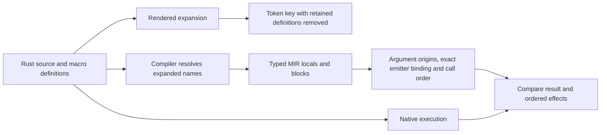

# RT-05 — Compare expanded tokens and resolved bindings for macro identity

A scoped SPG projection of compiler-resolved Rust locals preserves all 144 native observations across 48 programs. Removing retained macro definitions from expanded text and hashing the remaining tokens collapses eight pairs with different effects. Raw source, full rendered expansion, and compiler debug dumps distinguish the different effects in this corpus but also separate many equivalent variants.

## Question and scope

A graph may represent multiple surface syntaxes and generated frontend forms. The graph still needs the exact binding of a use that can resolve to more than one in-scope declaration. Rust declarative macros provide two distinct binding paths. Local identifiers mentioned literally in a macro use the relevant definition context, while an identifier supplied as a metavariable comes from the invocation. The fixture compares both forms with explicit source. It tests source and generated text as identity inputs separately from compiler-resolved binding. [Rust Reference on mixed-site hygiene](https://doc.rust-lang.org/reference/macros-by-example.html#hygiene) · [RT-03 macro boundary](../../language-design/RT-03/RESEARCH-SCENARIO-44-COMPTIME-AND-MACRO-BOUNDARIES.md)

In the distinguishing case, an outer local is initialized from the first argument and an inner local of the same name is initialized from the second argument. Placing the literal name in a macro defined before or after the inner declaration changes its binding. Both macro expansions visibly call the same function with the same spelling. For input `(5, 11)`, the outer-binding program emits `first:5, second:11` and the inner-binding program emits `first:11, second:11`. Both return 5. The full `expanded` printout retains the macro definition at its original site and distinguishes those programs. A projection that discards the definition and keeps expanded tokens loses the distinction.

## Method

Compile both binding choices, three surface constructions, two local-name sets, two comment/spacing layouts, and both effect orders. For each of the 48 programs, run three input pairs using the pinned native compiler. Record both ordered effects and the result for each input. Compare all 1,128 distinct program pairs by those observations and by exact keys.



The resolved projection follows the restricted typed MIR emitted for the function. It propagates the input ordinal through local copies and moves, checks primitive call signatures and sequences, and records the local's origin for each known call. It keeps the emitter source digest and the source return argument. MIR debug names, source spelling and macro provenance are outside the key. An evaluator of the graph computes the same observations independently of the native executable, and the generator separately checks the intended binding and order.

## Results

| Identity input | Different trace, same key | Same trace, different key | Same trace, same key |
| --- | ---: | ---: | ---: |
| source | 0 | 264 | 0 |
| expanded | 0 | 264 | 0 |
| expanded_without_definitions | 8 | 248 | 16 |
| expansion_hygiene | 0 | 264 | 0 |
| mir | 0 | 208 | 56 |
| bound_spg | 0 | 0 | 264 |

Every comparison has the same 1,128 pairs. The 264 observed-equivalent pairs and the 864 differing pairs use the same three native inputs. The result column of each input is identical across the corpus. The ordered effect observations discriminate the four fixture classes. Exact rendered forms preserve distinctions but give less reuse across equivalent spellings. The tested MIR-derived projection preserves the source choice of binding and the effect order without requiring identical source provenance.

## Implications and limits

Macro or frontend provenance can remain available for diagnostics and review while a semantic key uses resolved references. A generated program should carry enough information to check those references before reuse. Stripping definition context is sound only if the effect of that context has already been captured by resolution. A raw compiler dump is also a possible conservative input when stable text and missed reuse are acceptable.

This experiment covers two typed integer arguments, linear supported MIR, two fixed side-effecting emitters and three finite observations per program. It leaves cross-module imports, other macro kinds, arbitrary expansion traces, production canonical bytes, generated-source diagnostic maps and version-stable Rust tooling open. The `-Z` outputs belong to a pinned compiler experiment and offer no stable format guarantee. The token projection recognizes only the emitted shape of this corpus. No syntax or semantic representation is selected.

## Reproduce

Use CPython 3.12.14 and Rust 1.85.1 at commit `4eb161250e340c8f48f66e2b929ef4a5bed7c181` on x86-64 Linux. The runner enables unstable Rust introspection for the pinned compiler dumps. It compiles and runs native Rust separately. The ledger retains every generated source, the exact key digests, the resolved graph and the three observations for each case.

```sh
fixture=research/semantic-representation/RT-05/MACRO-BINDING-01
output=$(mktemp)
python3 -B "$fixture/run.py" --rustc "$(command -v rustc)" > "$output"
cmp "$fixture/evidence.json" "$output"
python3 "$fixture/chart.py"
```

[Runner](MACRO-BINDING-01/run.py) · [Pair counts, counterexample and observations](MACRO-BINDING-01/evidence.json)
