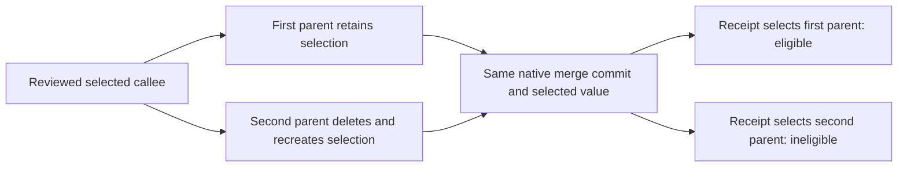

# RT-05 — Occurrence review at a two-parent Git merge

In two pairs of trials, the exact same native Git merge commit supports different review decisions. Each pair differs in which parent the resolution identifies as the source of the selected occurrence. A parent-order rule cannot distinguish those decisions from the commit alone. The fixture's exact, signed selection receipt distinguishes them and withholds reuse when the receipt or retained history is missing.

## Experiment

A fixture review covers an exact callee value selected at one managed slot. A branch can retain that selection, or can delete and recreate it with the same value. Both final branch trees import successfully and select the same exact callee. Ordinary files differ to force a real two-parent Git merge. Every merge tree selects the original immutable value. The native parent graph retains the deletion where it occurred.

The declared review policy follows the selected parent's uninterrupted lifetime. First-parent, any-parent and all-parents rules infer continuity from the available histories. The fourth rule checks a supplied selection receipt binding the exact merge commit, tree, ordered parents, selected parent, slot and value. The receipt uses the previous RT-24 OpenSSL Ed25519 fixture code and a reproducible demonstration key. The runner admits one fixture issuer and checks the signature against its fixed public key. The fixture assumes a trusted selection action supplies the chosen parent.



## Results

| Policy | Excess grants | Missed grants | Unknown |
| --- | ---: | ---: | ---: |
| all-parents | 5 | 2 | 1 |
| any-parent | 7 | 0 | 1 |
| exact-choice | 0 | 0 | 6 |
| first-parent | 6 | 1 | 1 |

The table compares twelve cases with the declared review policy. The first-parent rule misses an eligible second-parent selection. The any-parent rule grants review even when the selected parent recreated the occurrence. The all-parents rule rejects two eligible choices because the unselected parent recreated the occurrence. All three unqualified parent rules also grant in some cases where exact selection evidence is unavailable.

The exact receipt keeps six cases pending. The controls omit the receipt, substitute a validly signed equal-tree but different parent commit, use a valid signature from another issuer, sign an incorrect value, change the chosen parent after signing, and remove parent objects in a real depth-one clone. On known paths, the explicit rule preserves all three declared eligible grants and rejects the three selections that follow a recreated lifetime. The ledger retains Git object IDs, declared slots, selected parents, exact signature bytes and decisions.

## Implementation boundary

A source operation can record per-selection provenance alongside a merge rather than deriving it from parent order or equal payloads. Such evidence lets an authority state which lifetime is selected and which review can follow it. The example checks signature and exact-context admission using public fixture keys. Production issuer governance, verifying the actual selection action, provenance for semantic splits and joins across parents, and more general Git DAGs remain open. The prototype's parent-path check covers linear parent histories with complete typed inventories.

## Reproduce

Use Git 2.52.0, CPython 3.12.14 and OpenSSL 3.5.7 from the repository root. The runner creates temporary repositories, deterministic commits and demonstration keys.

```sh
fixture=research/semantic-representation/RT-05/MULTI-PARENT-LINEAGE-01
output=$(mktemp)
python3 "$fixture/run.py" --output "$output"
cmp "$fixture/evidence.json" "$output"
python3 "$fixture/chart.py"
```

[Runner](MULTI-PARENT-LINEAGE-01/run.py) · [Evidence ledger](MULTI-PARENT-LINEAGE-01/evidence.json) · [Native selection lifetimes](../../toolchain-and-collaboration/RT-24/RT-24-GIT-SELECTION-LIFETIMES-2026-11-24.md) · [Audit signature fixture](../../toolchain-and-collaboration/RT-24/AUDIT-AUTHORITY-01/run.py)
