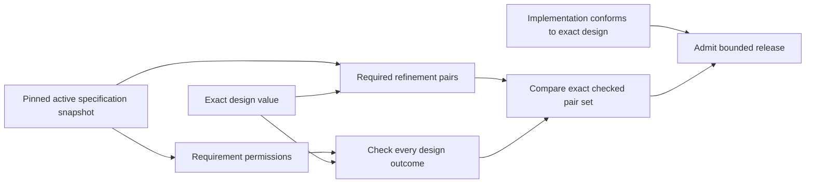

# RT-05 — Compose checked requirements over a pinned specification

**Evidence** — 2,744 finite design cases, twelve exact SPG release controls and four Lean theorems.

## Question and alternatives

The first layered SPG comparison separated specification identity, design values and implementation conformance for one requirement. With multiple requirements a release consumer must know which exact revisions are active. It must also distinguish an allowed outcome found separately for each requirement from a common outcome that meets all of them. The two questions affect whether scoped evidence can replace binding all independently authored requirements directly into the design hash. [Single-requirement layered evidence](RT-05-LAYERED-REFINEMENT-EVIDENCE-2026-11-24.md) · [Typed SPG](RT-05-TYPED-SEMANTIC-PROGRAM-GRAPH.md)

This fragment fixes one input state. Three decisions are possible: allow, review and deny. Each requirement permits a nonempty subset. A design admits a subset. An implementation emits one exact decision, with a typed dependency on the design value. The study compares the following admission evidence.

| Candidate | What must hold |
| --- | --- |
| Local compatibility | Each requirement has at least one witness among the design's possible outcomes. Different requirements can use different witnesses. |
| Shared feasibility | At least one outcome allowed by the design meets every active requirement. |
| Checked refinement | The design is nonempty and every design outcome meets every active requirement. |
| Submitted-edge release | The implementation conforms to its exact design and all supplied checks report success. |
| Pinned-coverage release | The implementation conforms. Each requirement revision selected by the authority snapshot has its exact design and scope check. The consumer also recomputes each refinement over the finite outcome domain. |



The authority snapshot supplies the active revision set independently of the submitted evidence. An exact successful check for an unchanged requirement and design can be reused when another requirement revision changes. The consumer enumerates the new required pairs and checks the changed edge. Assertions supplied by the producer and the provenance of how that authority snapshot was selected are separate concerns.

## Results

| Outcome across the 2,744 enumerated cases | Count |
| --- | ---: |
| Each requirement finds a local design witness | 1,183 |
| At least one jointly permitted design outcome exists | 721 |
| Every admitted design outcome meets all requirements and the design is nonempty | 217 |
| Local witnesses exist but no joint witness exists | 462 |
| Refinement is vacuous because the design permits no outcome | 343 |

The sweep checks (7^3 \\times 8) combinations and verifies the bitset decisions against an outcome-by-outcome oracle. The first conflict has one requirement allowing review only, two allowing allow only, and a design permitting both. Each local pair meets its witness test. The intersection of all four outcome sets is empty.

The twelve content-store controls cover exact endpoints and evidence. The submitted-edge rule admits nine controls. The pinned-coverage rule admits two: a complete revision and a compatible revision with its changed edge rechecked. It preserves the design and implementation addresses across the compatible specification edit. It rejects omitted or contradictory requirements, a false success label, a stale target revision, mismatched checker scope or design, a duplicate check, empty designs and an implementation bound to a different design.

Lean checks four claims. Universal refinement over covered active requirements composes with implementation conformance. A nonempty universally refined design supplies one shared witness. Local witnesses can disagree. Omission can hide a violation even when every recorded judgment succeeds. These statements use predicates directly. The Python experiment checks correspondence to them on the finite cases and exercises exact version bindings. Lean is not checking the Python implementation or the origin of the active set. [Lean source](REQUIREMENT-COVERAGE-01/Coverage.lean) · [Machine-readable results](REQUIREMENT-COVERAGE-01/evidence.json)

## Implementation implications

Scoped checks can compose if release admission pins the authoritative requirement inventory, checks every exact pair, validates the premises under a shared observation model and establishes the required feasibility boundary. A feasibility witness answers a different design question from universal refinement. If the language admits multiple inputs, guarded requirements, temporal policies or coupled components, the release consumer needs an authoritative applicability rule and a common input and observation domain. This study leaves those rules, source-derived coverage, authority issuance and adoption of the representation open.

## Reproduction

Use CPython 3.12.14 and Lean 4.36.0 at revision `611c117bfaf7b7ae1cfcf246ce6fba31e8f509e9` from the repository root:

```sh
study=research/semantic-representation/RT-05/REQUIREMENT-COVERAGE-01
PYTHONHASHSEED=991 python3 -B "$study/run.py" --output /tmp/llmlang-requirement-coverage.json
cmp "$study/evidence.json" /tmp/llmlang-requirement-coverage.json
lean "$study/Coverage.lean"
(cd research/PROTOTYPES/DEPENDENCY-GRAPH-01 && python3 -B -m unittest \
  tests.test_semantic_graph tests.test_requirement_evolution tests.test_spg_representation)
```

The [enumerator](REQUIREMENT-COVERAGE-01/run.py) checks every finite control. The ledger retains the exhaustive manifest digest, distinguishing witness, individual coverage controls and denominators. Lean's axiom audit reports that all four theorems are axiom-free.
