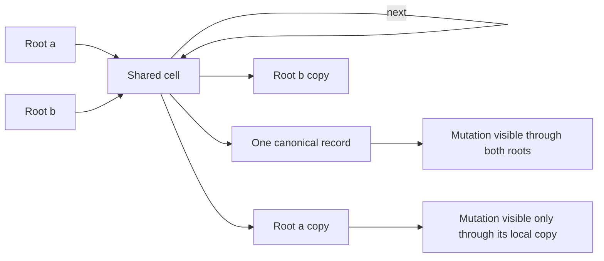

# Preserve mutable reference topology through SPG normalization

An LLMLang snapshot can contain several references to the same mutable location or several locations with equal contents. A value-based representation that restores each root separately can change which writes are visible through the other roots. This RT-05 experiment compares three graph representations against native reference behavior, with cycles and changes in physical identifiers. It studies concrete snapshot references. Static source analysis still has to discover which locations may alias when execution is unknown. [Typed SPG study](RT-05-TYPED-SEMANTIC-PROGRAM-GRAPH.md)

## Graph and comparison

A closed snapshot has three ordered root roles `a`, `b`, and `c` and one to three reachable mutable cells. Each cell initially contains `10` and has one optional `next` reference. Different roots or edges may reference the same cell. The fixture enumerates all such directed topologies at this bound. It compares each accepted snapshot under renamings into a disjoint physical identifier space and both ascending and descending input record order.

The physical identifier representation keeps a single table and sorts by input identifiers. The separate-root representation renames every reachable subgraph independently and preserves sharing within that subgraph. Reconstructing the three copies allocates separate cells where distinct roots meet. The shared graph representation numbers each reachable cell once. It queues the named roots in their fixed order, then visits each `next` edge, preserving references to previously numbered cells. Restoration allocates a cell for each record before linking any edges, so references can point into cycles.



The diagram uses two of the three root roles and one self-loop. Both copies preserve their local loop. Only the shared record preserves the fact that the two roots refer to the same location. The procedure is a candidate for ordered distinguished roots and ordered reference roles. It does not require solving canonical labeling for arbitrary symmetric unordered graphs.

## Observations

An independent finite isomorphism oracle groups graphs by enumerating all renamings. It produces 184 classes from 336 enumerated inputs. Across those classes the experiment exercises 1,948 relabeling and record-order settings. Each projection must be idempotent under re-normalization. Four controls for duplicate cells, missing roots, missing targets and unreachable cells are refused by all three comparisons.

Six recipes exercise reads, writes, bounded paths, pointer equality and edge relinking. The raw snapshot and three projections run against native Python objects and native JavaScript objects, with 46,752 complete recipe vectors per runtime. Each recipe starts from a fresh object graph. The runtimes agree on every raw and projected vector, including the effects of a lossy projection. The table compares each policy with the unprojected observation. It covers 11,688 recipe vectors per policy, 1,948 renamed input keys per policy, and all 16,836 unordered pairs of distinct isomorphism classes.

| Graph representation | Changed recipe traces | Changed keys under relabeling | Distinct graph pairs sharing a key | Colliding pairs with different traces |
|---|---:|---:|---:|---:|
| Physical identifiers | 0 | 1,948 | 0 | 0 |
| Separate graph per root | 4,758 | 0 | 161 | 156 |
| One shared graph | 0 | 0 | 0 | 0 |

For a snapshot with all three roots referencing one cell, the first recipe records `[10, 11, 11, 11, true]`. The separate-root result is `[10, 11, 10, 10, false]`. That encoding also gives the one-cell snapshot the same key as three separate equal-valued cells. Physical identifiers preserve both kinds of state and distinguish them, but identical graphs lose their key if storage labels change. A shared canonical table preserves concrete cross-root aliasing and is invariant to the measured transport changes.

## Scope and reproducibility

A graph encoding for mutable snapshots needs to retain location identity within the snapshot even when the transport can renumber locations. The experiment makes no claim about persistent identities across edits, comparing full program behavior, unordered root roles, resource ownership or authorization, weak references, garbage collection, concurrency, larger workloads or source-derived alias completeness. General schema and independent review remain open.

Run with CPython 3.12.14 and Node 22.23.5 with V8 12.4.254.21-node.57. The initial LLMLang base is `22434aae074df1c4abd7ee9347eca51da728c78d`. The ledger keeps the reference vector and exact projected differences indexed by recipe. When the difference list is empty the projected vector equals the reference vector. The source digests, graph enumeration, deterministic ordering and native runtime versions are recorded with the observations.

```bash
fixture=research/semantic-representation/RT-05/MUTABLE-REFERENCE-TOPOLOGY-01
PYTHONHASHSEED=1 python3 -B "$fixture/run.py" > /tmp/llmlang-mutable-reference-topology.json
cmp "$fixture/evidence.json" /tmp/llmlang-mutable-reference-topology.json
python3 "$fixture/chart.py"
```

[Graph enumeration, normalization and Python runtime](MUTABLE-REFERENCE-TOPOLOGY-01/run.py) · [Node runtime](MUTABLE-REFERENCE-TOPOLOGY-01/observe.js) · [Evidence](MUTABLE-REFERENCE-TOPOLOGY-01/evidence.json) · [Table generator](MUTABLE-REFERENCE-TOPOLOGY-01/chart.py)
