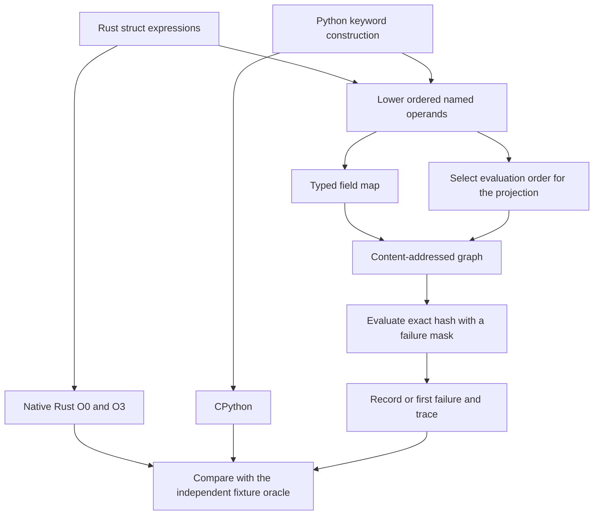

# Canonical named record fields and ordered evaluation

This RT-05 study compares three SPG projections for named record construction. A record has field identity and an evaluation sequence. Both can affect program observations. Preserving all source ordering may keep redundant distinctions, while sorting a field map before evaluating operands can change effects or which failure propagates first. The experiment uses a common Rust and Python subset with equal field values, an explicit event trace and a bounded failure mask.

## Source, graph and oracle

The twelve source-level cases formed by the six field orders and the two source languages share an `alpha`, `beta`, `gamma` schema. Rust's declaration order is `gamma`, `alpha`, `beta`. The Python dataclass uses `beta`, `gamma`, `alpha`. For every order, each of the three fields independently uses one of three initializer forms, resulting in 162 combinations per language. An integer literal is typed, total and effect-free for the fixture. A traced operand always succeeds after recording an event. A fallible operand records its attempt and fails when its bit is set in the input mask. The Rust operand uses `Result` and `?`; Python raises a fixture exception. The experiment observes the materialized record or first failure and the ordered effect prefix. The implementations have no user-defined record construction effects.

The Python adapter reads keyword order through the standard AST. The Rust adapter parses only the generated, closed constructor grammar. Both check required field coverage, single occurrence and the operation's declared field role. Rust adaptation also requires propagation syntax for the fallible helper. A separate oracle walks the input permutation and truncates its effects at the first failing field. It consumes the experiment parameters, never a generated syntax tree or SPG.



The full surface order stores every field in written order. Ordered observable operands store the field map and a sequence of only traced and fallible operands. Infallible literals contribute to the field map and need no sequence position. The field-map-only variant evaluates its values in canonical field name order. All three encode the same typed field data and publish a record only after successful evaluation.

## Results

Each of 162 fixture combinations runs under all eight masks. Rust at optimization levels zero and three and CPython each agree with the oracle on 1,296 vectors, for 3,888 native observations. Exact graph classes count distinct immutable hashes across the 162 combinations after both adapters produce equal hashes. Pair classification compares full eight-mask vectors. Observation mismatches use the 1,296 case-mask vectors.

| Projection | Exact classes | Equivalent pairs sharing a hash | Distinct pairs sharing a hash | Observation mismatches |
|---|---:|---:|---:|---:|
| Full surface order | 162 | 0 | 0 | 0 |
| Ordered observable operands | 79 | 177 | 0 | 0 |
| Field map only | 27 | 177 | 228 | 592 |

The complete oracle identifies 177 equivalent unordered case pairs. Ordered observable operands preserve all of them and have no behaviorally distinct collisions in the fixture. Full surface order preserves all traces and failures but retains all 162 distinct representations. Field-map-only canonicalization yields the smallest representation count by collapsing 228 behaviorally distinct pairs and changes 592 vectors.

Cases 4 and 58 exchange an infallible literal and a traced `beta` initializer. Both keep the `beta` then `gamma` effect order and share the ordered-observable graph. Cases 8 and 35 reverse two fallible operands. With mask 7 their outcomes are failure 2 after event 5 and failure 3 after event 6 respectively. They share the field-map-only hash. Missing, repeated or unknown fields and mismatched operation roles are rejected by both adapters. A fallible Rust term without `?` is also rejected by the fixture adapter.

## Limits and replay

The result supports separating canonical field roles from sequencing of observable operands. The permission to omit evaluations from the sequence covers only the fixture's closed integer literals. A seemingly pure general operand may read mutable state, trap, allocate, drop a value, diverge or depend on another operand. Default expressions, spread, field update, partial ownership and destruction, general frontends, supported source profiles, and independent review remain open. The Rust and Python observations compare the common result and trace contract and do not align every native error or source diagnostic.

Use CPython 3.12.14 and Rust 1.85.1 for the x86-64 Linux host. The ledger records full rustc build information, exact generated source and runner SHA-256 values. The initial LLMLang base is `12a7cfa69e8e7ee49dc4b991ecb9359aebde3dda`. The script generates and builds both native fixtures in temporary storage.

```bash
fixture=research/semantic-representation/RT-05/NAMED-RECORD-01
PYTHONHASHSEED=1 python3 -B "$fixture/run.py" > /tmp/llmlang-rt05-record.json
cmp "$fixture/evidence.json" /tmp/llmlang-rt05-record.json
python3 "$fixture/chart.py"
```

See the [fixture generator and runner](NAMED-RECORD-01/run.py), [measured ledger](NAMED-RECORD-01/evidence.json), [table generator](NAMED-RECORD-01/chart.py), and [RT-03 evaluation-order prior art](../../language-design/RT-03/RESEARCH-SCENARIO-77-CALL-ARGUMENT-EVALUATION-ORDER.md).
