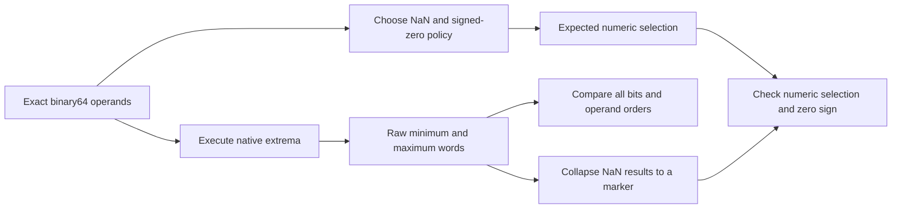

# Distinguish binary64 minimum and maximum semantics across runtimes

A primitive named `min` or `max` can select different results for NaNs and signed zeros. An LLMLang semantic node and its lowering need to identify which behavior the caller can observe. This study compares native operations with explicit candidate rules, separating the exact representation of a NaN output from the numeric decision to produce a NaN. [Floating-point semantics survey](../../language-design/RT-03/RESEARCH-SCENARIO-78-FLOATING-POINT-REPRODUCIBILITY-AND-IEEE-EDGES.md) · [Binary64 literal identity](RT-05-CROSS-RUNTIME-F64-IDENTITY-2026-11-25.md)

## Methods and candidate rules

The corpus has 32 binary64 words. They include signed zeros, subnormal and normal boundaries, adjacent normals, largest finite values, infinities, and 14 quiet or signaling NaNs with both signs and differing payloads. All 1,024 ordered pairs are tested, including equal operands. Each observation records both result words. The comparison normalizes output NaN bits to one marker while retaining every other bit, including the sign of zero. An independent ordering on bit words places negative non-NaNs in reversed magnitude order and nonnegative words in forward magnitude order.

Seven candidate rules use this common ordering when inputs are distinct numeric values. Their behavior on NaNs and ties differs.

- **Propagate NaN** yields NaN if either operand is NaN. Its ordered zero result is `−0` for minimum and `+0` for maximum.
- **Prefer number** returns the numeric operand if only one is NaN and NaN if both are NaN. It has the same signed zero rule as propagation for numeric inputs. The **left tie** and **right tie** variants select the named operand when numeric inputs compare equal.
- **Ordered left** returns the first operand for equal or unordered comparisons. A comparison is unordered when either operand is a NaN.
- **Unordered right** returns the second operand for equal or unordered comparisons.
- **Propagate signaling, right tie** returns NaN if either input is signaling, prefers the number when exactly one input is a quiet NaN, and returns the second operand on numeric ties.



The tested backends are glibc `fmin` and `fmax`, x86 SSE2 scalar instructions, Rust `f64::min` and `f64::max`, Node `Math.min` and `Math.max`, and two-argument CPython builtins. The C binary uses real libm dynamic symbols and separately emitted `minsd`/`maxsd`. `nm` and `objdump` check both. C O0/O2, Rust O0/O3, and default/jitless Node produce exactly the same words within their own families. Nine configurations supply 9,216 result vectors, each with two values.

## Native outcomes

Mismatch counts compare each rule with 1,024 observed numeric vectors in each family. NaN output payload and sign are compared separately in the raw record.

| Native family | Propagate NaN | Prefer number | Prefer number, left tie | Prefer number, right tie | Ordered left | Unordered right | Propagate signaling, right tie |
|---|---:|---:|---:|---:|---:|---:|---:|
| glibc | 290 | 218 | 218 | 216 | 254 | 252 | 0 |
| x86 SSE2 | 254 | 254 | 254 | 252 | 506 | 0 | 252 |
| Rust | 506 | 2 | 0 | 2 | 252 | 254 | 218 |
| Node | 0 | 504 | 506 | 506 | 254 | 254 | 290 |
| CPython | 254 | 254 | 252 | 254 | 0 | 506 | 254 |

For `(+0, −0)`, Node produces `(−0, +0)`, Rust and CPython produce `(+0, +0)`, and glibc and SSE2 produce `(−0, −0)`. Reversing operands changes the latter four families. With a quiet NaN and 1, glibc and Rust return 1, while Node returns NaN. With signaling `7ff0000000000100` and 1, glibc returns `7ff8000000000100` and Rust still returns 1. These pairs distinguish an operand preference from unconditional propagation and from quiet/signaling distinctions.

| Native family | Operand swaps changing bits | Operand swaps changing numeric observation |
|---|---:|---:|
| glibc | 86 | 1 |
| x86 SSE2 | 344 | 253 |
| Rust | 92 | 1 |
| Node | 0 | 0 |
| CPython | 344 | 253 |

The swap denominator is 496 unordered distinct pairs. A compiler using an order-changing rewrite or a native extrema instruction must establish the applicable operand and observation conditions. Even after normalizing NaN outputs, several examined routes change visible results when the order changes. A typed numeric profile can choose any supported rule, with a separate obligation for exact NaN payloads or hardware exception flags where exposed.

## Scope and replay

This comparison covers scalar binary64 on Linux x86-64 with the default arithmetic environment. It leaves full floating-point semantics, exception and status flag behavior, cross-target conformance, SIMD lane semantics, more than two operands, optimized lowering proofs and independent review open. The results are bounded implementation evidence for a potential LLMLang operation contract.

Use CPython 3.12.14, Debian GCC 14.2.0-19, glibc 2.41-12+deb13u4, GNU Binutils 2.44, Rust 1.85.1 at `4eb161250e340c8f48f66e2b929ef4a5bed7c181`, and Node 22.23.5 with V8 12.4.254.21-node.57. The initial LLMLang baseline is `dce8710b23f9b6811acab93ed87a478ee26362c5`. The ledger preserves exact operand and result bits, tool versions, source digests, native artifact observations and both comparisons.

```bash
fixture=research/semantic-representation/RT-05/NATIVE-F64-MINMAX-01
PYTHONHASHSEED=1 python3 -B "$fixture/run.py" > /tmp/llmlang-f64-minmax.json
cmp "$fixture/evidence.json" /tmp/llmlang-f64-minmax.json
python3 "$fixture/chart.py"
```

[Native C](NATIVE-F64-MINMAX-01/observe.c) · [Native Rust](NATIVE-F64-MINMAX-01/observe.rs) · [Native Node](NATIVE-F64-MINMAX-01/observe.js) · [Runner and policies](NATIVE-F64-MINMAX-01/run.py) · [Observation ledger](NATIVE-F64-MINMAX-01/evidence.json) · [Table generator](NATIVE-F64-MINMAX-01/chart.py)
