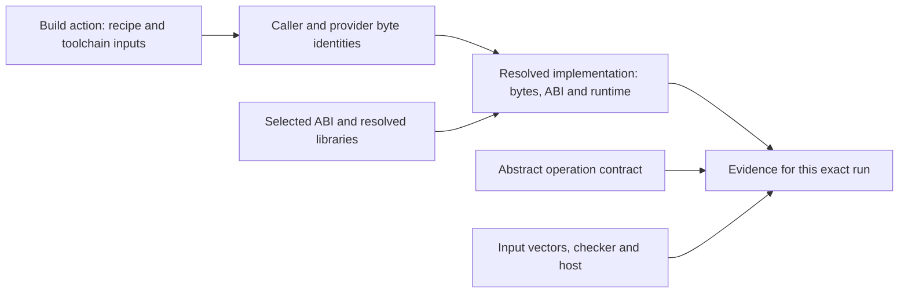

# RT-05 — Native implementation identity, ABI and build actions

## Question and fixture

Which properties determine the identity of one resolved native implementation, and which properties identify its build or evidence? [Scenario 92](RESEARCH-SCENARIO-92-OPERATION-IDENTITY-AND-IMPLEMENTATION-BINDING.md) proposes distinct operation, implementation, action and output identities. The [by-value ABI study](../../compiler-and-translation/RT-13/RT-13-BY-VALUE-CALL-ABI-2026-11-25.md) shows that the same symbol and record layout can have different native calling conventions. This experiment checks how those distinctions affect exact identity and potential reuse in a closed Linux fixture. [PLAN §1.2](../../../PLAN.md#12-semantic-identity-hashes-and-canonical-encoding) · [#289](https://github.com/aivibeflow/LLMLang/issues/289) · [LL-007 / #350](https://github.com/aivibeflow/LLMLang/issues/350)

The operation takes a record of two unsigned 64-bit words and a salt. Its contract specifies `(first + salt + 1 mod 2^64, second xor salt)`. A C executable dynamically loads a local provider and calls its `step` export. Both components use the same header and compile-time assertions for aggregate size, alignment and offsets. The fixture builds two calling conventions, System V AMD64 and Microsoft x64, on one ELF Linux host. The abstract operation has a stable contract in the comparison. Its C entry is the concrete target binding. A public native interface that promises a particular convention would also bind that convention as part of its interface.

Eight profiles cross the two calling conventions, the two provider implementations and two values of an unused caller macro. Each uses eight deterministic boundary and ordinary inputs. The second provider adds two where the contract requires one. The harness executes matching calling conventions and uses the two cross-convention combinations as admission controls. It resolves and hashes the caller's glibc and loader with `ldd` under the same fixed environment used for fixture execution.



## Results

| Projection | Profile pairs with distinct native vectors and the same key |
| --- | ---: |
| Caller bytes alone | 8/28 |
| Resolved implementation | 0/28 |
| Fixture evidence | 0/28 |

The `+1` provider satisfies the contract on 32 inputs across four profile runs. The `+2` provider fails all 32 corresponding inputs, even when the caller bytes, export name, ABI and record layout agree. The changed provider requires a new resolved implementation and separate evidence. Its receipt remains evidence of mismatch for that implementation.

The name-and-layout gate admits all four ordered ABI combinations, including two cross-convention combinations. The explicit convention gate admits the two matching combinations. Both matching conventions yield the same vectors for a given provider delta. Their exact native identities still differ.

Each of the four matched pairs that differ only in the unused macro has distinct caller build action keys, identical caller bytes and identical resolved implementation and fixture evidence keys. This demonstrates a case where exact build action identity changes without changing the output or the evidence inputs of a subsequent execution check. It does not authorize reuse of a build result before a changed recipe has been evaluated or covered by a verified invariance rule.

## Implications and limits

The candidate implementation envelope includes caller bytes, exact resolved provider bytes, target architecture and format, external entry and calling convention, and the two resolved library digests. If provider selection belongs to deployment, the same dependency can be committed by an exact binding while leaving a reusable caller component separately addressable. In either representation, exact execution evidence needs the resolved closure. The fixture's action key includes the fixed build arguments, selected source bytes, observed compiler components and build environment. Reproducible production actions still need the rest of the compiler dependency closure, including target headers and build-time libraries.

This is a finite execution check on one host. The two ABIs are emitted on Linux, and the runtime libraries were held fixed. It provides no measurement of runtime-library swaps, general dynamic-loader resolution, a proof of contract preservation, or a choice of canonical production hash format. The five build tools recorded by digest provide observed executable identities, with compiler, assembler and linker banners. The loader and glibc digests describe this run. Kernel, CPU and environmental effects beyond this fixture require separate evidence.

## Reproduce

The LLMLang baseline was `0a576189d080746d352653d3f15a01af079e39cb` on `research/all`. The run used Debian 13 x86-64 Linux 6.18.57, glibc 2.41, CPython 3.12.14, GCC 14.2.0-19 and GNU Binutils 2.44. Run from the repository root with those tools installed:

```sh
fixture=research/semantic-representation/RT-05/NATIVE-IMPLEMENTATION-IDENTITY-01
out=$(mktemp)
python3 -B "$fixture/run.py" > "$out" &&
  cmp "$fixture/evidence.json" "$out" &&
  python3 -B "$fixture/chart.py"
```

The [ledger](NATIVE-IMPLEMENTATION-IDENTITY-01/evidence.json) preserves commands, hashes, all inputs and observed vectors. The [comparison table generator](NATIVE-IMPLEMENTATION-IDENTITY-01/chart.py) reproduces the categorical counts in the report. [Caller](NATIVE-IMPLEMENTATION-IDENTITY-01/caller.c) · [Provider](NATIVE-IMPLEMENTATION-IDENTITY-01/provider.c) · [Runner](NATIVE-IMPLEMENTATION-IDENTITY-01/run.py)
