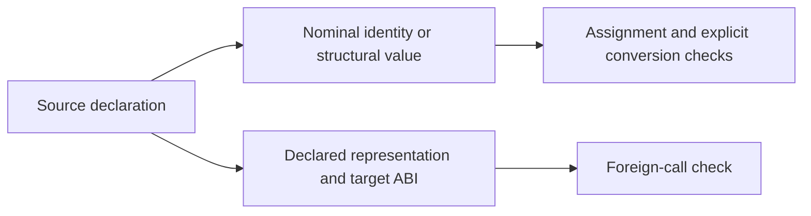

# RT-05 — Native structural compatibility, nominal identity and ABI

- **Date** — 2026-11-25
- **Tracking** — [PLAN §5.1](../../../PLAN.md#51-type-system-and-data-model) · [#324](https://github.com/aivibeflow/LLMLang/issues/324)
- **Status** — Reproduced compile-time comparison and one native ABI profile

## Question and scope

When two declarations contain the same fields, a source caller could be permitted to exchange them, required to construct a new value, or allowed to share their ABI under a separate guarantee. A type graph needs distinct evidence for each statement. This comparison covers closed, immutable-by-convention scalar fields and tuples, nominal names and aliases, explicit conversions, and Rust transparent wrappers at a C call boundary. [RT-04 type aliases and nominal wrappers](../../language-design/RT-04/RESEARCH-SCENARIO-70-TYPE-ALIASES-NEWTYPE-AND-OPAQUE-ABSTRACTIONS.md) · [RT-05 guarded recursive identity](RT-05-GUARDED-RECURSIVE-TYPE-IDENTITY-2026-11-24.md)

The source checks compile fresh independent units. Each rejected Go case requires the compiler's argument-assignment diagnostic. Rust cases require the type mismatch code or the separately enabled FFI layout lint. The ABI probe links an independently compiled C caller to a Rust static archive. It compares each result with a C implementation of the unsigned transform and checks layout against the C scalar. A deliberately unspecified wrapper participates only in the compiler lint check, so the native probe invokes functions whose declarations have a documented representation.

## Results

| Comparison | Observed result |
|---|---|
| Go unnamed records | Identical field name and type permit interchange. Changing the field name, scalar type or field tag rejects direct assignment. |
| Go named records | Two defined names with identical underlying records reject direct interchange. Assignment between a named and an unnamed record succeeds in both tested directions. An alias preserves the original acceptance. |
| Go explicit conversion | Conversion succeeds for both same-underlying named records and the tagged record case. |
| Rust tuple and nominal records | A matching tuple and the original record under an alias are accepted. Reversed tuple element types and a same-shaped record from another module are rejected. Explicit reconstruction is accepted. |
| Rust transparent wrappers | The same-field wrapper and bare scalar are each rejected at a typed Rust call. Explicit wrapper construction is accepted. The FFI lint accepts the transparent declaration and rejects the default one. |
| Native C calls | The scalar, transparent wrapper with a zero-size marker and nested transparent wrapper each yield the expected result for all 386 inputs in each build. Both wrappers have size and alignment 8 on this profile. |

Go passed 10 compile controls and Rust passed 10. The native test made 4,632 checked calls across Rust O0/O3 and C O0/O2 on x86-64 Linux. Inputs include zero, all ones, each single-bit value and its complement, and 256 deterministic generated values. The evidence ledger records compiler versions, source digests and every case outcome. [Go type identity, assignability and conversions](https://go.dev/ref/spec#Type_identity) · [Rust transparent representation](https://doc.rust-lang.org/reference/type-layout.html#the-transparent-representation) · [Evidence ledger](NATIVE-TYPE-IDENTITY-01/evidence.json)



## Implications and limits

A structural policy can admit interchange at interchange boundaries and needs an explicit account of fields and metadata. A nominal policy can preserve distinct domain declarations even when their layouts and field types match. Alias resolution can preserve the target identity. A mixed policy needs its own assignment rules. The Go cases distinguish assignability from identity and show that a conversion rule can treat field tags differently from assignment.

Keep nominal declarations, structural comparison, conversion rules and target representation independently expressible in candidate SPG designs. A field digest alone loses the distinction between the domain types in these probes, while layout coincidence supplies no source conversion. The comparison leaves LLMLang's policies, encapsulation, generic variance, by-value aggregate ABI, other targets and cross-version compatibility open.

## Reproduction

From the repository root, use Go 1.27.4, Rust 1.85.1 and GCC 14.2.0 for the same tool fingerprint. The Go linux-amd64 archive was checked against the published SHA-256, `7226736c2339719cda28fbf3a54d71aa63bcefe376e98cef00034268dab24840`. The runner uses a temporary build directory and leaves the source tree untouched. [Official Go downloads](https://go.dev/dl/) · [Runner](NATIVE-TYPE-IDENTITY-01/run.py)

```sh
set -eu
dir=research/semantic-representation/RT-05/NATIVE-TYPE-IDENTITY-01
observed=$(mktemp)
trap 'rm -f "$observed"' EXIT
python3 "$dir/run.py" --go go --rustc rustc --cc cc > "$observed"
cmp "$dir/evidence.json" "$observed"
```
