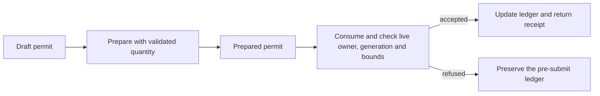

# RT-05 — Typed transition and live ledger generation

- **Date** — 2026-11-25
- **Tracking** — [PLAN §5.1](../../../PLAN.md#51-type-system-and-data-model) · [#324](https://github.com/aivibeflow/LLMLang/issues/324)
- **Status** — Reproduced native Rust phase and transition profile

## Question and contract

Which judgments belong in a typed state transition, and which require live validation? The experiment uses a small quota ledger. A draft permit carries an owner and original generation. Preparing consumes that permit and requires a quantity from 1 to 3. The private quantity constructor validates this constraint. Submitting consumes the prepared permit and requires the same owner and current generation. Before updating the ledger, the implementation checks both generation and total arithmetic. A successful transition emits a receipt for the original and new generation. A refused transition leaves the ledger at the state it had before submission. [RT-04 type, effect, ownership and capability alternatives](../../language-design/RT-04/RT-04-TYPE-EFFECT-OWNERSHIP-AND-CAPABILITY-ALTERNATIVES.md)

The compiler checks the caller through a separately compiled Rust library. The native matrix then compares the live state checks with an independent integer oracle. This distinguishes local misuse of a typed permit from an outstanding permit made stale by an intervening ledger update.



## Results

Rust admits the typed flow and refuses submission of a draft, cloning the prepared permit, reusing a consumed permit and constructing an unchecked quantity outside the module. The runner checks the exact frontend diagnostic codes at both optimization profiles.

| Native result | Count per profile |
|---|---:|
| Committed | 24 |
| Generation or total exhausted | 36 |
| Quantity outside the allowed range | 320 |
| Stale generation | 36 |
| Wrong owner | 96 |

All 512 cases per optimization profile match the expected status, live generation and total. The two native profiles therefore match 1,024 matrix observations. In an additional case per profile, two independently prepared permits from the same generation are both well typed. The first submits successfully, and the second refuses as stale. The final total reflects only the accepted submission. [Exact evidence](NATIVE-TYPESTATE-01/evidence.json)

## Limits

A phase type and a consuming API express local progression. The live owner and generation still determine whether a currently submitted permit applies. The fixture assumes distinct owner identifiers supplied by its harness and a serialized mutable ledger. The comparison leaves distributed owner identity, durable or concurrent checks, recovery after a lost receipt, and cross-language type-system design open.

## Reproduction

Run from the repository root with Rust 1.85.1 and CPython 3.12.14. The runner compiles both library profiles, checks externally compiled client controls and compares the native traces with the oracle. [Typed library](NATIVE-TYPESTATE-01/typestate.rs) · [Native runner](NATIVE-TYPESTATE-01/run.py)

```sh
set -eu
dir=research/semantic-representation/RT-05/NATIVE-TYPESTATE-01
observed=$(mktemp)
trap 'rm -f "$observed"' EXIT
python3 -B "$dir/run.py" --rustc rustc > "$observed"
cmp "$dir/evidence.json" "$observed"
```
