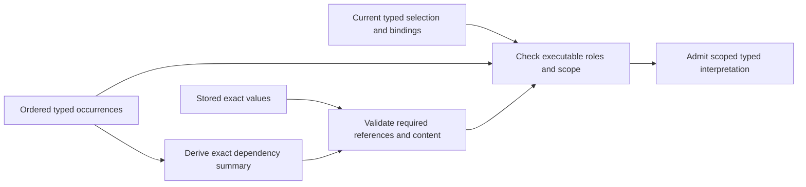

# RT-05 nodes, reference roles, ownership and selection

Which graph facts must be retained to interpret a selected SPG? This study distinguishes three notions of membership, gives a candidate contract for reference roles, and checks how the distinction survives aliasing and ownership examples. The executable check reconciles four exact prior ledgers and enumerates a scope fixture. It covers an acyclic selected graph and finite runtime ownership examples.

## Values and occurrences

An immutable semantic node has a kind and version, a validated payload and typed references. Types, interfaces, contracts, operations, bodies and binding records have different payload and edge rules. For example, a parameter-type reference carries a position, an operation has one exact interface and one exact contract in the scalar fixture, and a body has an owning declaration plus an ordered vector of executable reference occurrences. A binding names the operation and implementation and requires that the provider's declared operation and signature match the slot. A relation kind determines endpoint types, admissible scope, cardinality, order and whether its target participates in semantic identity. A descriptive evidence link may retain exact endpoints independently of those executable roles.

| Boundary | Membership question | Consequence |
|---|---|---|
| Physical archive | Can the exact bytes of this value be read and verified? | Historical bytes can be kept without activating the value |
| Reachable from selected roots | Does following the root's required exact edges reach this value? | An embedded type or interface can be available without a named slot |
| Selected by a typed slot | Does the current snapshot authorize the value in the required graph role? | A pinned body or a provider binding may require selection in addition to reachable bytes |



A dependency set describes reachability and reuse impacts. Execution still depends on occurrence order, role and multiplicity in the typed body. For a direct call the selected target is the exact implementation. For an operation call the binding in the selected context supplies the implementation. The fixture's dependency summary is a unique target set. Deriving that summary from the occurrences does not make it sufficient to reconstruct execution. The structural boundary likewise does not prove a contract or certify that the source inventory was complete.

A managed declaration slot, an immutable semantic reference, and a runtime resource owner are separate roles. A slot can select a shared value without owning its runtime resources. An executable reference to mutable state needs shared topology, with aliasing and capture mode recorded where execution depends on them. Resource edges record which runtime location currently owns a value and where responsibility for cleanup transfers. Construction order, rollback of acquired values and completed-object drop order can each affect an observable trace. The runtime models here supply examples of what lowering must preserve. They do not encode general dynamic ownership into the physical repository graph.

## Verified distinctions

- The [selected graph study](RT-05-SPG-SELECTION-BOUNDARY-2026-11-25.md) compares 14 archives. Seven pass typed admission, six fail it after passing persistence, and one fails persistence. A deselected body remains stored and reachable in both the binding and pin controls, yet neither executable role is admitted. Dropping unreachable bytes after the unused selection was removed preserves the already updated root and observations.
- In [partial record construction](RT-05-PARTIAL-RECORD-OWNERSHIP-2026-11-25.md), separate acquisition, rollback and completed-object ownership orders preserve the studied vectors. Substituting declaration order for rollback changes 144 abort vectors. Reusing initializer order for completed drops changes 168 completed vectors.
- The [mutable reference topology study](RT-05-MUTABLE-REFERENCE-TOPOLOGY-2026-11-25.md) checks 184 graph classes. Keeping one shared reference table preserves the observed traces. Independent per-root reconstruction changes 4,758 vectors. The [bound method study](RT-05-STATEFUL-BOUND-METHOD-2026-11-25.md) checks 108 contexts. Retaining values while erasing shared references changes 135 recipe vectors.
- The new scope fixture holds the typed template fixed with two occurrences of one direct pin around a distinct operation call. It crosses three occurrence vectors, three target summaries, two archive conditions, two selection conditions and three binding states. Exactly one of 108 cases passes. Reordering and deduplicating the occurrence vector preserve its target set but fail correspondence. The assumed typed binding includes the correct operation declaration and signature, which are checked separately in the persisted prototype.

An archive-only rule would accept both deselection controls. Executing from the target set would lose ordering and repeated calls. Root-local reconstruction would lose sharing and can change state-dependent results. The candidate retains exact value edges, selected roles and occurrence structure separately. It uses the dependency set for graph walks and retains explicit shared state and cleanup obligations where observations depend on them.

## Replay and limits

The [runner](REFERENCE-BOUNDARY-01/check.py) reads four ledgers at `a10c1376ea697afe907f31365b0f4cbaf994f284` and records their hashes and checked counts. The [result](REFERENCE-BOUNDARY-01/evidence.json) uses CPython 3.12.14 and Git 2.56.1. Both hash seeds produce the same bytes. The ledgers provide precise counts without timing or distribution measurements.

```bash
fixture=research/semantic-representation/RT-05/REFERENCE-BOUNDARY-01
PYTHONHASHSEED=37 python3 -B "$fixture/check.py" > /tmp/llmlang-reference-boundary.json
cmp "$fixture/evidence.json" /tmp/llmlang-reference-boundary.json
```

Recursive admission, fully resolved source inventory, richer ownership and alias analysis, and production binding or instance policies remain separate dependencies. This contract is a bounded representation candidate. It gives the store, type checker and evaluator distinct conditions they can test.
