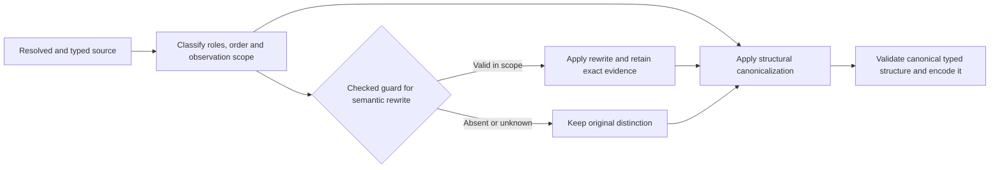

# RT-05 scoped SPG canonicalization and normalization rules

Canonicalization gives one structural representation to a typed graph under its declared profile. Semantic normalization can additionally remove a distinction once observations establish that removal is valid in the admitted scope. This candidate states which common distinctions the studied profiles preserve, where a normalization guard is needed, and how to distinguish canonical byte equality from a compiler correctness judgment.

## Candidate rules

1. Parse, resolve names, and validate types and reference roles under a pinned source and semantic profile. Replace local binder spelling by resolved positions where spelling cannot be observed. Retain externally meaningful names, resolved exact targets and nominal type identity. Keep original token bytes and locations in the source view.
2. Encode typed values, ordered instruction and argument sequences, and occurrence-indexed references deterministically. Sort field identities or map keys by the profile's total order. Retain a separate evaluation sequence for operands when evaluation order, failures, ownership, or effects can be observed. Deduplicate sets only where the profile defines unordered membership. For a set of allowed traces, preserve order and repetition inside every trace.
3. Normalize numeric values through the profile's fixed type and operator semantics. Keep checked arithmetic grouping and ordered operand visits unless a checked scope-specific guard permits regrouping. An equality-of-result rule that omits failure prefixes is insufficient for the studied observation model.
4. Keep branch order, conditional ownership transfers, rollback and cleanup events when they affect the selected observations. Attach behavioral equivalence evidence separately to an exact rewrite, observation model and scope.
5. Produce a deterministic typed value and verify that reconstructing and canonicalizing the supported representation is idempotent. Domain/version boundaries for portable bytes and the full recursive encoding remain independent design items.



## Cross-checks

The independent record model represents a three-field value as an unordered role-to-operand map paired with the sequence of effectful or fallible operands. Each closed literal has a known constant value and no modeled effects. In 162 cases across all field orders and operand assignments, the graph interpreter agrees with the source interpreter on all 1,296 failure-mask observations. The normalized representation has 79 classes. All 177 cross-source pairs with equal canonical records have equal checked observations. Erasing the evaluation sequence collapses 228 pairs with different observations. The comparison matches the independent [Rust and Python fixture's archived class and collision counts](RT-05-NAMED-RECORD-EVALUATION-2026-11-25.md).

Canonicalization is idempotent in all 162 source cases when the separated sequence and map are used to reconstruct input. Each of 972 checks permutes the outer trace set and duplicates one complete trace. All preserve the graph while the distinct internal traces `[close]` and `[close, close]` both remain present.

The [checked-arithmetic fixture](RT-05-CHECKED-REASSOCIATION-2026-11-25.md) compares all 4,096 triples. Erasing checked grouping would collapse 672 different value-or-failure outcomes and 688 additional different operand traces. The Lean model checks an admissible guard. The [owned SPG fixture](RT-05-OWNED-SPG-NORMALIZATION-2026-11-24.md) verifies 900 source profile pairs and 8,192 observations per execution path. It supports erasing local names and outer contract insertion order while preserving transfer timing and ordered obligations.

A representation that keeps all surface ordering avoids collapsing these examples but loses graph reuse when only independent literals or set ordering move. Canonicalizing every collection as a map or set loses observable sequencing. The scoped candidate separates immutable field roles and unordered membership from executable order. Its permission to omit a literal from the sequence requires the closed total literal premise. Mutable reads, construction defaults, cleanup, errors and divergence remain distinct semantic cases.

## Verify

The [runner](NORMALIZATION-BOUNDARY-01/check.py) reads the three archived ledgers at `70bd54d3b44c2ee5b018bd8d194b06110176e551` and compares their scoped results with the new finite model. The [ledger](NORMALIZATION-BOUNDARY-01/evidence.json) uses CPython 3.12.14 and Git 2.56.1. Hash seeds 37 and 71 give identical results. The checks enumerate outcomes and do not measure execution time.

```bash
fixture=research/semantic-representation/RT-05/NORMALIZATION-BOUNDARY-01
PYTHONHASHSEED=37 python3 -B "$fixture/check.py" > /tmp/llmlang-normalization-boundary.json
cmp "$fixture/evidence.json" /tmp/llmlang-normalization-boundary.json
```

The rules specify a candidate normalization boundary for these profiles. They leave exact portable bytes, a whole-language canonicalizer, immutable observation and proof policy, and the selected profile for implementation adoption open.
